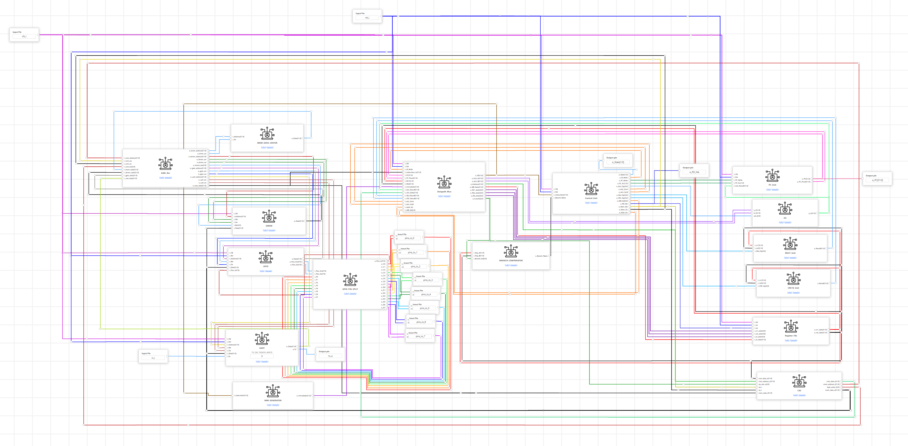
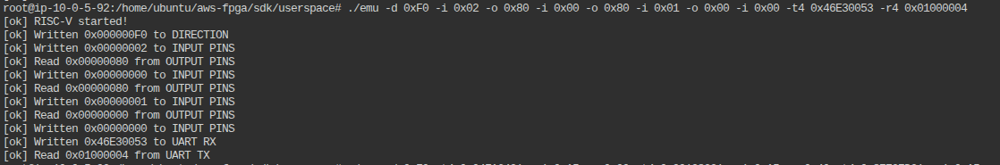

# CoreX RackSentinel: a RISC-V Rack Safety Controller, from CPU to FPGA

A data-centre rack protection controller running on **RVBL-2**, a RISC-V processor the team designed itself: from the CPU (RV32I + multiply + a custom CRC instruction), through a SoC with GPIO and UART, to firmware that reads temperature, current and a water-leak sensor and **latches an emergency power-off** when the rack is in danger. The final version runs on an **AWS FPGA**, where 9 of 9 rehearsed test runs pass on the hardware.

*Equipe 31 · Team CoreX · ChampionCHIP eXperience Malaysia 2026. A group project; this repository consolidates the team's Stage 2 to Stage 4 deliverables, a browser digital twin and a plain-language guide.*

<!-- Your role: edit the line above or add a "My contribution" section here. -->



*The SoC as built on the ChipInventor canvas: the RVBL-2 core, address decoder, memories, GPIO with pin splitter, and UART.*

---

## Overview

A rack controller has one job that must never fail: cut the power when the rack is about to damage itself or the building, and stay off until a human has checked it. That logic has to be small enough to verify, immune to corrupted messages, and robust against silent memory faults.

This project builds the whole stack for that job: the processor, the chip around it, and the application on top.

| | |
|---|---|
| **Processor** | RVBL-2: 44 instructions = 37 RV32I + 4 Zmmul + 3 custom `Xicrc` (hardware CRC-16), four-state multicycle |
| **SoC** | RVBL-2 core, address decoder, ROM and 8 kB RAM, 8-pin GPIO, UART at 115,200 baud |
| **Application** | RackSentinel v2: 547-instruction firmware, 4-byte CRC-checked packets |
| **Protection** | ASHRAE temperature classes, thermal-runaway trip, water-leak trip, power-limit alarm, energy metering, SECDED ECC on every safety setting, trip record |
| **Physical design** | OpenLane on sky130: DRC 0, LVS clean, timing met at 25 MHz |
| **Hardware target** | AWS FPGA (Vivado 2024.1), core at 31.25 MHz; 0 errors, routed WNS +0.711 ns on the shell clock |
| **Status** | CPU signed off in OpenLane · SoC verified in simulation · v2 verified on FPGA (9 of 9 runs) |

---

## The three stages

| Stage | What | Key result | Folder |
|---|---|---|---|
| **2** | The RVBL-2 CPU | Firmware self-test PASS; OpenLane GDSII on sky130, DRC and LVS clean | [`stage2_cpu/`](stage2_cpu/) |
| **3** | The SoC (GPIO, UART) and RackSentinel v1 | 12 cases, 124 checks; mutation 4/4; CRC 18,472 patterns, 0 missed (simulation) | [`stage3_soc/`](stage3_soc/) |
| **4** | RackSentinel v2 on the AWS FPGA | 9 of 9 runs `[ok]` on hardware; 524 checks; mutation 23/23 | [`stage4_fpga/`](stage4_fpga/) |

---

## System architecture

```
  DCIM / host ──── 4-byte packets + CRC-16 ────▶ ┌───────────────────────────────────────┐
  (UART, 115,200 baud) ◀──────── replies ─────── │ UART ─┐                                │
                                                 │       ├─▶ RVBL-2 core ◀─ ROM (firmware)│
  P0 reset button ───────────────────────────────▶ GPIO ─┘   44 instr.   ◀▶ RAM 8 kB      │
  P1 leak sensor  ───────────────────────────────▶ (8 pins)  crcb = CRC-16 per instruction│
                                                 └───────────────┬───────────────────────┘
                                                                 ▼
                                          P4 fan boost · P5 fans max · P6 overload alarm · P7 power-off request (latched)
```

Protocol, memory map and module-by-module reference: **[docs/02](docs/02-rules-and-protocol.md)**, **[docs/06](docs/06-soc-and-memory-map.md)**, **[docs/07](docs/07-module-reference.md)**.

---

## What RackSentinel v2 does

| Feature | Behaviour |
|---|---|
| **Temperature classes** (ASHRAE) | Warm ≥ 27.0 °C (P4 fan boost) · Hot ≥ 32.0 °C (P5 fans at maximum) · Critical ≥ 35.0 °C (P5 + P7 power-off, latched). A reading on a threshold takes the higher class |
| **Thermal runaway** | A rise of 2.0 °C or more between two readings latches P7 before any threshold is reached |
| **Water leak** | P1 high latches P7 with no message on the link |
| **Power and energy** | P = V × I against a 5.9 kW limit raises the P6 alarm and never cuts power; energy metered in Wh |
| **ECC on settings** | SECDED on 9 words: one flipped bit is repaired at next use; two make the setting unreadable and latch P7 until it is rewritten |
| **Trip record** | Cause, temperature and current at the moment of the trip, readable after reset (`TRIP_INFO`) |
| **Latched reset** | Cleared only by a **new** P0 press once every cause is gone; a held button never clears it |
| **Message integrity** | Every packet checked with the custom `crcb` instruction; bad CRC replies `5A`, invalid value `3C`, and nothing changes |

Full rules with worked examples: **[docs/01](docs/01-racksentinel.md)** · **[docs/02](docs/02-rules-and-protocol.md)**

---

## Engineering decisions

| Decision | Why |
|---|---|
| **Power-off is latched, not self-clearing** | A rack that powers itself back on into the same fault is worse than one that stays off. Only a new, edge-detected P0 press under safe conditions releases it |
| **High current raises an alarm but does not cut power** | A short overload should shed load, not take down every server in the rack. Cut-off is reserved for threats to hardware and building: heat, cooling failure, water, untrustworthy settings |
| **Reset allowed when merely Warm or Hot** | The trip is at Critical; once below it with the cause gone the fans are protecting the rack, and demanding Normal could keep it off for hours in a warm hall |
| **CRC in the instruction set (`crcb`)** | Integrity checking costs one instruction per byte instead of a software loop, keeping the firmware small enough to verify (547 words) |
| **ECC on the settings, not only on the data path** | A bit flip in a threshold is a silent safety failure; SECDED turns it into a repaired value or a loud, latched fault |
| **Voltage is a setting, not a measurement** | Feed voltage is close to constant; this keeps every packet at 4 bytes and lets the site choose 230 V or 240 V |

Version 1 versus version 2, and the bugs found along the way: **[docs/14](docs/14-project-journey.md)**.

---

## Verification

Each stage was proved before the next was attempted, so a failing test always points at one layer.

| Level | Evidence | Result |
|---|---|---|
| CPU | Organiser firmware self-test (simulation) | PASS, PC settles at `0x004003EC` |
| Manufacturability | OpenLane on sky130, die 0.4225 mm² | DRC 0, LVS clean, WNS 0.0 ns at 25 MHz |
| Peripherals | Organiser GPIO/UART test firmware | 20 checks, 0 failures |
| Application v1 | Regression, mutation, exhaustive CRC | 124 checks; 4/4 mutants caught; 18,472 CRC patterns, 0 missed |
| Application v2 | Team testbench, mutation | 524 checks; 23/23 planted firmware bugs caught |
| **Hardware** | **Nine `./emu` runs on the AWS FPGA** | **9 of 9 `[ok]`** |



*Run R5 on the AWS FPGA: every printed line `[ok]`. All nine runs, the Vivado log and the AFI status are in [`stage4_fpga/evidence/`](stage4_fpga/evidence/).*

Details and how each number is reproduced: **[docs/11](docs/11-verification.md)** · **[docs/12](docs/12-build-and-reproduce.md)**

---

## Digital twin

[`racksentinel-twin/`](racksentinel-twin/) is a browser digital twin of RackSentinel v2 (Next.js, TypeScript, Vitest): a pixel-art operator room with a DCIM terminal, thirteen deterministic scenarios (nine matching the FPGA runs one to one), a guided demo, a `/features` page and a `/data-flow` page that walks each test case byte by byte, including the `crcb` CRC trace.

The controller model is a port of the v2 firmware, and its unit tests replay every step of the nine FPGA runs and 1,000 cases replayed on the RTL, so a single wrong byte fails the build.

```bash
cd racksentinel-twin
npm install
npm run dev        # http://localhost:3000
npm test
```

Architecture notes: [`racksentinel-twin/ARCHITECTURE.md`](racksentinel-twin/ARCHITECTURE.md)

---

## Engineering challenges

- **A GPIO bus that looked connected but was not.** The first Stage 3 export had an 8-bit pin bus at the top level, but the GPIO pad block's `pins_io` port was unconnected, so no pin could be driven or read. A design audit caught it; the fix was a dedicated pin-splitter block and eight scalar inout pins.
- **A UART parameter that was off-spec.** The organisers' rule is that only `CONTROL.TRANSMIT` starts a send; the first export also sent on a TXDATA write. Low functional impact, but the spec value was restored.
- **OpenLane failed at global routing six times** before the seventh run completed with DRC and LVS clean.
- **Testing the tests.** Passing tests prove little if they cannot fail, so the firmware was mutated (23 planted bugs in v2) and every mutant had to be caught.
- **Reading an unconstrained timing report honestly.** The reported +0.711 ns slack belongs to the 250 MHz shell clock; the divided 31.25 MHz core clock has no constraint of its own in the AWS flow. The claim for the core rests on the hardware runs, not on that number.

---

## Limitations

- Only runs R1 to R9 were executed on the FPGA; the 1,000 random cases were checked in simulation.
- The 31.25 MHz core clock is not timing-constrained in the AWS flow (see above).
- The v2 testbenches, mutation scripts and firmware source live in the team's separate CoreX source repository and are not in this one. The 524 checks and 23 mutants are the team's reported results; this repository contains the generated RTL (`stage4_fpga/riscv.sv`), the specification and the hardware evidence.
- The OpenLane GDSII used a placeholder ROM and RAM: it shows the CPU can be manufactured, not the full SoC with firmware.
- Digital layer only. Real sensors, fan drivers, contactors and electrical isolation are out of scope; P7 is a power-off request.
- One rack per controller. The digital twin is a simulation and is not connected to any hardware.

## Future work

Constrain the divided core clock so Vivado times the core · measure voltage instead of setting it · hardware watchdog · interrupts instead of polling · ECC on all of data memory · several racks per controller · time-stamped multi-entry trip log · tape-out of the full SoC. Detail and effort estimates: **[docs/15](docs/15-limitations-and-next-steps.md)**.

---

## Repository structure

```
.
├── README.md
├── docs/                    ← plain-language guide (chapters 00 to 15, 17, glossary)
│   ├── README.md            ← index and reading paths
│   ├── attachments/         ← block diagrams, waveforms, test logs
│   └── slides/              ← labelled block diagrams
├── stage2_cpu/              ← RVBL-2 CPU: RTL, OpenLane run (reports, GDS, netlist), notes
├── stage3_soc/              ← SoC + RackSentinel v1: submission package, LaTeX report, simulation
├── stage4_fpga/             ← RackSentinel v2: riscv.sv, SPEC.md, offline demo page, FPGA evidence
└── racksentinel-twin/       ← Next.js digital twin with tests
```

---

## Skills demonstrated

**CPU and digital design** — RISC-V microarchitecture (multicycle control, ALU, register file, load/store unit), ISA extension (custom CRC instructions), Verilog, memory-mapped peripheral design (GPIO, UART), address decoding.

**Physical design and FPGA** — OpenLane / sky130 flow, DRC/LVS/timing reports, AWS FPGA build with Vivado, interpreting constrained versus unconstrained timing.

**Embedded firmware** — RV32 assembly, byte-level protocol design with CRC-16, SECDED ECC, latched safety state machines, edge-detected inputs.

**Verification** — self-checking Verilog testbenches, mutation testing, exhaustive CRC testing, hardware-in-the-loop evidence, traceability from requirement to test case.

**Software** — TypeScript, React / Next.js, Vitest golden-fixture tests against RTL and hardware results.

**Engineering process** — staged bring-up (prove each layer before the next), honest separation of simulated, synthesised and hardware-proven results, documented design decisions and known limits.

---

## Documentation

Start at **[docs/README.md](docs/README.md)**; it assumes no chip background.

- **[docs/01](docs/01-racksentinel.md)–[03](docs/03-fpga-and-demo.md)** — the application, the packet protocol, the FPGA deployment and evidence.
- **[docs/04](docs/04-digital-basics.md)–[09](docs/09-uart.md)** — digital basics, the CPU, the SoC and memory map, every module, GPIO, UART.
- **[docs/10](docs/10-firmware.md)–[13](docs/13-troubleshooting.md)** — firmware, verification, build and reproduce, troubleshooting.
- **[docs/14](docs/14-project-journey.md)–[15](docs/15-limitations-and-next-steps.md)** — project journey and what is not claimed.

---

## Credits and attribution

Built by **Equipe 31 / Team CoreX** for ChampionCHIP eXperience Malaysia 2026. The ChipInventor platform, the AWS FPGA shell and top-level wrapper, the `./emu` emulator and the organisers' test firmware are provided by the organisers and are not redistributed here.
