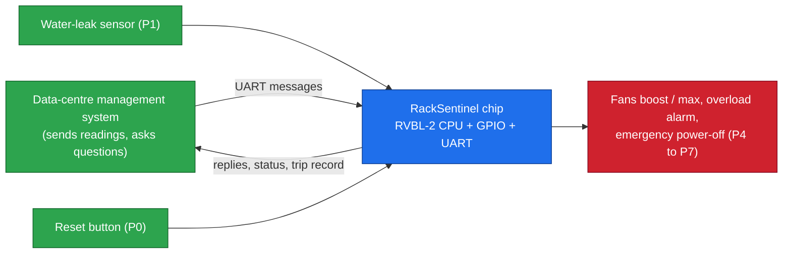
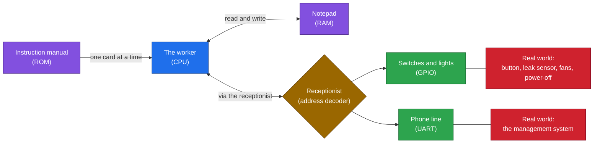
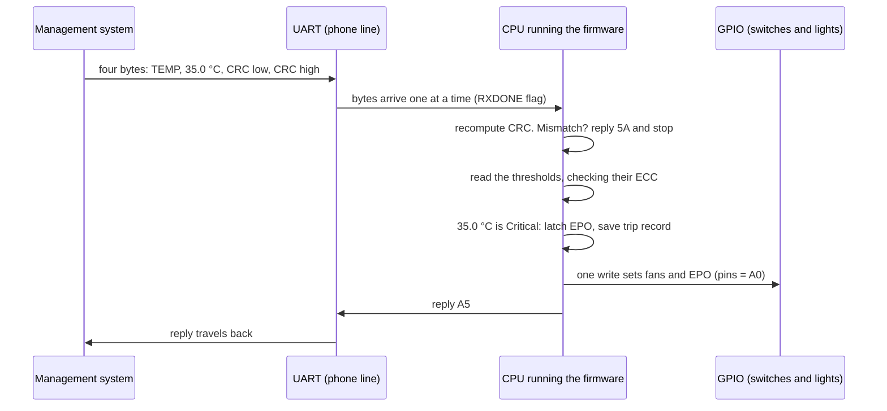
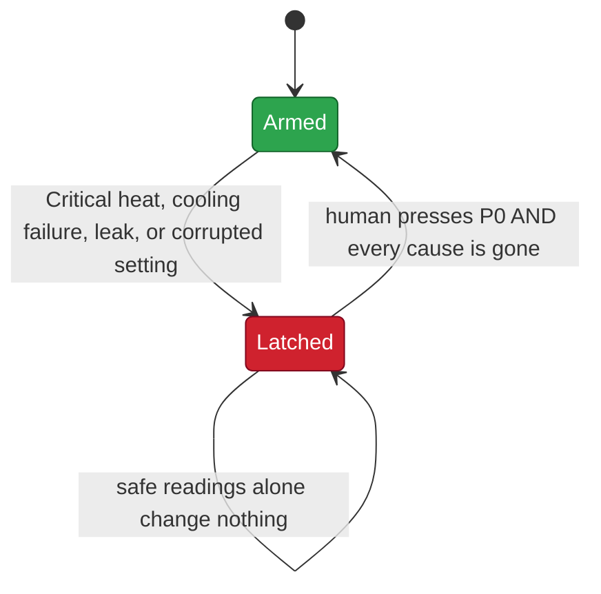

# 00 · Start here

> [!NOTE]
> **Why this page exists**
> The other chapters are full of new words. This page gives you **one picture in your head** first: what we built, how it grew from Stage 2 to Stage 4, and five rules of thumb. Read it in ten minutes, then come back whenever you feel lost.

## The project in one minute

> [!TIP]
> **The one-minute version**
> We designed our own small **RISC-V processor** (Stage 2), turned it into a complete **chip design with pins and a serial port** (Stage 3), and ran it on a **real FPGA in the AWS cloud** (Stage 4). The chip's job is **RackSentinel**: a guard for a server rack in a data centre. It reads the rack's **temperature**, **current** and a **water-leak sensor**, checks every message for corruption, turns the fans up, raises an overload alarm, and **cuts the power** when the rack is in danger. The power stays off until a **human** presses reset and the danger is gone. Its safety settings are stored with **error-correcting memory**, so a flipped bit can never silently disable the protection.

## Three stages, one system

| | Stage 2 · The CPU | Stage 3 · The SoC | **Stage 4 · On real hardware** |
|---|---|---|---|
| Goal | A working RISC-V processor | A whole system that does a job | Run the job on an FPGA, present it |
| What we built | RVBL-2: 37 RV32I + 4 Zmmul + 3 custom CRC = **44 instructions** | GPIO, UART, address decoder, RackSentinel **v1** firmware | RackSentinel **v2** firmware, AWS FPGA build |
| Proof | Firmware self-test PASS; OpenLane GDSII, DRC/LVS clean | 12 cases, 124 checks; mutation 4/4; CRC 18,472/0 | **9 of 9 runs on the FPGA**; 524 checks; mutation 23/23 |
| Folder | `stage2_cpu/` | `stage3_soc/` | `stage4_fpga/` |

> [!IMPORTANT]
> **The principle that ties the stages together**
> **Same hardware, different program.** The processor from Stage 2 is reused unchanged. Stage 3 added peripherals and proved them with the organisers' test program, then swapped only the program to make the same chip a rack guardian. Stage 4 swapped the program again, for v2, and put the result on an FPGA.

## The one big idea: a tiny office with one obedient worker

> [!TIP]
> **The analogy**
> The worker (the **CPU**) never thinks for itself. It reads **one instruction card at a time** from a manual and does exactly what the card says. Everything else in the office exists to **feed the worker cards, give it a notepad, and connect it to the outside world**.

| In the office | In the project | Chapter |
|---|---|---|
| The worker | **CPU** (RVBL-2, a RISC-V processor) | [05](05-the-cpu.md) |
| One instruction card | One **instruction** (44 kinds) | [05](05-the-cpu.md) |
| The manual | **Firmware** in the **ROM** (v2: 547 cards) | [10](10-firmware.md) |
| The notepad | **RAM** (DMEM) | [06](06-soc-and-memory-map.md) |
| The receptionist | **Address decoder** | [06](06-soc-and-memory-map.md) |
| Light switches and bulbs | **GPIO** pins P0 to P7 | [08](08-gpio.md) |
| The phone line | **UART** serial port | [09](09-uart.md) |
| A tamper seal on every letter | **CRC** checksum | [02](02-rules-and-protocol.md) |
| Check digits on the safety settings | **ECC** (error-correcting code) | [02](02-rules-and-protocol.md) |
| A circuit breaker that stays tripped until someone pulls the lever | **Latched EPO** with the P0 reset | [01](01-racksentinel.md) |
| The inspector who tests the office | **Testbench** | [11](11-verification.md) |

## The life of one message

If you can follow one message from end to end, you understand the whole system.

## The safety idea in one picture

> [!NOTE]
> **Everyday version**
> A smoke alarm that keeps beeping after the smoke is gone until you press the button. The beeping tells you **something happened**, and silencing it is a **deliberate human act**.

## Five rules of thumb

> [!TIP]
> **Keep these in your pocket**
> 1. **Everything is an address.** Pins, serial port and memory are all reached by loading from or storing to an address.
> 2. **Check first, trust later.** The CRC is verified before any value is used; every setting's ECC is checked before the setting is used.
> 3. **Danger is sticky, safety is earned.** The power-off turns on automatically but only turns off with a human press once every cause is gone.
> 4. **When in doubt, fail safe.** A setting that cannot be trusted cuts the power rather than guessing.
> 5. **Test the tests.** A test that cannot fail proves nothing, so we plant bugs and check the tests catch them.

## Five traps

> [!CAUTION]
> **Watch out**
> | Trap | Truth |
> |---|---|
> | "The chip is the program" | The chip is hardware; the program is a separate file loaded into the ROM |
> | "1 means input" | In `DATADIR`, **1 means output** |
> | "Writing the UART data register sends it" | You must also set the **TRANSMIT** bit |
> | "Safe readings clear the power-off" | Only a **new P0 press** does, and only when every cause is gone |
> | "v1 and v2 speak the same language" | v2 uses different packets and command codes; see [14](14-project-journey.md) |

## Self-check

> [!NOTE]
> **Try before opening the answers**
> 1. Which block decides whether an address means memory, pins or serial?
> 2. What does the CPU do four times for every instruction?
> 3. Why does the chip check the CRC before looking at the temperature?
> 4. A held-down button: can it clear a later power-off? Why not?
> 5. Two bits of the Critical threshold flip in memory. What does the chip do?
>
> **Answers:** 1. The address decoder. 2. Fetch, decode, execute, write back. 3. So a corrupted packet cannot influence any decision. 4. No: only a *new* press counts, and a held button never produces one. 5. It cannot repair two bits, so it treats the setting as unreadable and cuts the power at the next reading, until the management system rewrites it.

## Where to go next

| Your goal | Read |
|---|---|
| Understand RackSentinel in 30 minutes | [01](01-racksentinel.md), [02](02-rules-and-protocol.md), [03](03-fpga-and-demo.md) |
| Understand the chip | [04](04-digital-basics.md) to [09](09-uart.md) in order |
| Trust the results | [11](11-verification.md) |
| Know how we got here | [14](14-project-journey.md) |

Next: [01 RackSentinel](01-racksentinel.md)
