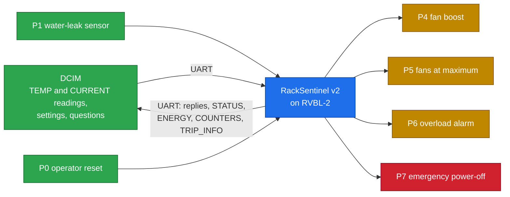
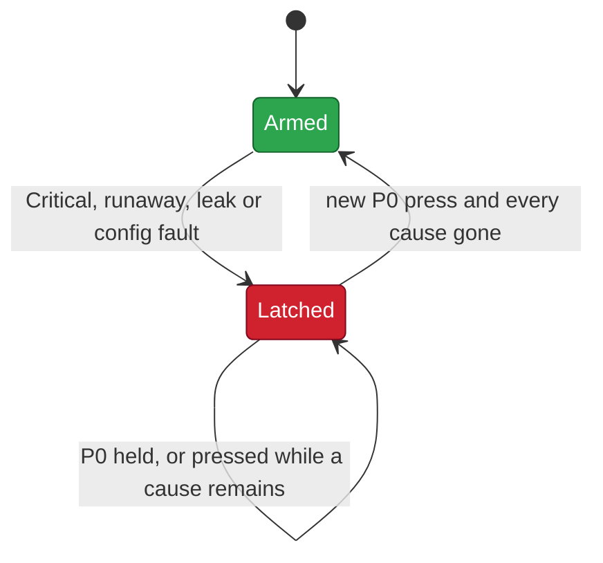

# 01 · RackSentinel

> [!NOTE]
> **After this chapter you will know**
> What problem RackSentinel solves and for whom, what it senses and controls, its six protection features, **why the power-off is latched**, why the settings carry an error-correcting code, and what it deliberately does not do. Exact byte-level rules are in [02](02-rules-and-protocol.md). This chapter describes **v2**, the firmware running on the AWS FPGA.

## The problem

A data-centre rack is a metal cabinet full of servers worth a great deal of money, and the services on them are worth even more. Four things can destroy a rack quickly:

| Threat | What happens | How fast |
|---|---|---|
| **Overheating** | A cooling unit fails; inlet air climbs past safe limits | minutes |
| **Cooling failure** | Temperature rises steeply even before it is "hot" | seconds to minutes |
| **Water** | A chilled-water pipe or condensate drain leaks under the floor | seconds |
| **Overload** | New servers push the feed past its budget; breakers trip and take everything down | instant |

Monitoring software exists, but it lives on a network and a server that can themselves fail. A **local controller on the rack** keeps protecting it even when the network is down.

## Who it is for: Ali's day

Ali is an operator in a data hall in Johor. Ali watches dozens of racks from a management console (the **DCIM**: Data Centre Infrastructure Management system) and walks the floor when something goes wrong. RackSentinel is the controller on one of those racks: it acts in microseconds, on its own, and tells Ali exactly what happened.

| Ali's moment | What RackSentinel does | Run on the FPGA |
|---|---|---|
| Morning check | Reports Normal, 22.0 °C, 20 A, no trips | R1 |
| The hall warms up | Fan boost at 27.0 °C, maximum fans at 32.0 °C | R2 |
| A cooling unit fails | Cuts power on a 2.5 °C jump, before the rack is even Warm | R4 |
| The rack overheats | Cuts power at 35.0 °C; refuses reset until it cools; says why it tripped | R3 |
| A pipe leaks | Cuts power with no network message at all; reset only once dry | R5 |
| A new server raises the load | Overload alarm, no outage; clears when load is shed | R6 |
| Energy report | 230 Wh used over three minutes at 4.6 kW | R7 |
| A memory bit flips | Repairs it silently and counts it; the threshold still acts exactly | R8 |
| Two bits flip | Refuses to guess: cuts power until the setting is rewritten | R9 |

The full runs and their results are in [03](03-fpga-and-demo.md).

## What it senses and controls

| Input | How it arrives | Unit |
|---|---|---|
| Inlet temperature | `TEMP` packet over UART | 0.5 °C per step |
| Feed current | `CURRENT` packet over UART | 0.2 A per step |
| Water leak | GPIO pin **P1**, watched by the chip itself | wet / dry |
| Operator reset | GPIO pin **P0**, only a new press counts | pressed / released |

## The six protection features

### 1. Temperature classes (ASHRAE limits)

| Class | Inlet | Action |
|---|---|---|
| Normal | below 27.0 °C | nothing |
| Warm | from 27.0 °C | **P4** fan boost |
| Hot | from 32.0 °C | **P5** fans at maximum |
| Critical | from 35.0 °C | **P5 + P7 power-off** |

The limits follow the ASHRAE data-centre guidelines: 27 °C is the top of the recommended range, 32 °C the class A1 allowable maximum, 35 °C the class A2 maximum. All three are adjustable.

### 2. Cooling-failure detection (thermal runaway)

If the temperature rises **2.0 °C or more between two readings**, the cooling has probably failed. The chip cuts the power **before** any threshold is reached. The limit is adjustable, and 0 turns it off.

### 3. Water-leak protection

The chip watches P1 while it waits for messages, so a leak cuts the power **even if the network is silent**. Drying the sensor is not enough; a person must reset.

### 4. Power limit and energy metering

Power = voltage × current, computed with the CPU's multiply instruction. At or above the limit (5.9 kW by default, 80 % of a 32 A / 230 V feed) the **P6 overload alarm** turns on, so the DCIM can shed load. It turns off again when the load drops: an overload is a warning, not an outage. Each current reading also adds to an **energy** total, reported in Wh.

### 5. Trip record

When the power is cut, the chip saves **why** (cause), and the temperature and current **at that moment**. The DCIM reads it with `TRIP_INFO`, even after the reset. Ali no longer has to guess what happened at 3 a.m.

### 6. Error-correcting memory (ECC)

All six settings and the trip record are stored with an **error-correcting code** and checked **every time they are used**:

- **one flipped bit**: repaired, written back, counted;
- **two flipped bits**: cannot be repaired, so the chip **cuts the power** rather than act on a setting it cannot trust, and refuses reset until the DCIM rewrites it.

> [!NOTE]
> **Why this matters**
> A single bit flip from radiation or a weak memory cell could turn "Critical = 35.0 °C" into "Critical = 99.5 °C". The rack would then never trip. With ECC the chip either repairs the value or fails safe.

## Why the power-off is latched

A **latch** means "once on, stays on until something specific turns it off".

> [!NOTE]
> **Why not switch the power back on when the readings look safe?**
> Because a sensor can flicker, and a cooling unit can fail and recover for a minute. If power came back automatically, a rack that just tripped could be switched straight back into danger. A person must **acknowledge** recovery.

### The reset rules (all must be true)

| # | Rule | Why |
|---|---|---|
| 1 | A **new press** of P0 (released, then pressed) | A taped-down or stuck button cannot clear a later trip |
| 2 | Temperature is **below Critical** | Still dangerous otherwise; Warm and Hot are fine because the fans are still running |
| 3 | The latest reading was **not a runaway** | The cooling has not been shown to recover yet |
| 4 | The leak sensor is **dry** | Water is still present otherwise |
| 5 | **No setting is in fault** | The chip cannot judge safety with an untrusted setting |

> [!NOTE]
> **The overheat story (run R3)**
> | Step | Event | Pins | Power-off |
> |---|---|---|---|
> | 1 | Reading 35.0 °C (Critical) | `A0` | **latched** |
> | 2 | Ali presses reset while still Critical | `A0` | refused |
> | 3 | Reading 30.0 °C (Warm) | `90` | still latched |
> | 4 | Ali presses reset again | `10` | **cleared**; fan boost stays on |
> | 5 | DCIM asks `TRIP_INFO` | | cause: Critical temperature, at 35.0 °C |

## How it uses the processor

| Processor resource | RackSentinel use |
|---|---|
| **UART** (115,200 baud) | Every reading, setting and answer |
| **GPIO** | P0 reset, P1 leak in; P4 to P7 out |
| **`crcb`** (custom Xicrc instruction) | CRC-16 check of every packet, one instruction per byte |
| **`mul`** (Zmmul) | Power = V × I |
| **`mulhu`** (Zmmul) | Energy ÷ 300 without a divider |
| **DMEM** | State, counters and the ECC-protected settings |

## What it does not do

> [!NOTE]
> **Scope**
> - RackSentinel is the **digital control layer**. Real sensors, fan drivers, power contactors and electrical isolation sit outside the chip; P7 is a power-off **request** to that hardware.
> - **High current does not cut the power.** It raises the P6 alarm. Short circuits are the job of the upstream breakers.
> - **Voltage is a setting**, not a measurement (230 V by default).
> - It protects **one rack**.

Next: [02 Rules and protocol](02-rules-and-protocol.md)
