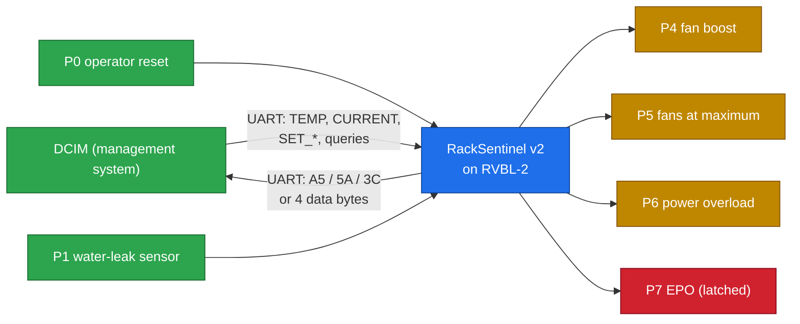
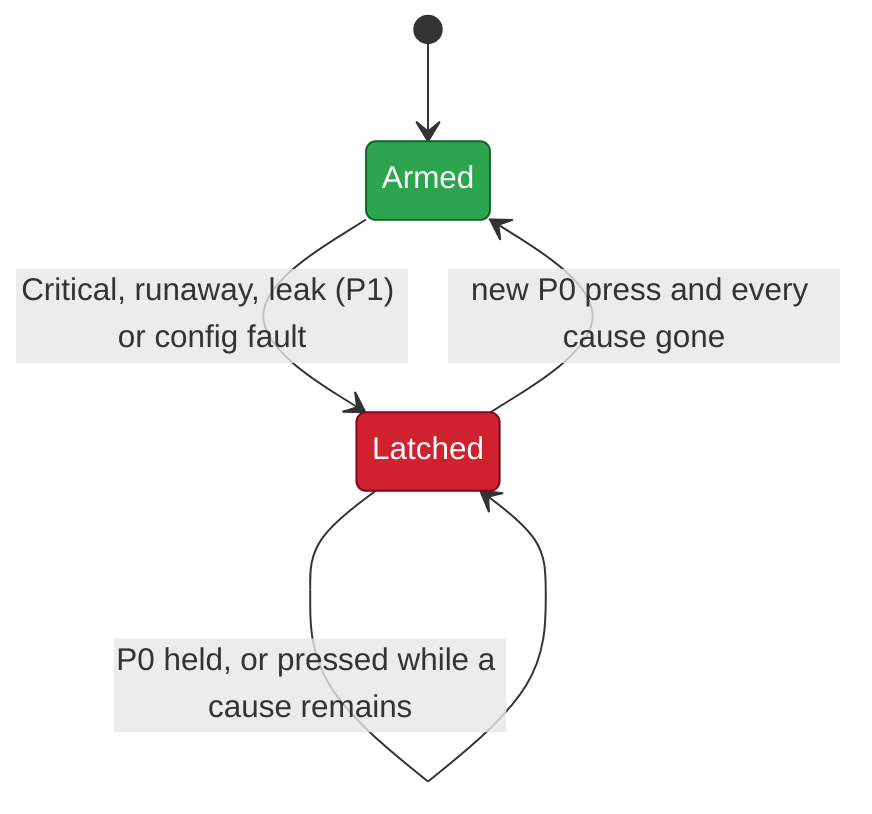

# 02 · Rules and protocol

> [!NOTE]
> **After this chapter you will know**
> The exact v2 packet, every command and reply, the pins, the STATUS flags and trip causes, how the temperature classes, runaway, EPO latch, ECC, power and energy rules work, and how to decode a real FPGA reply by hand.
> This is RackSentinel **v2**, the firmware on the AWS FPGA. Source: `stage4_fpga/SPEC.md` and the ROM in `stage4_fpga/riscv.sv`. The v1 rules are archived in [14](14-project-journey.md).

## The picture

## Pins

| Pin | Direction | Meaning | `-o` / `-i` bit |
|---|---|---|---|
| P7 | out | **Emergency power-off (EPO)**, latched | `0x80` |
| P6 | out | Power overload / load-shed alarm | `0x40` |
| P5 | out | Fans at maximum (Hot or Critical) | `0x20` |
| P4 | out | Fan boost (Warm) | `0x10` |
| P1 | in | Water-leak sensor, 1 = water | `0x02` |
| P0 | in | Operator reset; only a **new** press counts | `0x01` |

Typical `-o` values: Normal `00`, Warm `10`, Hot `20`, Critical `A0` (fans at maximum + EPO), Warm with a latched EPO `90`, overload adds `40`.

## The packet

Every message to the chip is **four bytes**:

| Byte | 0 | 1 | 2 | 3 |
|---|---|---|---|---|
| Field | Command | Data | CRC low | CRC high |

The CRC is CRC-16-CCITT (polynomial `0x1021`, start `0xFFFF`) over **command and data**, computed by the `crcb` instruction. On the emulator a packet is `-t4 0x{CRC}{DATA}{CMD}`, because `./emu` sends the least significant byte first.

> [!NOTE]
> **Building `TEMP 22.0 °C` by hand**
> 1. 22.0 °C ÷ 0.5 = 44 = `0x2C`. Command `TEMP` = `0x20`.
> 2. CRC-16 of `20 2C` = `0xFE07`.
> 3. Wire order: `20 2C 07 FE`. Emulator: `-t4 0xFE072C20` (this is the first packet of run R1).

Bytes 2 to 4 of a packet must arrive within a timeout, or the fragment is dropped with no reply. `SPEC.md` gives 1.0 s at 250 MHz; on the FPGA the core runs at 31.25 MHz, so it is about 8 s. The first byte has no time limit, and P0 and P1 are watched while the chip waits for it.

## Replies

| Reply | Meaning |
|---|---|
| `A5` | Accepted and done |
| `5A` | Bad CRC: nothing executed, CRC-reject counter + 1 |
| `3C` | Invalid command or value: nothing changed |
| 4 bytes | Data from a query command, sent byte 0 first |

## Commands

| CMD | Name | DATA | Reply | Effect |
|---|---|---|---|---|
| `0x20` | TEMP | raw 1 to 254 (0.5 °C) | A5 / 3C | Class, runaway check, EPO; reads all four temperature settings |
| `0x21` | CURRENT | raw 0 to 254 (0.2 A) | A5 / 3C | P = V × I, overload flag, energy += P; reads voltage and power limit |
| `0x31` | FLIP_TEST | bits 3:0 = word 0 to 8, bit 4 = flip two bits | A5 / 3C | Self-test: flips 1 or 2 bits of a protected word |
| `0x41` | SET_WARM | raw 1 to 254 | A5 / 3C | Only if Warm < Hot < Critical stays true |
| `0x42` | SET_HOT | raw 1 to 254 | A5 / 3C | Same rule |
| `0x43` | SET_CRIT | raw 1 to 254 | A5 / 3C | Same rule |
| `0x44` | SET_RISE | raw, 0 = off | A5 | Runaway limit (default 4 = 2.0 °C per reading) |
| `0x45` | SET_VOLTAGE | 180 to 254 V | A5 / 3C | Default 230 V |
| `0x46` | SET_POWER_LIMIT | 1 to 254, × 100 W | A5 / 3C | Default 59 = 5.9 kW |
| `0x50` | STATUS | 0 | 4 bytes | Flags, temperature raw, current raw, EPO trips |
| `0x51` | ENERGY | 0 | 4 bytes | Energy in Wh, least significant byte first |
| `0x52` | COUNTERS | 0 | 4 bytes | CRC rejects, ECC corrected, ECC uncorrectable, 0 |
| `0x53` | TRIP_INFO | 0 | 4 bytes | Cause, temperature raw, current raw, EPO trips |

Protected words for `FLIP_TEST`: 0 Warm, 1 Hot, 2 Critical, 3 runaway limit, 4 voltage, 5 power limit, 6 trip cause, 7 trip temperature, 8 trip current.

> [!WARNING]
> **Invalid values**
> TEMP raw 0 (no reading) and 255 (sensor fault), CURRENT raw 255, a SET value of 0 or 255, a voltage below 180, query commands with non-zero data, and any unknown command code all reply `3C` and change nothing. All counters stop at 255.

## STATUS and trip causes

| STATUS flag bit | Meaning |
|---|---|
| 1:0 | Class: `00` Normal, `01` Warm, `10` Hot, `11` Critical |
| 2 | Overload (power at or above the limit) |
| 3 | EPO latched |
| 4 | Leak sensor wet now |
| 5 | Runaway on the latest reading |
| 6 | A temperature has been received |
| 7 | **Config fault**: a setting is unreadable (2-bit ECC error) |

| Trip cause bit | Meaning |
|---|---|
| `0x01` | Critical temperature |
| `0x02` | Thermal runaway |
| `0x04` | Water leak |
| `0x08` | Config fault |

An unreadable trip-record byte reads as `0xFF` in TRIP_INFO. It never blocks a reset.

## The rules

### Temperature classes (ASHRAE)

| Class | Inlet | Raw | Outputs | Why this limit |
|---|---|---|---|---|
| Normal | < 27.0 °C | < 54 | none | inside the recommended 18 to 27 °C range |
| Warm | ≥ 27.0 °C | ≥ 54 | P4 | above the recommended range |
| Hot | ≥ 32.0 °C | ≥ 64 | P5 | above the class A1 allowable maximum |
| Critical | ≥ 35.0 °C | ≥ 70 | P5 + **EPO** | above the class A2 allowable maximum |

A reading exactly on a threshold takes the **higher** class: 27.0 °C is Warm, 32.0 °C is Hot, 35.0 °C is Critical.

### Thermal runaway

Runaway = `raw − previous raw ≥ limit`, checked only when a previous reading exists. A falling temperature never counts. With the default limit of 4, a rise of 2.0 °C or more between two readings trips the EPO.

### The EPO latch

- The EPO pin is driven **first**; the trip record is written after.
- A reset needs a **new** P0 press **and** all of: not Critical, no runaway on the latest reading, leak sensor dry, no setting in fault. Warm or Hot does **not** block a reset.
- Each 0 → 1 change of the latch counts one trip.
- The latch word is all ones when set, and any non-zero value counts as latched, so **no single flipped bit can unlatch it**.

### ECC (SECDED) on the settings

Each protected byte is stored as a 13-bit codeword: 8 data bits, 4 Hamming check bits and 1 overall parity bit. A setting is decoded **every time it is used**:

| Decode result | Action |
|---|---|
| No error | Use the value |
| 1 bit flipped | Correct it, write it back (scrub), ECC-corrected counter + 1 |
| 2 bits flipped | Read the setting as 0, set its fault bit, ECC-uncorrectable counter + 1 (once), and the reading that found it **trips the EPO** with cause config. The fault clears only when the DCIM rewrites that setting |

> [!NOTE]
> **ELI5**
> Think of writing a phone number with a few extra check digits. If one digit smudges, the check digits tell you which one and what it was. If two smudge, you can tell something is wrong but not what, so you refuse to dial.

### Power and energy

- **Power:** `P = V × I_raw`, in 0.2 W units, with `mul`. Overload when `P ≥ limit × 500`. The flag follows the latest reading; it does not latch.
- **Energy:** one CURRENT reading is one minute. `E += P` in 0.2 W·min units, saturating at `0xFFFFFFFF`. `Wh = E / 300`, computed as `mulhu(E, 0xDA740DA8) >> 8`, exact for all 2³² values (checked exhaustively in C).

### Boot

2,949 cycles. Settings 27.0 / 32.0 / 35.0 °C, runaway limit 2.0 °C, 230 V, 5.9 kW, all stored as codewords. Everything else 0, all outputs off.

## Decoding real FPGA replies

> [!NOTE]
> **R1 · STATUS `-r4 0x00642C40`**
> Bytes in the order sent: `40 2C 64 00`.
> - `0x40` = bit 6 only: a temperature has been received, class Normal, no EPO.
> - `0x2C` = 44 = **22.0 °C**. `0x64` = 100 = **20.0 A**. `0x00` = no trips.

> [!NOTE]
> **R3 · TRIP_INFO `-r4 0x01004601`**
> Bytes: `01 46 00 01`.
> - Cause `0x01` = **Critical temperature**.
> - `0x46` = 70 = **35.0 °C** at the moment of the trip. Current `0` (no CURRENT packet was sent in this run).
> - **1** trip so far.

> [!NOTE]
> **R6 · the overload sequence**
> | Packet | Current | P = 230 V × I | vs 5.9 kW | `-o` |
> |---|---|---|---|---|
> | `0x64` | 20.0 A | 4.60 kW | below | `00` |
> | `0x82` | 26.0 A | 5.98 kW | **at or above** | `40` |
> | `0x7D` | 25.0 A | 5.75 kW | below | `00` |
> | SET_VOLTAGE 240, then `0x7D` | 25.0 A | 6.00 kW | **at or above** | `40` |

> [!NOTE]
> **R7 · ENERGY `-r4 0x000000E6`**
> Three readings of 20.0 A at 230 V: P = 23,000 units (4.6 kW) each, E = 69,000. 69,000 ÷ 300 = **230 Wh** = `0xE6`.

> [!NOTE]
> **R8 · COUNTERS `-r4 0x00000100`**
> Bytes `00 01 00 00`: 0 CRC rejects, **1 ECC correction**, 0 uncorrectable.

## v2 versus v1 quick reference

| v1 command | v2 status |
|---|---|
| `0x5A` SAMPLE (6 bytes) | Removed; use `0x20` TEMP and `0x21` CURRENT |
| `0x40` STAGE_HIGH | Removed |
| `0x41` SET_WARM, `0x43` SET_CRIT | Kept, now one byte each, plus `0x42` SET_HOT |
| `0x46` SET_WARN_CURRENT | **Now `0x46` SET_POWER_LIMIT** |
| `0x48` SET_TRIP_CURRENT | Removed |
| `0x50` STATUS | Kept, flags redefined (table above) |
| `0x52` COUNTERS | Kept, now 3 counters |

The full comparison is in [14](14-project-journey.md).

Next: [03 FPGA deployment and demo](03-fpga-and-demo.md)
