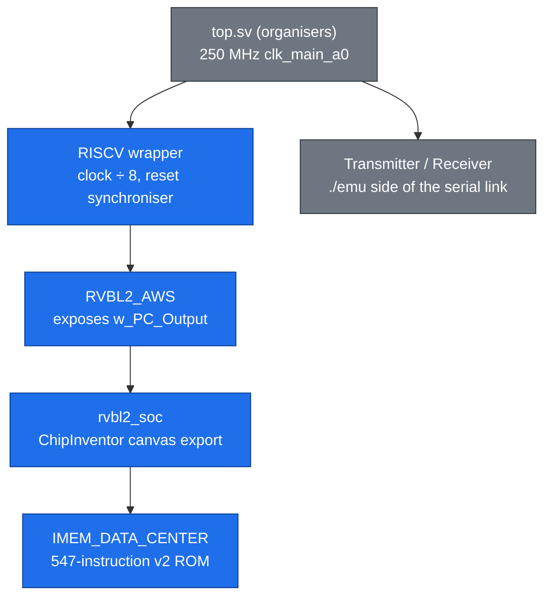

# 03 · FPGA deployment, evidence and the demo page

> [!NOTE]
> **After this chapter you will know**
> How RackSentinel v2 was put on the AWS FPGA, what the clock divider and timing results mean, what each piece of evidence proves, what the nine rehearsed runs R1 to R9 show, and how `rack_demo.html` works and can be used on Demo Day.
> Source: `stage4_fpga/` and the organisers' `stage4_fpga/organiser/Stage4_AWS_Guide.pdf`.

## What Demo Day asks for

From the organisers' pre-departure briefing (Demo Day, 17 October 2026, Hall 4, KLCC):

| Item | Requirement |
|---|---|
| Format | **12 min presentation + 10 min Q&A**; about 10 slides; every member speaks |
| Practical demonstration | "Show the application running with the processor **on AWS FPGA** and clearly present its operation and results" |
| Note | Technical tests completed in earlier stages do not need to be repeated |
| Scoring | 10 criteria × 10 points: 4 Application, 5 Presentation, 1 Potential for evolution; each scored fully / mostly / partially / not demonstrated (100 / 75 / 50 / 0 %) |
| Judges | Matheus Souza (ChipInventor Brazil), Kother Badushah (UST Global), Giap Seng Teoh (Skyechip) |

## The files that go on the FPGA

| File | Origin | Role |
|---|---|---|
| `top.sv` | Organisers, **unchanged** | AWS shell top level: AXI-Lite registers, the `./emu` side of the UART (`Transmitter` / `Receiver` at 2,170 clocks per bit), pin tristates |
| `riscv.sv` | Team, generated by `CoreX/aws/gen_riscv.py` | The whole SoC: the ChipInventor canvas export with the v2 ROM `IMEM_DATA_CENTER`, plus the wrapper modules `top.sv` expects |
| `cl_ports.vh` | AWS | Provided by the platform; not edited |



> [!IMPORTANT]
> **Why a clock divider**
> The AWS shell gives a 250 MHz clock. Our multicycle core closes timing near 30 MHz, so the `RISCV` wrapper divides by 8 and runs the core at **31.25 MHz** (UART divisor 271 for 115,200 baud). Vivado put the divided clock on a global clock buffer (`w_Core_Clk`, 1,191 loads). The wrapper also synchronises the active-low reset into the core clock domain.

## The build, step by step (as done on 2026-10-10)

Following the organisers' AWS guide:

1. Open **AWS FPGA** in ChipInventor and create `riscv.sv` and `top.sv` next to `cl_ports.vh`.
2. **Save Project**, then **Start Synthesis**. Vivado 2024.1 builds the design; the log ends with the image IDs.
3. Wait until `aws ec2 describe-fpga-images` shows the image as `available`.
4. `sudo fpga-clear-local-image -S 0`, then `sudo fpga-load-local-image -S 0 -I agfi-0a4f37f7744a84a88`.
5. Manual reset: `./axil_rw write 0 0x00 0 && sleep 1 && ./axil_rw write 0 0x00 1 && sleep 1`.
6. Run each `./emu` line.

| Result | Value |
|---|---|
| Synthesis | 0 errors, 16 critical warnings, 5,795 warnings |
| Routed timing (250 MHz clock) | **WNS +0.711 ns, WHS +0.013 ns**, "SUCCESS: Design has no negative slack path" |
| AFI / AGFI | `afi-0d0eb57f78ad69e3b` / `agfi-0a4f37f7744a84a88`, state `available` |
| Hardware runs | **R1 to R9: 9 of 9, every line `[ok]`** |

> [!NOTE]
> **About the critical warnings**
> The 16 "Converted tricell instance to logic" warnings are expected: an FPGA has no internal tristate wires, so Vivado turns the pin tristates (in `top.sv` and in our eight Inout Pins) into ordinary logic. The organisers' reference design does the same. The other critical warnings come from the AWS shell's constraint files.

> [!WARNING]
> **What the timing number does and does not cover**
> WNS +0.711 ns is for the 250 MHz clock. The divided 31.25 MHz clock has no constraint of its own in this flow, so Vivado does not time the core's paths. The core has 32 ns per cycle, and nine passing hardware runs are the evidence that this is enough. If a judge asks: adding a `create_generated_clock` constraint would let Vivado prove it.

## Evidence folder

| File | Proves |
|---|---|
| `synthesis_log_2026-10-10.txt` | The full Vivado log: clean build and timing |
| `afi_available.png` | The FPGA image exists and is ready |
| `load_and_reset.png` | Clear, load and reset exactly as the guide shows |
| `fpga_emu_R1.png` … `R9.png` | The nine runs on real hardware, every line `[ok]` |

## The nine rehearsed runs

Each run starts from reset. `./emu` returns at most 8 bytes per run, and every run fits.

| Run | Story | What it proves | Key results |
|---|---|---|---|
| **R1** | Healthy rack: 22.0 °C, 20 A, STATUS | Normal operation, status path | `-o 00`, STATUS `40 2C 64 00` |
| **R2** | Heating up: 26.5 → 27.0 → 32.0 °C (runaway off) | ASHRAE classes and boundaries | `-o 00` → `10` → `20` |
| **R3** | 35.0 °C trips; reset refused while Critical; cools to 30.0 °C; reset accepted | Latch, safe reset, trip record | `A0`, press `A0`, `90`, press `10`; TRIP_INFO cause `01` at 35.0 °C |
| **R4** | 24.0 → 26.5 °C jump, still Normal | Thermal runaway trips early | `00` → `80` → `90`, press `10`; cause `02` |
| **R5** | Leak on P1, no packets | Leak trips, stays latched when dry | `-i 02` → `80`, dry `80`, press `00`; cause `04` |
| **R6** | 20, 26, 25 A, then 240 V and 25 A | P = V × I overload, non-latching, voltage setting | `00` → `40` → `00` → `40` |
| **R7** | Three minutes at 4.6 kW | Energy metering with `mulhu` | ENERGY `230 Wh` |
| **R8** | One bit of Critical flipped; 34.5 then 35.0 °C | ECC corrects; threshold still exact | `20` → `A0`; COUNTERS 1 corrected |
| **R9** | Two bits of Critical flipped; 22.0 °C | Fail-safe on uncorrectable memory | `80`, reset refused until SET_CRIT, then `00`; cause `08` |

The exact command lines:

```text
R1 ./emu -d 0xF0 -t4 0xFE072C20 -r1 0xA5 -o 0x00 -t4 0x04FA6421 -r1 0xA5 -o 0x00 -t4 0x13B00050 -r4 0x00642C40
R2 ./emu -d 0xF0 -t4 0xDC070044 -r1 0xA5 -t4 0x7D1F3520 -r1 0xA5 -o 0x00 -t4 0x4D7C3620 -r1 0xA5 -o 0x10 -t4 0x532D4020 -r1 0xA5 -o 0x20
R3 ./emu -d 0xF0 -t4 0x33EB4620 -r1 0xA5 -o 0xA0 -i 0x01 -o 0xA0 -i 0x00 -t4 0xEC363C20 -r1 0xA5 -o 0x90 -i 0x01 -o 0x10 -i 0x00 -t4 0x46E30053 -r4 0x01004601
R4 ./emu -d 0xF0 -t4 0x2DBA3020 -r1 0xA5 -o 0x00 -t4 0x7D1F3520 -r1 0xA5 -o 0x80 -t4 0x4D7C3620 -r1 0xA5 -o 0x90 -i 0x01 -o 0x10 -i 0x00 -t4 0x46E30053 -r4 0x01003502
R5 ./emu -d 0xF0 -i 0x02 -o 0x80 -i 0x00 -o 0x80 -i 0x01 -o 0x00 -i 0x00 -t4 0x46E30053 -r4 0x01000004
R6 ./emu -d 0xF0 -t4 0x04FA6421 -r1 0xA5 -o 0x00 -t4 0x99128221 -r1 0xA5 -o 0x40 -t4 0x87E27D21 -r1 0xA5 -o 0x00 -t4 0x0029F045 -r1 0xA5 -t4 0x87E27D21 -r1 0xA5 -o 0x40
R7 ./emu -d 0xF0 -t4 0x04FA6421 -r1 0xA5 -t4 0x04FA6421 -r1 0xA5 -t4 0x04FA6421 -r1 0xA5 -t4 0x20810051 -r4 0x000000E6
R8 ./emu -d 0xF0 -t4 0x0BE90231 -r1 0xA5 -t4 0x03884520 -r1 0xA5 -o 0x20 -t4 0x33EB4620 -r1 0xA5 -o 0xA0 -t4 0x75D20052 -r4 0x00000100
R9 ./emu -d 0xF0 -t4 0x19D81231 -r1 0xA5 -t4 0xFE072C20 -r1 0xA5 -o 0x80 -i 0x01 -o 0x80 -i 0x00 -t4 0x6D924643 -r1 0xA5 -i 0x01 -o 0x00 -i 0x00 -t4 0x46E30053 -r4 0x01002C08
```

> [!TIP]
> **Cross-checked**
> These lines were regenerated from the model inside `rack_demo.html` on 2026-10-13 and are identical to the commands in the nine FPGA screenshots.

## The demo page: `rack_demo.html`

One self-contained HTML file (about 1,170 lines). It opens in any browser **with no network**, which makes it safe for a venue with bad Wi-Fi.

### What it contains

| Part | What it does |
|---|---|
| **Firmware model** (`<script id="rack-model">`) | A JavaScript port of `rack_sentinel.s`: CRC-16 exactly as `crcb`, SECDED encode/decode bit-for-bit as the firmware, the class, runaway, latch, reset, power, energy and counter rules |
| **Rehearsed runs** | R1 to R9, the same lines that passed on the FPGA; badge "rehearsed run, passed on the FPGA" |
| **Random cases** | 10 scenario templates: heating up, overheat and reset, cooling failure, leak, overload, energy, 1-bit memory fault, 2-bit memory fault, noisy link and bad input, threshold change. A **seed** always builds the same case; seed `n` uses template `(n − 1) mod 10` |
| **Command line** | The `./emu` line with every option clickable; a Copy button |
| **Step timeline** | Each option as a step: packet bytes colour-coded (command, value, CRC), decoded replies, what the chip did and why, P4 to P7 dots |
| **Rack panel** | A drawn rack: fans spin slow (P4) or fast (P5), a red "POWER CUT" banner (P7), water on the floor (P1); lamps, temperature bar with Warm/Hot/Crit marks, power bar with the limit, energy, trips, counters, and the six ECC settings shown as OK / 1 bit repaired / UNREADABLE |
| **FPGA compare box** | Paste the terminal output of `./emu`; each `[ok]` / `[error]` line is matched to its step and marked ✓ or ✗, with the meaning of a wrong value |
| **Reference** | Packet format, commands, replies, pins and trip causes |

### How "pre-verified" works

`verify_demo.py` (in the team's CoreX source repository, not in this folder) runs the model block under Node, builds every case for seeds 1 to 1,000 plus R1 to R9, and replays each `./emu` line on the RTL. Only if all pass does it write a stamp: seed count + an FNV-1a hash of the model block. The page recomputes the hash when it loads:

- hash equals the stamp and seed ≤ 1,000 → green "pre-verified on the design in simulation";
- seed above 1,000, or the model edited → amber "NOT pre-verified".

Current stamp: 1,000 seeds, hash `A9E52850`, 2026-10-11, design `apps/rack_sentinel/hdl_rack.v`. The hash recomputes to the same value, so the badge is honest. **Do not edit the model block** before Demo Day, or the stamp breaks.

### Limits to know

- Random cases were checked **in simulation**, not on the FPGA. Only R1 to R9 have FPGA screenshots. If you run a random seed live on AWS, paste the output to show the match.
- The compare box matches lines **in order** and uses the last `RISC-V started!` it finds, so paste one run at a time.
- The page is a model of the firmware, not the hardware. The proof is the FPGA terminal; the page explains it.

### Using it live

1. Load the AFI and reset the FPGA (steps 4 and 5 above) before the session.
2. In the page, pick a rehearsed run (or a pre-verified seed) and press **Copy**.
3. Paste the line into the AWS terminal and run it.
4. Paste the terminal output into **Compare with the FPGA**. The page shows **MATCH** and marks every step ✓.
5. Step through the timeline with the arrow keys while you narrate what the rack is doing.

## Using the runs in Ali's daily routine

A suggested mapping from Ali's day as a data-centre operator to the rehearsed runs, so every story beat has a real FPGA result behind it:

| Moment in the day | Run | The chip's answer |
|---|---|---|
| Morning check: is my rack healthy? | R1 | STATUS: Normal, 22.0 °C, 20 A, no trips |
| Afternoon heat: the hall warms up | R2 | Fan boost at 27.0 °C, maximum fans at 32.0 °C |
| A CRAC unit fails | R4 | Cuts power on the 2.5 °C jump, before the rack is even Warm |
| The rack overheats anyway | R3 | EPO at 35.0 °C; reset refused until it cools; TRIP_INFO says why |
| A pipe leaks under the floor | R5 | EPO with no message on the link; reset only once dry |
| A new server pushes the load up | R6 | P6 overload alarm, no outage; clears when load is shed |
| Monthly energy report | R7 | 230 Wh after three minutes at 4.6 kW |
| A bit flips in the controller's memory | R8 | Repaired silently, counted, threshold still exact |
| Two bits flip | R9 | Refuses to guess: cuts power until the setting is rewritten |

## The digital twin and its two explainer pages

`racksentinel-twin/` (updated to v2 on 2026-10-13) tells the same story visually. Its controller model is checked byte for byte against all nine FPGA runs and the 1,000 RTL-verified demo cases, so what the twin shows is what the chip does.

| Page | What it is for |
|---|---|
| `/` (the twin) | The operator room. Its scenarios are Ali's day: one per run R1 to R9 (tagged "FPGA run R3" and so on), plus four extras (taped reset button, noisy link, bad input, leak with the link down). The guided demo (G) walks the whole shift in eleven steps |
| `/features` | Eleven feature cards: in plain words, why it matters, why it stands out, and a live mini-demo (drag a temperature, flip ECC bits, compute a CRC) |
| `/data-flow` | Each run step by step in raw bytes: the packet on the wire, the `crcb` CRC trace, what the firmware decided, the reply and the pins, with the FPGA screenshot beside it |

Run it with `npm run dev` in `racksentinel-twin/` ([12](12-build-and-reproduce.md)).

Next: [04 Digital basics](04-digital-basics.md)
