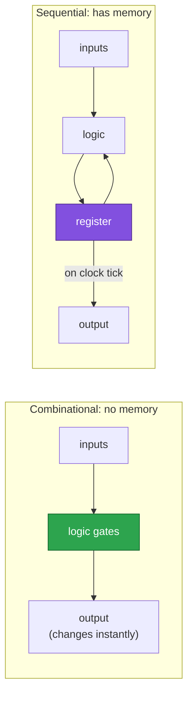
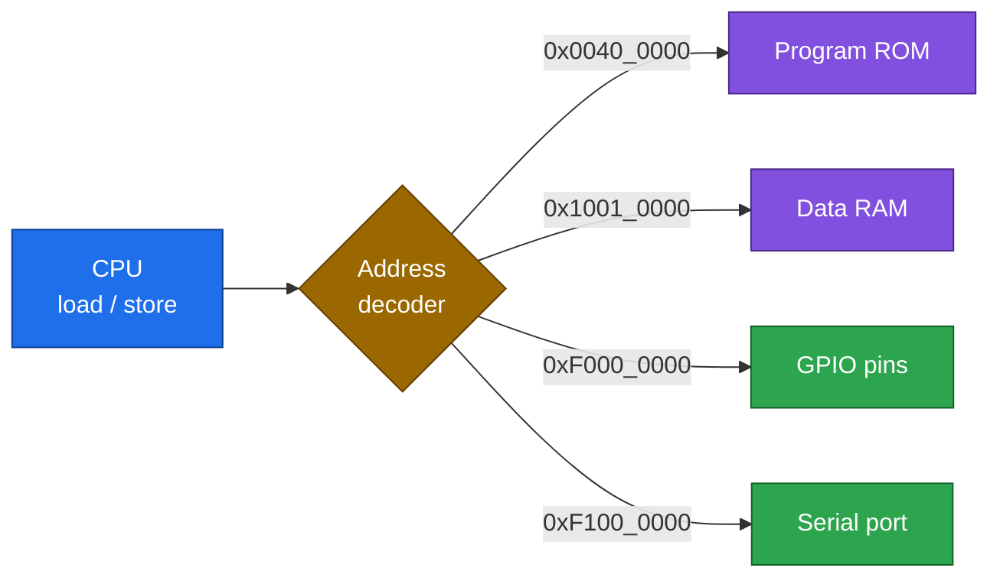
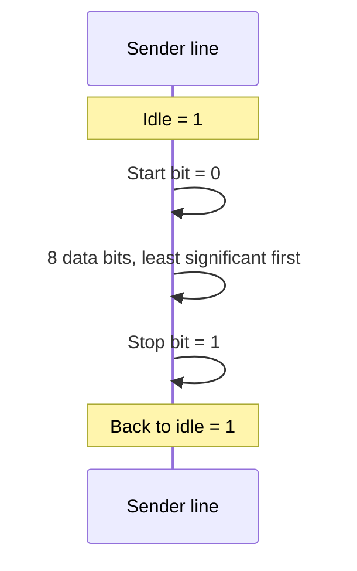

# 04 · Digital basics

> [!NOTE]
> **After this chapter you will know**
> Just enough vocabulary (bits, hex, clock, register, memory, reset, pin, serial) to follow every other chapter. Skip anything you already know.

## 1. Bits, bytes, words

A **bit** is a switch that is either **0** or **1**. Eight bits make a **byte**. Our CPU works on **32-bit words** (four bytes).

| Unit | Bits | Example value |
|---|---|---|
| Bit | 1 | `1` |
| Byte | 8 | `0x5A` (decimal 90) |
| Word | 32 | `0xF0000000` |

**Hexadecimal** (hex, written `0x...`) is a shorthand: one hex digit stands for 4 bits. So `0xF0` is `1111 0000`: the upper four bits on, the lower four off. You will see this for GPIO pins.

> [!NOTE]
> **Hex cheat sheet**
> | Hex | Binary | Decimal |
> |---|---|---|
> | 0x1 | 0001 | 1 |
> | 0xA | 1010 | 10 |
> | 0xF | 1111 | 15 |
> | 0x10 | 0001 0000 | 16 |
> | 0x80 | 1000 0000 | 128 |

## 2. Combinational vs sequential logic

- **Combinational** = a calculator: answer depends only on the current inputs (the ALU, the decoder).
- **Sequential** = a notebook: it **remembers** (registers, the program counter, the CPU state).

## 3. Clock and reset

- The **clock** is a steady tick (ours: **25 MHz** in simulation, **31.25 MHz** on the AWS FPGA). Sequential parts only change on a tick.
- **Reset** forces everything to a known starting state. Our chip's reset input is `rst_i`.

> [!NOTE]
> **Why the clock speed matters**
> The serial port counts clock ticks to time each bit: 25,000,000 / 115,200 baud = **217 ticks per bit** in simulation; 31,250,000 / 115,200 = **271** on the FPGA. See [09](09-uart.md).

## 4. Registers and memory

| Thing | What it is | Our example |
|---|---|---|
| **Register** | A few bits stored inside a block | CPU has 32 registers (x0 to x31) |
| **ROM** | Memory you can only read | Instruction memory (IMEM) holds the program |
| **RAM** | Memory you can read and write | Data memory (DMEM), 8 kB |

## 5. Memory-mapped I/O (the most important idea)

The CPU only knows two moves: **load** (read an address) and **store** (write an address). To talk to pins or the serial port, we give them **addresses** too. Writing to address `0xF0000000` does not write to RAM. It sets output pins.

> [!TIP]
> **Post-office analogy**
> The address is the street address. The **decoder** is the postman who looks at it and delivers to the right building.

## 6. Pins, inputs, outputs, tri-state

A **pin** is a metal leg of the chip. A **GPIO** pin can be an **input** (the chip listens) or an **output** (the chip drives it high or low). Our pins are *bidirectional*, so each has a **direction** switch. When a pin is an input, the chip's driver is **disconnected** (called "high-impedance", or `Z`) so something outside can drive it. Detail in [08](08-gpio.md).

## 7. Serial communication and baud

A **UART** sends bytes **one bit at a time on one wire**. Both sides agree on speed (**baud**, here 115,200 bits per second) and format (**8-N-1**: 1 start bit, 8 data bits, no parity, 1 stop bit). The line rests at `1`.

## 8. Checksums and CRC

Wires glitch. A **checksum** is a small number computed from a message and sent with it. The receiver recomputes it; a mismatch means corruption. **CRC-16** is a very strong checksum. We compare it to a weak one in [11](11-verification.md).

## 9. A state machine

A **finite-state machine (FSM)** is a thing that is in exactly one *state* at a time and moves to the next on each clock tick. Our CPU is a 4-state FSM: [05](05-the-cpu.md).

## 10. Simulation vs real hardware

| | Simulation | Real chip or FPGA |
|---|---|---|
| Speed | Very slow | Real time |
| Cost | Free | Hardware needed |
| What we did | **Yes** | Not yet |

> [!WARNING]
> **Beginner trap**
> "It passed in simulation" does **not** mean "it works on a board". Timing, pin voltages and noise exist only on real hardware.

Next: [05 The CPU](05-the-cpu.md)
