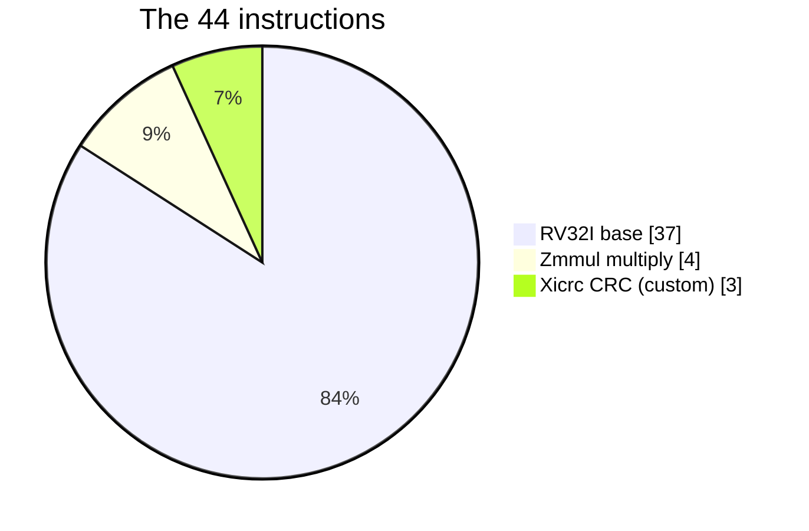
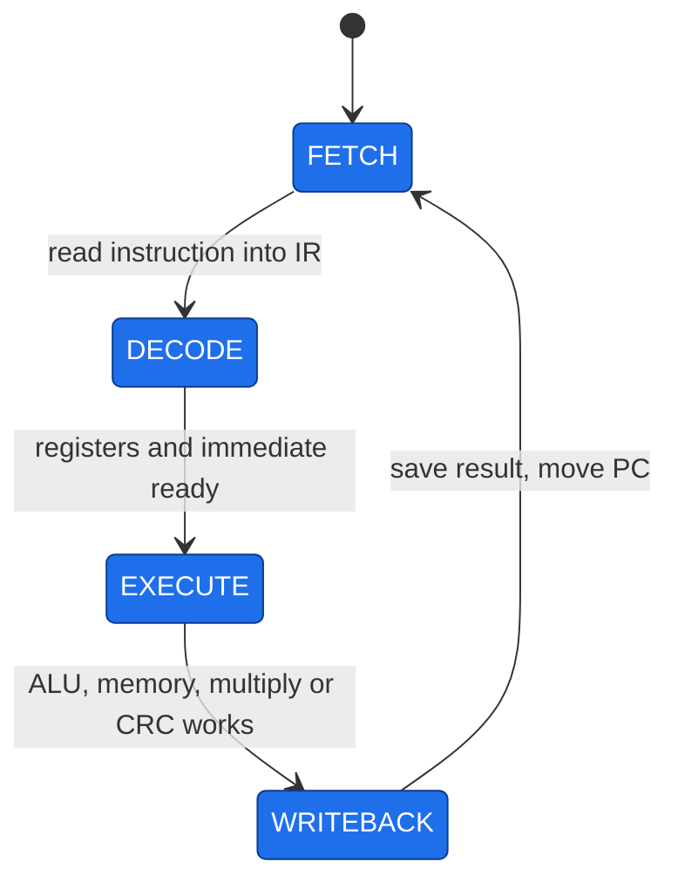
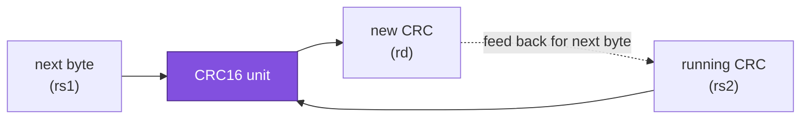

# 05 · The CPU: RVBL-2 (Stage 2)

> [!NOTE]
> **After this chapter you will know**
> What a RISC-V CPU is, the four-beat rhythm our CPU follows, the **two special instructions** RackSentinel relies on (`mul` family and `crcb`), how we brought the CPU up in six stages, and what the OpenLane physical-design run proved. The CPU was built in Stage 2 and is reused **unchanged** in Stages 3 and 4.
> Source: `stage2_cpu/` (design export, OpenLane run, original Stage 2 notes).

## What a CPU does

A CPU **fetches** an instruction from memory, **works out** what it means, **does** it, and **stores** the result. Then it repeats, forever. Instructions are tiny commands such as "add these two registers" or "read this address".

**RISC-V** is an open, simple instruction-set family. Ours is called **RVBL-2**:

| Part | Count | What it gives us |
|---|---|---|
| **RV32I** | 37 instructions | Base: add, compare, branch, load, store, jump |
| **Zmmul** | 4 instructions | Multiply (`mul`, `mulh`, `mulhsu`, `mulhu`) |
| **Xicrc** (custom) | 3 instructions | Hardware CRC-16 (`crcb`, `crch`, `crcw`) |
| **Total** | **44** | |

## Registers

32 registers of 32 bits (`x0` to `x31`). **`x0` always reads 0**; writes to it are ignored. The firmware gives them friendly names: `s0` holds the GPIO base address, `s1` the UART base, `s11` the data-memory base, `t0` to `t6` are scratch.

## The four-beat heartbeat

Every instruction takes **four clock ticks**, one per state. The **Control Unit** is the small state machine that steps through them. This is called a **multicycle** design: one simple datapath reused over several ticks, instead of a long pipeline.

| State | What happens |
|---|---|
| **FETCH** | Address = program counter (PC). Read the ROM. Latch the word in the instruction register. |
| **DECODE** | The register file hands out the two source registers; the immediate generator builds the constant. |
| **EXECUTE** | The ALU computes; or a load/store is issued; or the multiply/CRC unit computes. |
| **WRITEBACK** | The result goes to the destination register; the PC advances (or jumps). |

> [!NOTE]
> **Speed**
> | Where | Clock | Instructions per second |
> |---|---|---|
> | Simulation and ChipInventor (Stages 2 and 3) | 25 MHz | about 6.25 million |
> | AWS FPGA (Stage 4) | 31.25 MHz (250 MHz ÷ 8) | about 7.8 million |
> Plenty for a rack guardian waiting on a 115,200-baud serial line.

## Special instructions

### The multiply family (Zmmul)

`mul` gives the low 32 bits of a product; `mulh`, `mulhsu` and `mulhu` give the high 32 bits with different signedness. RackSentinel v2 uses:

- **`mul`** for power: `P = V × I`;
- **`mulhu`** to divide energy by 300 without a divide instruction: `Wh = mulhu(E, 0xDA740DA8) >> 8`, exact for every 32-bit value.

> [!NOTE]
> **Division by multiplication**
> Dividing by 300 is the same as multiplying by 1/300. `0xDA740DA8 / 2⁴⁰` is a very close binary approximation of 1/300, so taking the high 32 bits of the product (`mulhu`, which divides by 2³²) and shifting right by 8 more gives `E ÷ 300`. The team checked it exhaustively for all 2³² inputs.

### `crcb` (Xicrc, our custom instruction)

`crcb rd, rs1, rs2` feeds **one byte** (from `rs1`) into a running **CRC-16** (held in `rs2`) and writes the new CRC to `rd`. Polynomial `0x1021`, start value `0xFFFF`. Done in hardware, so the firmware needs **no loop** of shifts and XORs: checking a 4-byte packet takes two instructions.

> [!WARNING]
> **How the assembler learns `crcb`**
> Standard tools do not know our custom instruction. The firmware defines it as a macro with the raw encoding (`.insn r 0x33, 0, 0x40, ...`): the normal register-op opcode, with **funct7 = `1000000`** marking it as CRC. Multiply uses funct7 = `0000001`.

## The blocks

| Block | Job |
|---|---|
| `Control_Unit` | The four-state FSM; sets every control wire each beat |
| `PC_Unit` | Program counter; resets to `0x0040_0000` |
| `Register_File` | 32 × 32-bit registers |
| `alu` | Add, subtract, logic, shifts, compares |
| `MULT_Unit` | Zmmul multiplier |
| `CRC16_Unit` | Xicrc CRC engine |
| `BRANCH_COMPARATOR` | Decides whether a branch is taken |
| `IMM_GENERATOR` | Builds constants hidden inside instructions |
| `Datapath_Mux` | Instruction register and all the selector switches |
| `LSU` | Formats loads and stores (byte, half, word) |
| `DMEM`, address decoder | Data memory and address routing |

Each block is described in [07](07-module-reference.md).

## How we built it: six bring-up stages

The CPU was assembled on the ChipInventor canvas one capability at a time, with a test after each step.

| Stage | Added | Test | Bug found and fixed |
|---|---|---|---|
| 1 Fetch loop | PC, IMEM, IR, control | PC steps `0x00400000`, `…04`, `…08` | IR write-enable not connected, so the IR stayed a NOP |
| 2 Datapath | Registers, immediate, ALU, muxes | `10 + 5 = 15` in x7 | Missing wires showed as `X` |
| 3 Branches and jumps | Branch comparator, next-PC mux | `beq` and `jal` skip the right instructions | none |
| 4 Memory | DMEM, LSU | store 100, load it back | none |
| 5 Multiply and CRC | MULT and CRC units | `7 × 6 = 42`; `crcb` = `0x67C6` | Wrong funct7 in the first `crcb` encoding (decoded as SUB) |
| 6 Full firmware | Organisers' 254-instruction self-test | PC settles at `0x004003EC` = **PASS** | **Loads from IMEM returned the address, not the data** |

> [!WARNING]
> **The significant Stage 2 bug**
> The firmware self-test failed at a CRC comparison. The CRC unit was right; it had been fed the wrong data. The LSU's load input was wired to DMEM only, so a load from the ROM's data section returned the address instead of the value. Fix: route the LSU's load data through the address decoder, which selects IMEM or DMEM by address. After the fix the CRC chain produced `0x1E82` and the self-test passed.

## Physical design: OpenLane (Stage 2)

To show the CPU can be manufactured, the design was taken through the full **OpenLane RTL-to-GDSII flow** on the SkyWater **sky130** process. The seventh run (9 September 2026) completed.

| Metric | Result |
|---|---|
| Flow | **Completed**, 1 h 49 min |
| Process / cells | sky130A, `sky130_fd_sc_hd` |
| Die area | **0.4225 mm²** (650 × 650 µm), 45 % utilisation |
| Cells | 12,795 synthesised |
| Timing at 25 MHz (40 ns) | **WNS 0.0 ns, TNS 0.0 ns**; critical path 11.68 ns |
| DRC (Magic, KLayout) | **0** violations |
| LVS | **Clean**, 0 errors |
| Antenna | 3 pin / 3 net warnings (non-blocking) |
| Outputs | GDSII, gate-level netlist, LEF, LIB, DEF, SDC |

> [!WARNING]
> **What the OpenLane run used**
> The GDSII was built with a small placeholder ROM and RAM (`IMEM_MOCK`, `DMEM_MOCK`), because a full firmware ROM is too large for the flow. The functional PASS came from simulation with the real firmware. The two results are complementary: OpenLane shows the CPU is **manufacturable**; simulation shows it is **correct**.

The slimmed run (config, reports, final GDS and netlist) is in `stage2_cpu/openlane/`. The original Stage 2 notes, with full detail on every block and wire, are in `stage2_cpu/docs/`.

## What later stages changed

> [!TIP]
> **Nothing in the core**
> Stage 3 kept every processor block and added **GPIO**, **UART**, **GPIO_PIN_SPLIT**, a larger **address decoder** and the **firmware ROM**. Stage 4 kept all of that and added only an AWS wrapper: a clock divider and a reset synchroniser ([03](03-fpga-and-demo.md)).

Next: [06 SoC and memory map](06-soc-and-memory-map.md)
