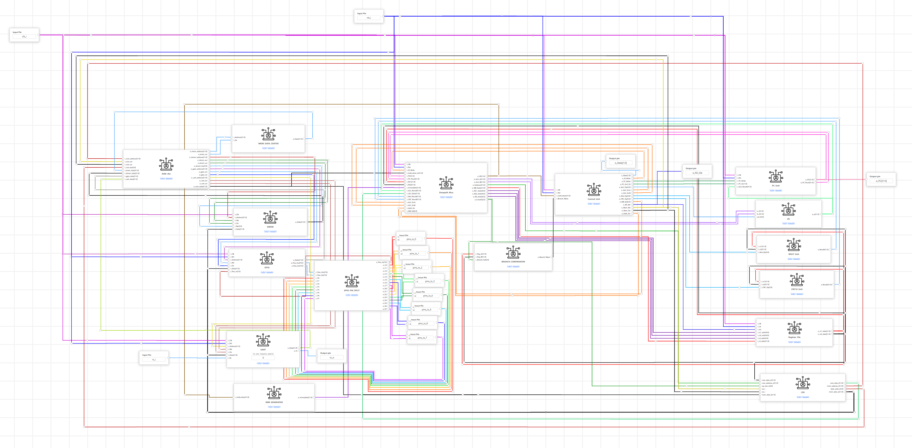
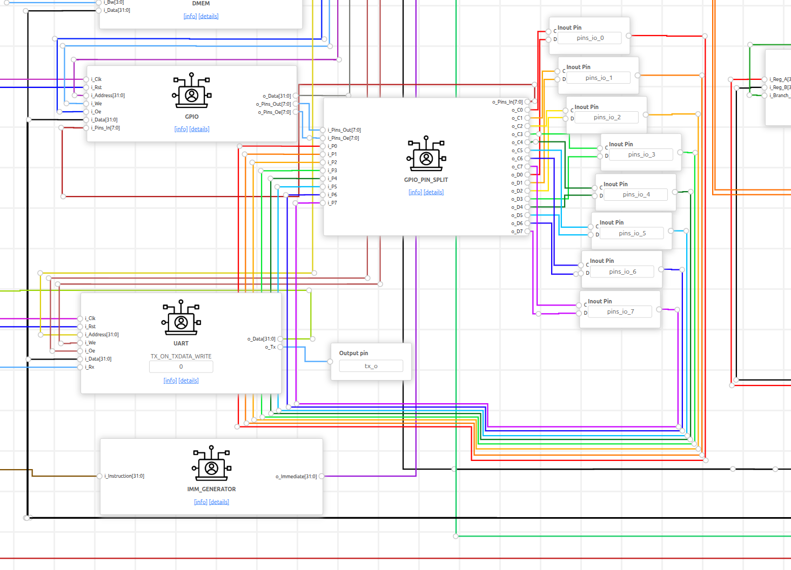
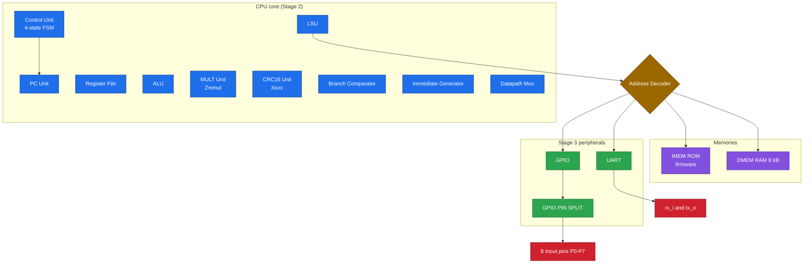
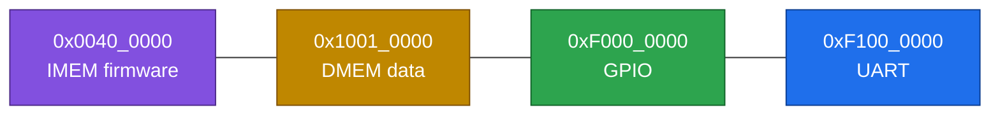
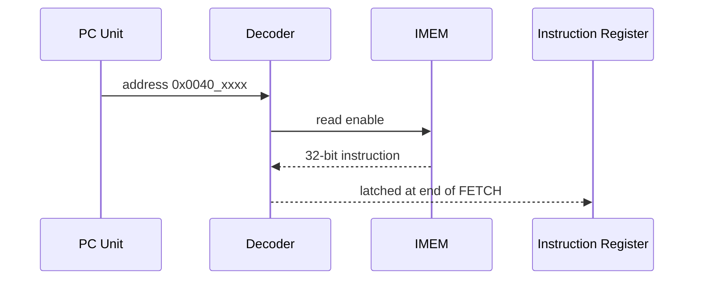
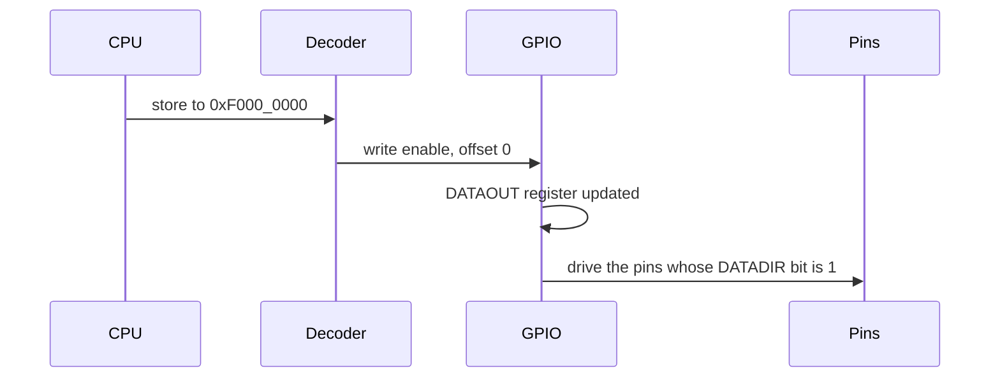
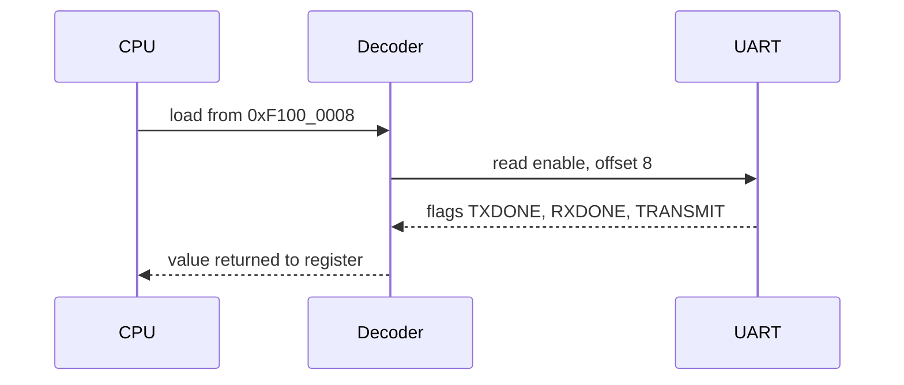

# 06 · SoC and memory map

> [!NOTE]
> **After this chapter you will know**
> Every block in the final design, how they connect, the address of everything, and what happens on a typical instruction fetch, GPIO write and UART read.

## The real diagrams

This is the ChipInventor canvas of the SoC (Stage 3). Stage 4 uses the same canvas with the v2 ROM `IMEM_DATA_CENTER`.

And the peripheral side (GPIO, the pin splitter, eight pins, UART):

## The same thing, simplified

> [!NOTE]
> **Colour key**
> Blue = CPU core · Orange = address decoder · Purple = memories · Green = peripherals · Red = the outside world.

## Top-level ports of the chip (`top`)

| Port | Direction | Purpose |
|---|---|---|
| `clk_i` | in | The clock: 25 MHz in simulation; on the AWS FPGA a wrapper divides 250 MHz by 8 to 31.25 MHz |
| `rst_i` | in | Reset |
| `rx_i` | in | Serial receive (messages **into** the chip) |
| `tx_o` | out | Serial transmit (replies **out of** the chip) |
| `pins_io_0` ... `pins_io_7` | in/out | The eight GPIO pins P0..P7 |
| `o_PC`, `o_State`, `o_RD_We` | out | Debug views of the CPU, handy in waveforms |

> [!TIP]
> **Why eight separate pins?**
> ChipInventor's pin blocks are **one bit each**, so the design exposes eight scalar ports instead of one 8-bit bus. The little block **GPIO_PIN_SPLIT** slices the GPIO's 8-bit buses into per-pin wires. See [08](08-gpio.md).

## The memory map

| Block | Starts at | Size of window | Access | What lives there |
|---|---|---|---|---|
| **IMEM** | `0x0040_0000` | 4 MB window | read only | The firmware (CPU starts here after reset) |
| **DMEM** | `0x1001_0000` | 8 kB | read and write | Application variables |
| **GPIO** | `0xF000_0000` | 4 kB window | word access | 3 registers |
| **UART** | `0xF100_0000` | 4 kB window | word access | 3 registers |

### Peripheral registers at a glance

| Peripheral | Offset | Register | Meaning |
|---|---|---|---|
| GPIO | `+0x0` | DATAOUT | Value driven onto output pins |
| GPIO | `+0x4` | DATAIN | Value read from input pins |
| GPIO | `+0x8` | DATADIR | Direction per pin: **0 = input, 1 = output** |
| UART | `+0x0` | TXDATA | Byte to send |
| UART | `+0x4` | RXDATA | Last byte received |
| UART | `+0x8` | CONTROL | Flags: bit0 TRANSMIT, bit1 RXDONE, bit2 TXDONE |

> [!CAUTION]
> **Direction convention**
> `DATADIR` bit = **1 means output**. If you guess the opposite, the pins will do nothing and the bug will be hard to spot. RackSentinel writes `0xF0`: P7..P4 are outputs, P3..P0 are inputs.

## Three journeys through the chip

### Fetching an instruction

### Writing a GPIO pin (`sw t2, 0(s0)`)

### Reading the UART (`lw t0, 8(s1)`)

> [!WARNING]
> **A subtle simulator hazard the decoder avoids**
> GPIO and UART read data is *combinational* (changes the instant the read-enable changes). If the decoder had set the peripheral enables inside the same `always` block that also reads their data, the simulator could loop forever on the first peripheral load. Final design drives the selects with plain continuous `assign` statements to avoid it. DMEM does not have the problem because its read is clocked.

## Unmapped addresses

An address outside all four windows reads as **0** and writes go nowhere. The 4 kB peripheral windows are exactly as big as the registers' address decode, so no stray address can *alias* (accidentally hit) a register.

Next: [07 Module reference](07-module-reference.md)
