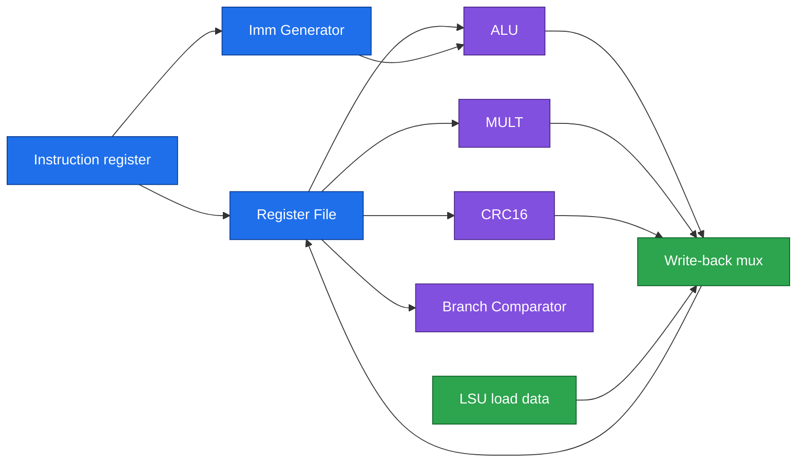

# 07 · Module reference

> [!NOTE]
> **After this chapter you will know**
> What each of the 15 custom Verilog blocks does, in plain words, and whether it belongs to Stage 2 or Stage 3. Source files are in `stage3_soc/submission/rtl/modules/`; the v2 build (the same blocks plus the v2 ROM and AWS wrappers) is `stage4_fpga/riscv.sv`.

## Overview

| # | Module | Stage | Kind | One-line job |
|---|---|---|---|---|
| 1 | `Control_Unit` | 2 | Sequential FSM | Conductor: tells every block what to do each beat |
| 2 | `PC_Unit` | 2 | Sequential | Remembers which instruction is next |
| 3 | `Register_File` | 2 | Sequential | 32 fast scratch registers |
| 4 | `alu` | 2 | Combinational | Add, subtract, logic, shifts, compares |
| 5 | `MULT_Unit` | 2 | Combinational | Multiplier (Zmmul) |
| 6 | `CRC16_Unit` | 2 | Combinational | CRC-16 engine (Xicrc) |
| 7 | `BRANCH_COMPARATOR` | 2 | Combinational | Decides if a branch is taken |
| 8 | `IMM_GENERATOR` | 2 | Combinational | Builds constants hidden inside instructions |
| 9 | `Datapath_Mux` | 2 | Mixed | Instruction register and the selector switches |
| 10 | `LSU` | 2 | Combinational | Formats loads and stores (byte, half, word) |
| 11 | `DMEM` | 2 | Sequential | 8 kB data RAM |
| 12 | `Addr_dec` | 2, **extended in 3** | Combinational | Routes addresses to memory or peripherals |
| 13 | `GPIO` | **3** | Sequential | 8 programmable pins |
| 14 | `GPIO_PIN_SPLIT` | **3** | Wiring only | Cuts the 8-bit GPIO buses into 8 single pins |
| 15 | `UART` | **3** | Sequential | Serial transmitter and receiver |
| - | `IMEM_DATA_CENTER` (v2) / `IMEM_Data_Center` (v1) / `IMEM_TESTFW` | **3, 4** | ROM | The firmware, baked into Verilog |

---

## CPU core (Stage 2, brief)

### Control_Unit
Moves through **FETCH, DECODE, EXECUTE, WRITEBACK** forever. In each state it sets the control wires: which ALU operation, whether to write a register, whether to read or write memory, how to update the PC. It spots our special instructions by **funct7**: `0000001` = multiply, `1000000` = CRC.

### PC_Unit
Holds the **program counter**. Reset value `0x0040_0000` (start of IMEM). Next value is `PC+4`, a jump or branch target, or a `jalr` target with bit 0 cleared.

### Register_File
32 x 32-bit registers. Two read ports (instant), one write port (on the clock). `x0` is hard-wired to zero.

### alu
Eleven operations: pass-B, add, subtract, AND, OR, XOR, shift left, shift right logical, shift right arithmetic, set-less-than signed, set-less-than unsigned.

### MULT_Unit
`mul` (low 32 bits), `mulh`, `mulhsu`, `mulhu` (high 32 bits, various signedness). RackSentinel v2 uses `mul` for power and `mulhu` to divide energy by 300.

### CRC16_Unit
Three sizes: `crcb` (8 bits), `crch` (16), `crcw` (32). Loops over the bits: if the top bit of the CRC XOR the next data bit is 1, shift left and XOR `0x1021`; otherwise just shift.

### BRANCH_COMPARATOR
Compares two registers for equal, not-equal, signed less/greater-or-equal, unsigned less/greater-or-equal.

### IMM_GENERATOR
RISC-V hides constants in different bit positions depending on instruction type (I, S, B, U, J). This block gathers and sign-extends them.

### Datapath_Mux
Holds the **instruction register (IR)** (resets to a no-op `addi x0,x0,0`) and the selector switches: ALU operand A (register or PC), operand B (register or immediate), address source (PC or ALU), and the **write-back mux** that picks what goes into the destination register.

| WB select | Source |
|---|---|
| 0 | ALU result |
| 1 | Load data from LSU |
| 2 | Multiply result |
| 3 | **CRC result** |
| 4 | PC + 4 (for jumps) |

### LSU
Load/Store Unit. For `sb`/`sh`/`sw` it produces a **byte-enable mask** so only the right bytes of a word change; for `lb`/`lh`/`lw`/`lbu`/`lhu` it picks the right bytes out and sign- or zero-extends.

### DMEM
2048 words (8 kB). **Read is clocked** (data appears one tick later) and writes use the per-byte mask.

---

## Stage 3 blocks (in depth)

### Addr_dec (extended)

> [!NOTE]
> **What Stage 3 added**
> Stage 2 only had IMEM and DMEM. Stage 3 added two more outputs, **GPIO** and **UART**, each with address, write-enable, read-enable and read data. Peripherals are **word-access only**: they receive `we`/`oe` but no byte mask.

| Region | Base | Mask used | Notes |
|---|---|---|---|
| IMEM | `0x00400000` | `0xFFC00000` | 4 MB window, read only |
| DMEM | `0x10010000` | `0xFFFFE000` | 8 kB window |
| GPIO | `0xF0000000` | `0xFFFFF000` | 4 kB window |
| UART | `0xF1000000` | `0xFFFFF000` | 4 kB window |

### GPIO
Three registers, an input **synchroniser**, and the rule "in output mode DATAIN holds its old value". Full story: [08](08-gpio.md).

### GPIO_PIN_SPLIT
Pure wiring (15 lines of Verilog). Takes `Pins_Out[7:0]`, `Pins_Oe[7:0]` from the GPIO and produces, for each pin *k*, a value wire `Ck` and a direction wire `Dk`; gathers the eight pin wires `P0..P7` back into `Pins_In[7:0]`.

### UART
Transmitter and receiver state machines at **115,200 baud, 8-N-1**, with a `TX_ON_TXDATA_WRITE` parameter set to **0** (spec behaviour: only the TRANSMIT bit starts a send). Full story: [09](09-uart.md).

### AWS wrapper modules (Stage 4)
`stage4_fpga/riscv.sv` adds the modules the organisers' `top.sv` expects: **`RISCV`** (divides the 250 MHz clock by 8 and synchronises the reset), **`RVBL2_AWS`** (the canvas design with the program counter exposed), and the `./emu` side of the serial link. The SoC blocks themselves are unchanged. See [03](03-fpga-and-demo.md).

### IMEM ROM modules
`IMEM_DATA_CENTER` holds RackSentinel v2 (**547 words**, `0x00400000` to `0x00400888`); the Stage 3 `IMEM_Data_Center` held v1 (275 words). `IMEM_TESTFW` holds the organisers' test program (**21 words**). They are a big `case` statement mapping address to instruction, generated from the assembled firmware. The two top-level files `hdl_application.v` and `hdl_official_test.v` are the **same SoC** with a different ROM plugged in.

> [!TIP]
> **Analogy**
> The ROM is a cassette tape. The SoC is the player. Swap the tape (ROM), same player, different show.

## Which module touches which signal? (the data path)

Next: [08 GPIO guide](08-gpio.md)
