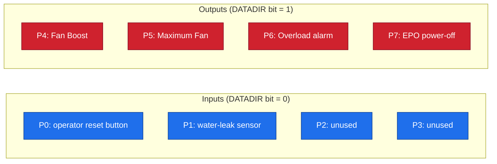
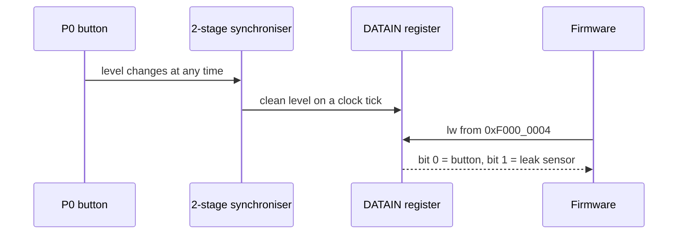

# 08 · GPIO

> [!NOTE]
> **After this chapter you will know**
> What GPIO is, its three registers, how the same pin can be input or output, why the design synchronises inputs, how pins connect to the outside, and exactly how RackSentinel uses P0 to P7.

## ELI5

GPIO = **General-Purpose Input/Output**. Picture **eight light switches and eight light bulbs sharing the same eight sockets**. For each socket you choose:

- **input**: it is a switch, the world decides its value, you only look;
- **output**: it is a bulb, you decide its value.

The program picks a mode per pin and then reads or sets values by touching three special addresses.

## The three registers

Base address **`0xF000_0000`**. Only the lowest 8 bits matter.

| Offset | Name | Read/Write | Meaning |
|---|---|---|---|
| `+0x0` | **DATAOUT** | R/W | Value to drive on output pins |
| `+0x4` | **DATAIN** | R only | What the input pins currently show |
| `+0x8` | **DATADIR** | R/W | Direction per bit: **0 = input, 1 = output** |

> [!NOTE]
> **Reset state**
> After reset DATAOUT, DATADIR and DATAIN are all 0. Everything is an **input** and nothing is driven, so the chip never shocks the outside world during start-up.

## Who uses which pin in RackSentinel?



| Pin | Direction | Bit value | Function |
|---|---|---|---|
| P0 | in | `0x01` | Operator reset (only a new press counts) |
| P1 | in | `0x02` | Water-leak sensor, 1 = wet |
| P4 | out | `0x10` | Fan boost (Warm) |
| P5 | out | `0x20` | Fans at maximum (Hot or Critical) |
| P6 | out | `0x40` | Power overload alarm |
| P7 | out | `0x80` | Emergency power-off request |

> [!NOTE]
> **Reading output values**
> The test plan writes pin values as one hex number. `0xA0` = `1010 0000` = P7 and P5 on = **EPO + max fan**. `0x90` = P7 and P4 = **EPO still latched while Warm**. `0x40` = **overload only**.

> [!NOTE]
> **v1 pin use (Stage 3)**
> The hardware and the `-d 0xF0` direction mask were the same in v1; only the meaning of three pins changed:
> | Pin | v1 (Stage 3) | v2 (above) |
> |---|---|---|
> | P1 | unused | **water-leak sensor input** (`-i 0x02`), watched while the chip waits for a packet |
> | P5 | maximum fan on Critical | maximum fan on **Hot or Critical** |
> | P6 | current warning | **power overload** (V × I at or above the limit) |
> Details in [02](02-rules-and-protocol.md).

## What the firmware does at boot

```text
lw  t0, GPIO_DATADIR(s0)   read direction
ori t0, t0, 0xF0           make P7..P4 outputs, leave P3..P0 alone
sw  t0, GPIO_DATADIR(s0)   write it back
sw  zero, GPIO_DATAOUT(s0) all outputs low
```

> [!TIP]
> **Why read-modify-write?**
> Reading first and OR-ing means we **only change the bits we mean to**. Writing `0xF0` blindly would be fine here but is a bad habit if other bits were already configured.

Direction is set **before** clearing outputs so nothing is asserted before the state is initialised.

## How the chip talks to a pin: tri-state

A pin has two internal wires from the GPIO: a **value** (C) and a **direction** (D).

| D (direction) | Pin becomes |
|---|---|
| 1 (output) | Driven to the value C |
| 0 (input) | **High-impedance (Z)**: disconnected, so outside signals can drive it |

In the top-level this is literally `assign pins_io_4 = w_81 ? w_82 : 1'bZ;`. The ChipInventor "Inout Pin" block is what the canvas draws for this.


## Two clever details in the GPIO RTL

### 1. Input synchroniser

The outside world is **not** tied to our clock. Sampling a wire that changes at a random moment can produce a garbled in-between value (called **metastability**). The fix: pass the pin through **two flip-flops** (`r_Sync1`, `r_Sync2`) before the program sees it. Cost: the DATAIN value arrives about two ticks late, which is irrelevant for a button.

### 2. "DATAIN holds while output"

The organisers' rule: when a pin is an **output**, its input buffer is isolated, so DATAIN for that pin **holds its previous value** instead of echoing the pin.

```text
DATAIN_next = (DATAIN and DATADIR) or (synced_pin and not DATADIR)
```

> [!WARNING]
> **Consequence**
> Reading DATAIN for an output pin does **not** show what you just wrote. Read **DATAOUT** to see your own output.

## A GPIO read, step by step (the reset button and leak sensor)



The firmware's `check_inputs` routine does this read over and over while it waits for a packet, so a leak or a reset press is noticed even when the serial line is silent.

## Official test firmware (what the organisers' test checks)

Their 21-instruction program does: set P7..P4 as outputs, then forever: read P3..P0, shift left 4, write to P7..P4 (so inputs are **copied** to outputs), wait for a UART byte, echo it back. If copying works, GPIO direction, DATAIN, DATAOUT and the pins all work. See [11](11-verification.md).

## Mistakes beginners make

> [!CAUTION]
> **Common errors**
> - Treating `1` as input (it is **output**).
> - Writing DATAOUT without setting DATADIR first: nothing appears on the pin.
> - Expecting to read back an output through DATAIN.
> - Forgetting that only bits 7:0 exist.

Next: [09 UART](09-uart.md)
