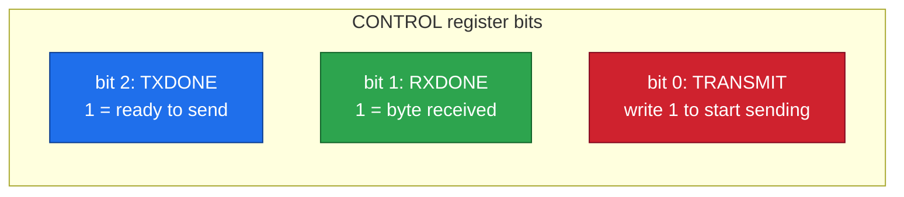
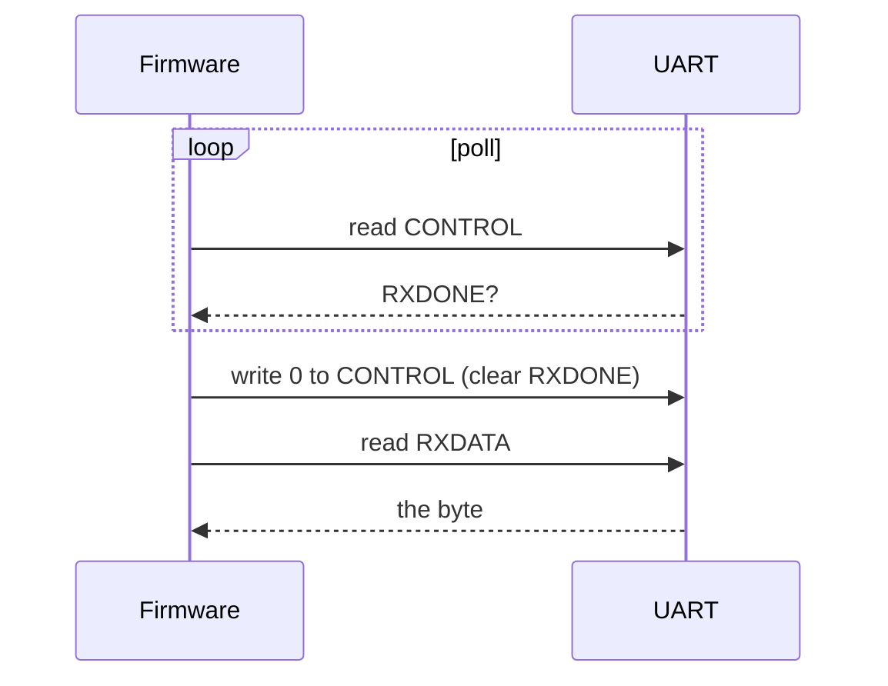
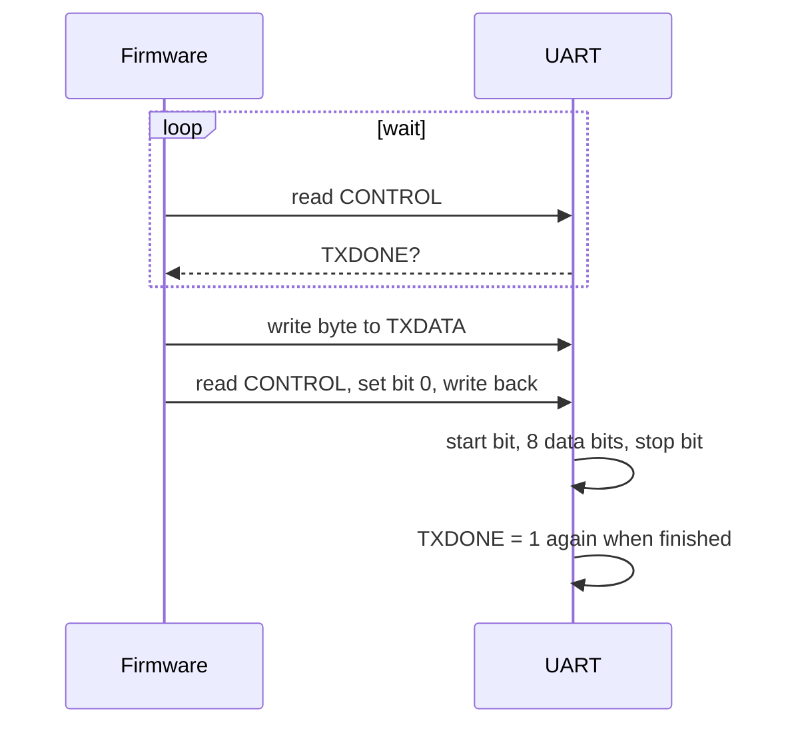
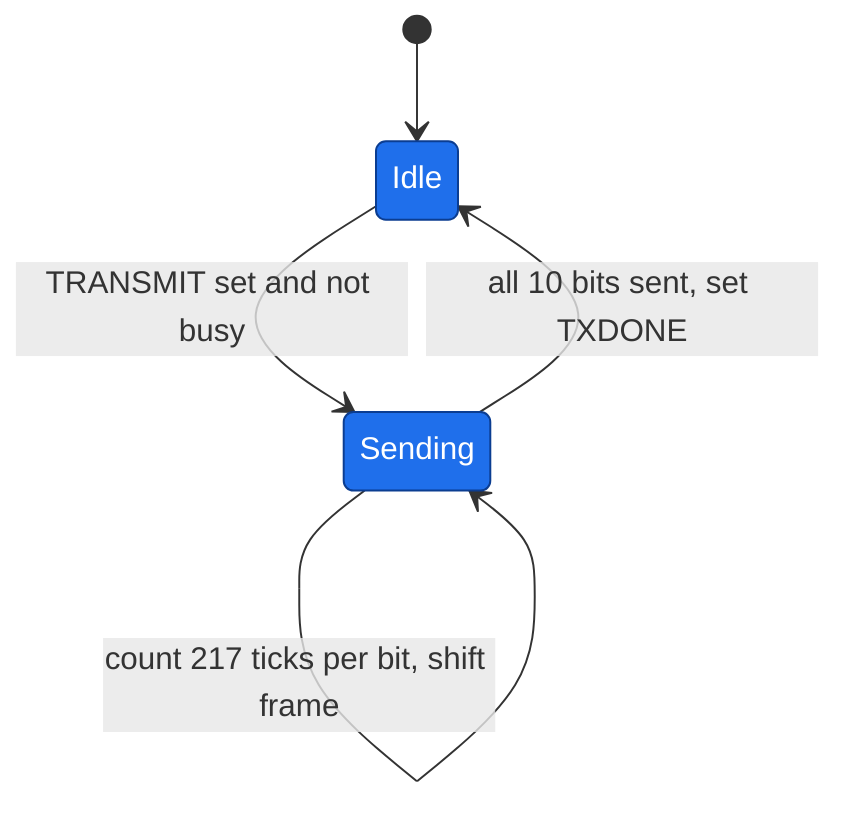
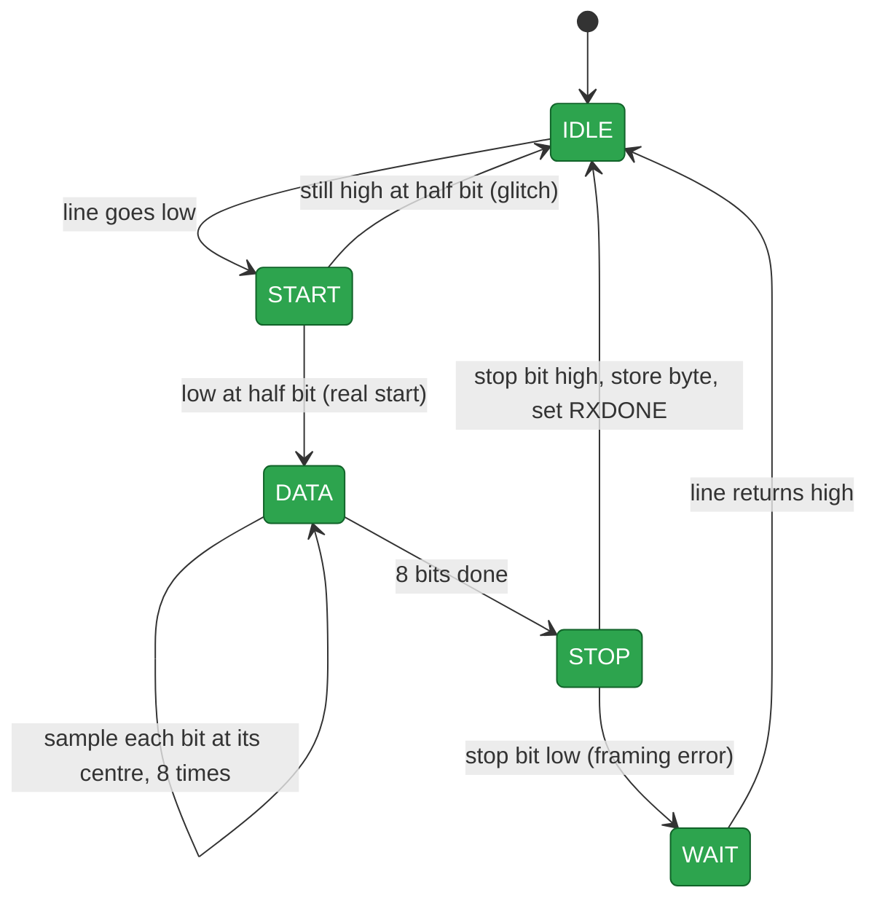

# 09 · UART

> [!NOTE]
> **After this chapter you will know**
> How a UART sends and receives bytes, the three registers, the exact software handshake RackSentinel uses, how the transmitter and receiver state machines work, and the timing numbers.

## ELI5

A UART is like **two people talking through a straw, one letter at a time**, at an agreed speed. No shared clock: both just promise "115,200 bits per second". The receiver notices the start of a letter, then **looks at the wire in the middle of each bit** to read it.

## A byte on the wire (8-N-1)

| Position | Level | Purpose |
|---|---|---|
| Idle | 1 | Line rests high |
| Start bit | 0 | "Letter incoming" |
| Data bits 0 to 7 | data | **Least significant bit first** |
| Stop bit | 1 | "Letter finished" |

10 bits per byte, so one byte takes about 86.8 microseconds.

> [!NOTE]
> **Sending 0x5A (binary 0101 1010)**
> LSB first, the data bits go out as 0, 1, 0, 1, 1, 0, 1, 0. With start and stop: `0 | 0 1 0 1 1 0 1 0 | 1`.

## Timing numbers

| Quantity | Value |
|---|---|
| Clock | 25 MHz (40 ns period) |
| Baud | 115,200 |
| Divisor (clocks per bit) | 25,000,000 / 115,200 = **217** |
| Bit time | 217 x 40 ns = **8,680 ns** |
| Byte time (10 bits) | **86.8 microseconds** |

> [!NOTE]
> **On the AWS FPGA**
> The core clock there is 31.25 MHz, so the divisor is 31,250,000 / 115,200 = **271**. The baud rate, and so every bit and byte time, is the same. The organisers' `top.sv` drives its side of the link at 250 MHz with 2,170 clocks per bit.

## The three registers

Base address **`0xF100_0000`**.

| Offset | Name | Meaning |
|---|---|---|
| `+0x0` | **TXDATA** | Write the byte to send here. It only **loads** the byte. |
| `+0x4` | **RXDATA** | The last received byte |
| `+0x8` | **CONTROL** | bit 0 **TRANSMIT**, bit 1 **RXDONE**, bit 2 **TXDONE** |

> [!WARNING]
> **Writing TXDATA does not send**
> The project rule is that **only** setting `CONTROL.TRANSMIT` starts a transmission. The RTL has a parameter `TX_ON_TXDATA_WRITE`; the final design sets it to **0** (spec behaviour). Setting it to 1 would make a TXDATA write auto-send, which the organisers do not want.

## The software handshake

### Receiving a byte

### Sending a byte

> [!NOTE]
> **Subtle facts that make the handshake safe**
> - **TXDONE is 1 out of reset** ("idle means ready"). If it read 0, firmware that waits for it before the first send would wait forever.
> - **TRANSMIT self-clears** one tick after being written.
> - If a byte arrives **in the same tick** software clears RXDONE, the **new byte wins** and is not lost.

## Transmitter state machine

The frame is loaded as `{stop, data[7:0], start}` and shifted out LSB first. While idle the output `tx_o` is held at 1.

## Receiver state machine

| Detail | Why |
|---|---|
| Two-flop synchroniser on `rx_i` | The line is asynchronous to the clock |
| Wait **half a bit** after the falling edge | Confirms it is a real start bit and lands us in the **centre** of bit 0 |
| Then sample every **217 ticks** | Always reading in the middle of each bit, the safest spot |
| Bad stop bit | Byte is **dropped**; chip waits for idle so a low stop bit is not mistaken for a new start |

## Stage 3 reference test

Echo test from the official firmware: wait RXDONE, clear it, read RXDATA, wait TXDONE, write TXDATA, set TRANSMIT, repeat. The organisers' emulator uses the same flow.

## How RackSentinel uses it

Every RackSentinel v2 message is four bytes. The firmware adds a **receive timeout** while collecting bytes 2 to 4: if they stop arriving (about 8 s on the FPGA), it abandons the half-built packet with no reply and returns to waiting. Waiting for the **first** byte has no timeout and instead polls the reset button and the leak sensor (chapter [10](10-firmware.md)).

> [!CAUTION]
> **Common mistakes**
> - Forgetting to **clear RXDONE** (you would read the same byte over and over).
> - Not waiting for **TXDONE** before sending (the next byte overwrites the one in progress).
> - Writing TXDATA and expecting the byte to go out.
> - Baud mismatch between the sender and the divisor (217 at 25 MHz, 271 at 31.25 MHz).

Next: [10 Firmware](10-firmware.md)
