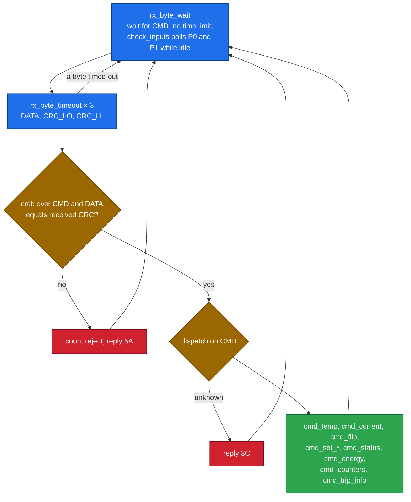
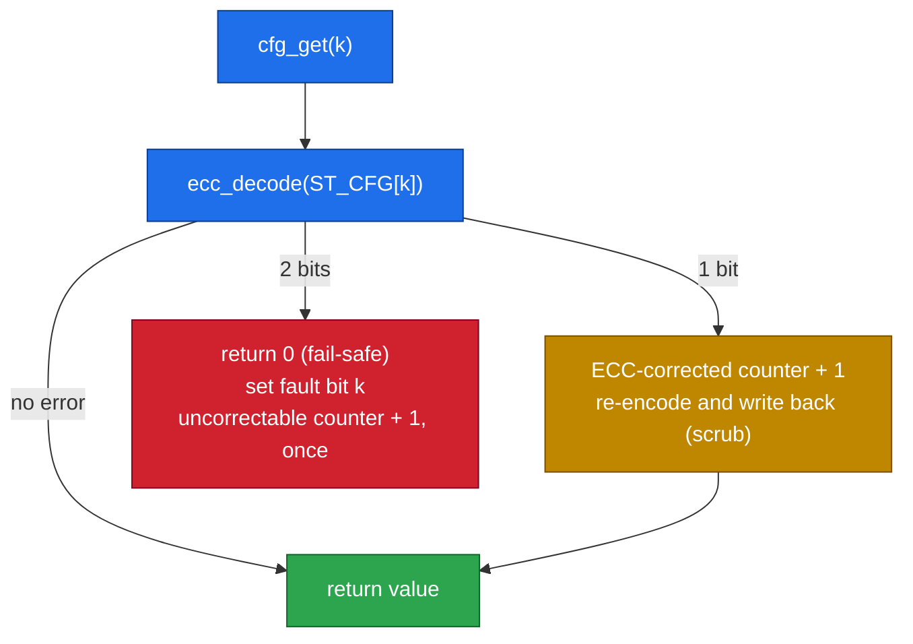

# 10 · Firmware

> [!NOTE]
> **After this chapter you will know**
> What firmware is, how the v2 program `rack_sentinel.s` becomes the ROM inside the chip, how its main loop works, and how its key routines (ECC read and write, the power-off trip, the input poll, the output write) are built. The excerpts below are real instructions from the v2 ROM.
> Source: the `IMEM_DATA_CENTER` module in `stage4_fpga/riscv.sv`, which lists every instruction with its source line as a comment. The `.s` file itself lives in the team's CoreX source repository.

## What is firmware?

**Firmware** is the program the CPU runs. The chip has no operating system. After reset the PC points at `0x0040_0000`, and the CPU runs whatever instructions the ROM holds, forever.

> [!NOTE]
> **Why assembly?**
> The firmware is written in **assembly**: one human-readable line per machine instruction. That gives exact control, a small size (v2: **547 instructions, 2,188 bytes**), and direct use of our custom `crcb` instruction.

## From text to chip


The team's build script assembles the source with its own assembler **and** with the organisers' GNU toolchain and Makefile, and checks the two outputs are **bit-identical**.

## Register roles

| Register | Holds |
|---|---|
| `s0` | GPIO base `0xF000_0000` |
| `s1` | UART base `0xF100_0000` |
| `s11` | DMEM base `0x1001_0000` (the state block) |
| `s2` | Command byte of the current packet |
| `s3` | Data byte |
| `s4` | Received CRC (low and high bytes joined) |
| `a0` | Byte just received or to be sent; argument and return value |
| `a1` | Second argument; "byte arrived?" flag; ECC decode status |
| `t0` to `t6` | Scratch |

## The state block in DMEM

The program keeps its memory of the world in **23 words** starting at `0x1001_0000`, all cleared at boot.

| Name | Meaning |
|---|---|
| `ST_CFG[0..8]` | The nine **ECC codewords**: Warm, Hot, Critical, runaway limit, voltage, power limit, trip cause, trip temperature, trip current |
| `ST_CFG_FAULT` | One bit per setting that had a 2-bit error |
| `ST_EPO` | The **latch**: all ones when set; any non-zero value counts as latched |
| `ST_CLASS` | 0 Normal, 1 Warm, 2 Hot, 3 Critical |
| `ST_RAPID` | 1 if the latest reading was a runaway |
| `ST_LATEST_TEMP`, `ST_GOT_TEMP` | Last temperature, and whether one has arrived |
| `ST_LATEST_CURRENT`, `ST_OVERLOAD` | Last current, and the overload flag |
| `ST_ENERGY` | Energy total in 0.2 W·min |
| `ST_CRC_REJECTS`, `ST_ECC_CORR`, `ST_ECC_UNCORR` | The three counters (stop at 255) |
| `ST_EPO_TRIPS` | Number of trips (stops at 255) |
| `ST_BTN_PREV` | P0 level at the previous poll, for edge detection |

## Boot

1. Set P7 to P4 as outputs (`DATADIR |= 0xF0`), clear all outputs.
2. Clear the 23 state words.
3. Store the six default settings as ECC codewords with `cfg_set`: 54 / 64 / 70 (27.0 / 32.0 / 35.0 °C), runaway 4 (2.0 °C), 230 V, 59 (5.9 kW).

Boot takes 2,949 clock cycles.

## The main loop



The CRC check is four instructions:

```text
li   t0, 0xFFFF
crcb t0, s2, t0        # command byte
crcb t0, s3, t0        # data byte
bne  t0, s4, cmd_badcrc
```

> [!IMPORTANT]
> **Order matters**
> Check the CRC **first**, validate the value **second**, act **third**. A corrupted packet can never change the protection state.

## The routines

| Routine | Job |
|---|---|
| `rx_byte_wait` | Spin until RXDONE; while spinning, call `check_inputs` |
| `rx_byte_timeout` | Receive a continuation byte, or give up after `RX_TIMEOUT_LOOPS` (about 1 s at 250 MHz, about 8 s on the FPGA's 31.25 MHz core) |
| `tx_byte` | Wait TXDONE, write TXDATA, set TRANSMIT |
| `check_inputs` | Leak on P1 trips the EPO; a new P0 press attempts a reset |
| `cmd_temp` | Classify, check runaway, trip on Critical / runaway / config fault |
| `cmd_current` | Power, overload, energy; trip on config fault |
| `cmd_flip` | Self-test: flip 1 or 2 bits of a protected word |
| `set_threshold`, `cmd_set_*` | Validate and store a setting |
| `cmd_status`, `cmd_energy`, `cmd_counters`, `cmd_trip_info` | The four queries |
| `cfg_get`, `cfg_set` | Read and write a setting through ECC |
| `ecc_encode`, `ecc_decode` | The SECDED code itself |
| `epo_trip` | Latch the power-off and write the trip record |
| `update_outputs` | Build the output byte and write it once |

## Classifying a temperature (`cmd_temp`)

```text
li   t2, 0
bltu s3, s5, _tp_class_done     # below Warm   -> 0 Normal
li   t2, 1
bltu s3, a6, _tp_class_done     # below Hot    -> 1 Warm
li   t2, 2
bltu s3, a7, _tp_class_done     # below Crit   -> 2 Hot
li   t2, 3                      # otherwise    -> 3 Critical
```

Because each test is "below", a reading **exactly on** a threshold falls through to the higher class. The runaway check follows:

```text
lw   t0, ST_LATEST_TEMP(s11)
beqz t0, _tp_rapid_done          # no previous reading
beqz t3, _tp_rapid_done          # runaway detection off
sub  t0, s3, t0
blt  t0, t3, _tp_rapid_done      # signed: cooling is never a runaway
li   a5, 1                       # runaway
```

## Reading a setting through ECC (`cfg_get`)

Every use of a setting goes through `cfg_get`:



`cfg_set` encodes the value and **clears** that setting's fault bit, which is why rewriting a damaged setting with its `SET_*` command is the only way out of a config fault.

## Tripping the power-off (`epo_trip`)

```text
lw   t0, ST_EPO(s11)
bnez t0, _et_ret                 # already latched: keep the first record
li   t0, -1
sw   t0, ST_EPO(s11)             # latch = all ones
lw   t0, GPIO_DATAOUT(s0)        # cut power first; the record comes after
ori  t0, t0, PIN_EPO
sw   t0, GPIO_DATAOUT(s0)
...                              # trips + 1, then cfg_set the cause, temperature, current
```

Two safety details are visible here: the pin is driven **before** anything else, and the latch is stored as **all ones** so that no single flipped bit can unlatch it.

## Writing the outputs (`update_outputs`)

It builds the whole output byte in a register, then does **one** store to DATAOUT, so the pins never flicker through a wrong combination.

| Condition | Bit |
|---|---|
| class Warm | `0x10` (P4) |
| class Hot or Critical | `0x20` (P5), instead of P4 |
| overload | `0x40` (P6) |
| EPO latched | `0x80` (P7) |

## The v1 firmware (Stage 3)

The Stage 3 program, `stage3_soc/submission/firmware/firmware_application/main.s` (275 instructions), used a 6-byte SAMPLE packet, three temperature classes, a current trip and two-step threshold updates. Its routines (`rx_byte_wait`, `check_reset`, `update_outputs`) are the ancestors of the v2 ones. What changed is summarised in [14](14-project-journey.md).

Next: [11 Verification](11-verification.md)
