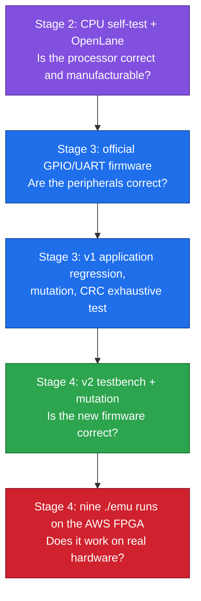
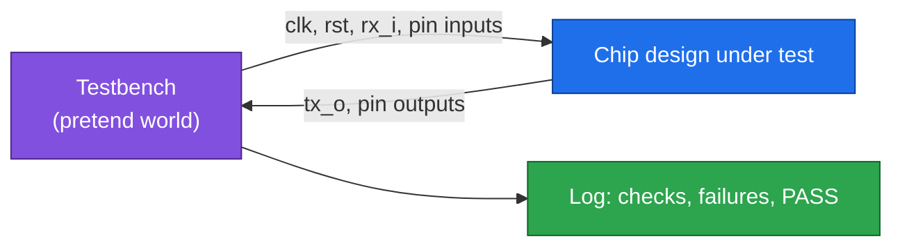
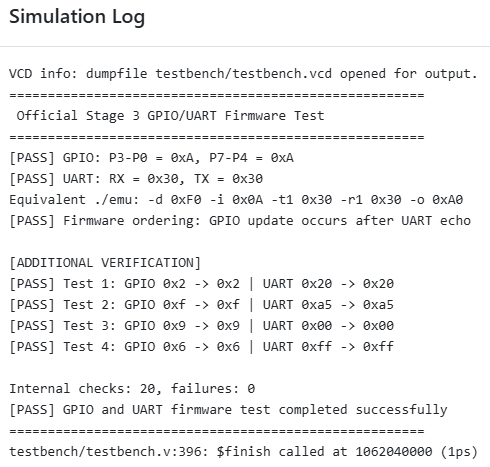
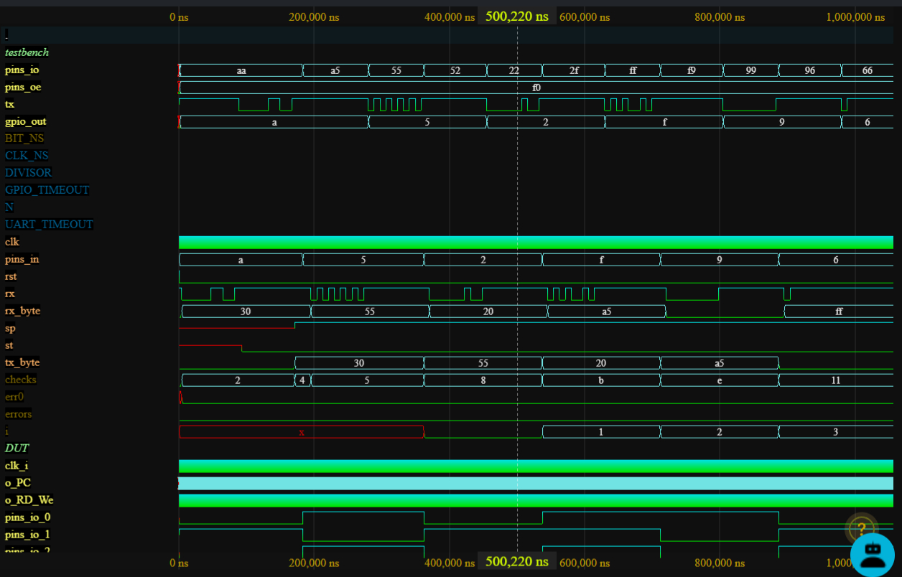
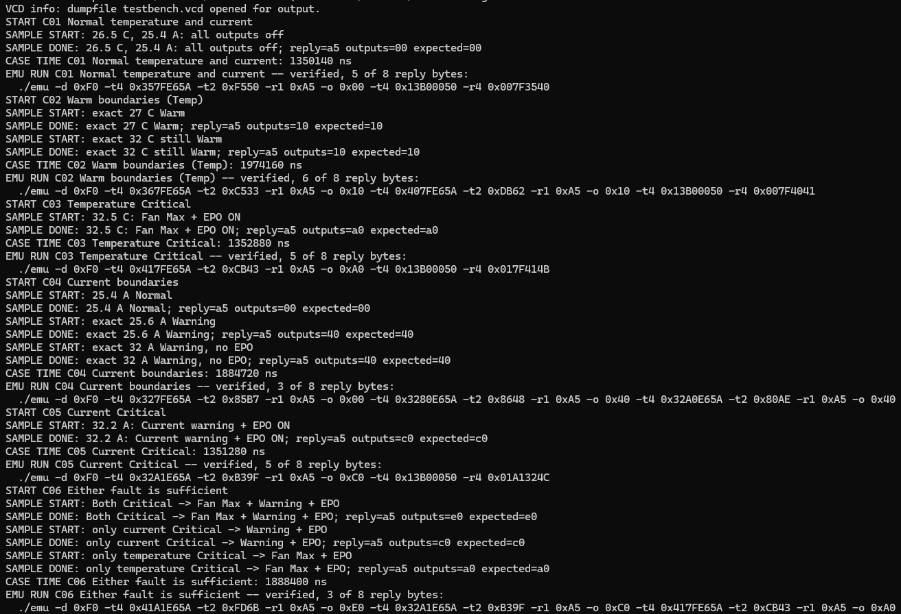
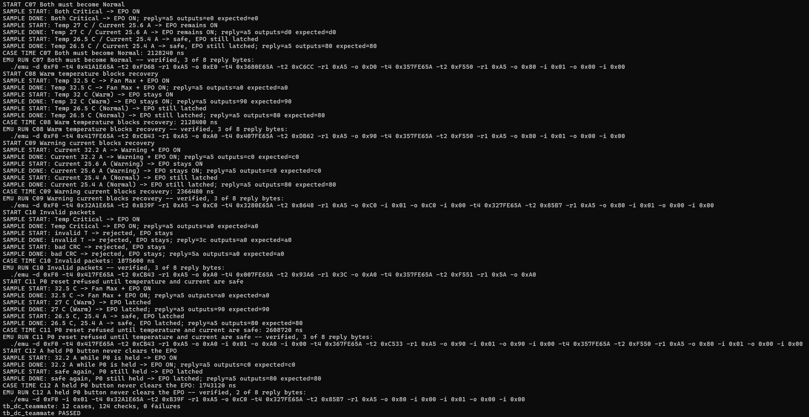
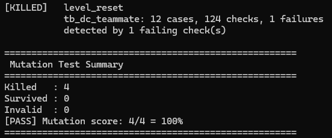
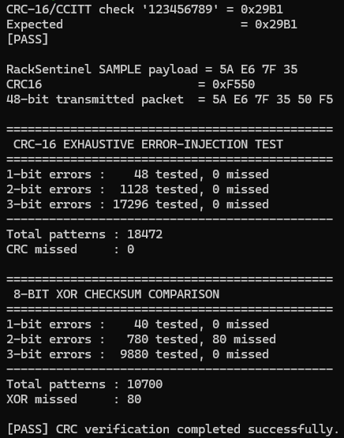

# 11 · Verification

> [!NOTE]
> **After this chapter you will know**
> How each stage was proved, from the CPU self-test in Stage 2 to nine runs on real FPGA hardware in Stage 4; what each test actually shows; why we also test the tests (mutation); and which numbers you can rerun from this workspace.

## The proof ladder

> [!TIP]
> **Why a ladder?**
> If an application test failed, you would not know whether the **hardware** or the **software** was at fault. Each rung removes one doubt before the next is attempted.

## What is a testbench?

A **testbench** is a Verilog program that is **not** part of the chip. It pretends to be the outside world: it drives the clock, sends bytes on `rx_i` at 115,200 baud, presses P0, wets P1, and **checks** what comes back on `tx_o` and on the pins. It prints PASS or FAIL for each check.

---

## Stage 4: RackSentinel v2

### On the FPGA

The strongest evidence: the nine rehearsed `./emu` runs R1 to R9 executed on the AWS FPGA, **every printed line `[ok]`**. Screenshots, the Vivado log and the AFI status are in `stage4_fpga/evidence/`; the runs and what each proves are in [03](03-fpga-and-demo.md).

### In simulation (team results)

| Check | Result |
|---|---|
| Team testbench `tb_soc_rack.v` | **16 scenarios + 9 `./emu` runs, 524 checks**, on the local SoC and on the 8-pin canvas design |
| Mutation `mutate.sh` | **23 of 23** planted firmware bugs caught |
| Platform testbench `tb_platform_rack.v` | The 9 runs, one per ChipInventor batch, 1.2 to 2.7 ms each |
| Demo-page cases | Seeds 1 to 1,000 and R1 to R9 replayed on the RTL; stamp hash `A9E52850` |
| Build check | Team assembler and organiser Makefile produce bit-identical ROMs |

> [!WARNING]
> **Where these files are**
> The v2 testbenches and scripts live in the team's CoreX source repository, not in this workspace. The numbers above are reported in `stage4_fpga/README.md` and `SPEC.md`.

### Checked independently in this workspace (2026-10-13)

- The nine command lines generated by `rack_demo.html` are identical to those in the nine FPGA screenshots.
- The demo page's model hash recomputes to `A9E52850`, matching its stamp.
- The ROM in `riscv.sv` holds 547 instructions (`0x00400000` to `0x00400888`).
- The Vivado log reports 0 errors and routed WNS +0.711 ns.

---

## Stage 3: the SoC and RackSentinel v1

All Stage 3 files are in `stage3_soc/submission/`; commands to rerun them are in [12](12-build-and-reproduce.md).

### Official GPIO/UART firmware

`testbench/tb_official_test.v` against `rtl/hdl/hdl_official_test.v` (organiser ROM, 21 words). It exercises pin direction, copying P3..P0 to P7..P4, UART receive, transmit and ordering.

> [!TIP]
> **Result**
> `Internal checks: 20, failures: 0`, `[PASS] GPIO and UART firmware test completed successfully`.

### v1 application regression: C01 to C12

`testbench/tb_data_center_application.v` against `rtl/hdl/hdl_application.v`. Every case starts from reset.

> [!TIP]
> **Result**
> `12 cases, 124 checks, 0 failures`.

| Case | What is proved (v1 rules) |
|---|---|
| C01 | Normal reading: all outputs off, STATUS correct |
| C02 | 27.0 °C and exactly 32.0 °C are Warm |
| C03 | 32.5 °C: max fan and EPO on the first reading |
| C04 | 25.4 A Normal; 25.6 A and 32.0 A warning only |
| C05 | 32.2 A: warning and EPO |
| C06 | Either fault alone latches the EPO |
| C07 | Safe readings alone do not clear the EPO; P0 does |
| C08 | Warm blocks recovery |
| C09 | Warning current blocks reset |
| C10 | Invalid reading gives `3C`, bad CRC gives `5A`, state unchanged |
| C11 | Reset refused while Critical or Warm, accepted when safe |
| C12 | A held P0 never clears the EPO |

> [!NOTE]
> **The testbench prints "tb_dc_teammate"**
> It was adapted from a teammate's earlier test and kept its print name.

### Mutation testing: testing the tests

A test that never fails proves nothing. **Mutation testing** plants a realistic bug in the firmware and checks that the regression **catches** it (the mutant is **killed**).

| Mutant | Planted bug | Result |
|---|---|---|
| M1 | EPO clears automatically | Killed |
| M2 | Reset allowed while Warm | Killed |
| M3 | Reset allowed at the current-warning level | Killed |
| M4 | No edge detection (a held button resets) | Killed |

v2 extends the same idea to **23 mutants** covering the new features.

### Exhaustive CRC test

`extra_verification/crc_verify/crc_verify.py` is an independent Python CRC. It first checks the standard string `"123456789"` gives `0x29B1`, then flips **every** possible 1, 2 and 3 bits of the v1 SAMPLE frame.

| Bits flipped | Patterns | CRC-16 misses |
|---|---|---|
| 1 | 48 | 0 |
| 2 | 1,128 | 0 |
| 3 | 17,296 | 0 |
| **Total** | **18,472** | **0** |

An 8-bit XOR checksum missed **80 of 10,700** of the same patterns. v2 packets are shorter (4 bytes), so the same CRC is at least as strong on them.

### Traceability and emulator replay

- `main.s` rebuilt with the organiser Makefile matches the v1 ROM **275 of 275** words.
- The twelve `./emu` lines replay on the simulated SoC: **12 of 12** pass. (Stage 3 did not run them on the FPGA; Stage 4 does that for v2.)

---

## Stage 2: the CPU

| Check | Result |
|---|---|
| Organiser firmware self-test (254 instructions) | **PASS**: PC settles at `0x004003EC`, x4 = 0 |
| OpenLane RTL-to-GDSII, sky130 | Completed; DRC 0, LVS clean, timing met at 25 MHz |

Details in [05](05-the-cpu.md).

## Scoreboard

| Stage | Evidence | Result |
|---|---|---|
| 2 | CPU self-test | PASS |
| 2 | OpenLane | DRC 0, LVS 0, WNS 0.0 ns |
| 3 | Official GPIO/UART firmware | 20 checks, 0 failures |
| 3 | v1 regression | 12 cases, 124 checks, 0 failures |
| 3 | v1 mutation | 4 of 4 killed |
| 3 | CRC exhaustive | 18,472 tested, 0 missed |
| 4 | v2 testbench | 524 checks (team) |
| 4 | v2 mutation | 23 of 23 killed (team) |
| 4 | **FPGA hardware runs** | **9 of 9, every line `[ok]`** |

Next: [12 Build and reproduce](12-build-and-reproduce.md)
