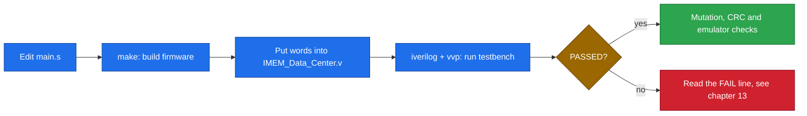
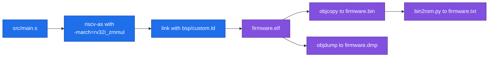

# 12 · Build and reproduce

> [!NOTE]
> **After this chapter you will know**
> How to run RackSentinel v2 on the AWS FPGA and the demo page, how to start the digital twin, and the exact commands that rerun the Stage 3 results in [11](11-verification.md).

## Stage 4: RackSentinel v2 on the AWS FPGA

The full walkthrough, with screenshots, is in [03](03-fpga-and-demo.md) and `stage4_fpga/organiser/Stage4_AWS_Guide.pdf`. In short:

1. In ChipInventor's **AWS FPGA** area, create `riscv.sv` and `top.sv` from `stage4_fpga/` next to the provided `cl_ports.vh`. **Save Project**, then **Start Synthesis**.
2. Wait until the image is `available`:

```bash
aws ec2 describe-fpga-images --fpga-image-ids afi-0d0eb57f78ad69e3b --region us-east-1
```

3. Load and reset:

```bash
sudo fpga-clear-local-image -S 0
sudo fpga-load-local-image -S 0 -I agfi-0a4f37f7744a84a88
./axil_rw write 0 0x00 0 && sleep 1 && ./axil_rw write 0 0x00 1 && sleep 1
```

4. Run a rehearsed case, for example R1:

```bash
./emu -d 0xF0 -t4 0xFE072C20 -r1 0xA5 -o 0x00 -t4 0x04FA6421 -r1 0xA5 -o 0x00 -t4 0x13B00050 -r4 0x00642C40
```

Every line should print `[ok]`. Reset before each run.

> [!NOTE]
> **Rebuilding `riscv.sv`**
> `riscv.sv` is generated from the canvas export and the v2 ROM by `CoreX/aws/gen_riscv.py`, in the team's CoreX source repository. Do not hand-edit it.

## The demo page

Open `stage4_fpga/rack_demo.html` in any browser. It needs no network and no server. Pick a rehearsed run or a seed, copy the `./emu` line, run it on the FPGA, and paste the output into **Compare with the FPGA**.

## The digital twin

`racksentinel-twin/` is a Next.js app (Node 20 or later):

```bash
cd racksentinel-twin
npm install
npm run dev        # http://localhost:3000
npm test
```

Pages: `/` (the twin), `/features` and `/data-flow`. The controller model (`src/sim/controller.ts`) is the v2 firmware; `npm test` replays the nine FPGA runs and the 1,000 RTL-verified demo cases against it.

## Stage 3: rerun the v1 results

Run these from `stage3_soc/submission/`.

### What you need

| Tool | Used for | Version used |
|---|---|---|
| **Icarus Verilog** (`iverilog`, `vvp`) | Simulate the chip | 12.0 |
| **RISC-V GCC toolchain** | Assemble `main.s` | 14.2.0 |
| **GNU Make** | Run the organiser builder | 4.4.1 |
| **Python 3** | CRC test, emulator replay, ROM conversion | 3.14.4 |

Ubuntu or WSL:

```bash
sudo apt update
sudo apt install -y make python3 iverilog gcc-riscv64-unknown-elf
```

### The workflow



### 1. Official GPIO/UART test

```bash
iverilog -g2012 -o official.out testbench/tb_official_test.v rtl/hdl/hdl_official_test.v
vvp -n official.out
```

Expected last lines:

```text
Internal checks: 20, failures: 0
[PASS] GPIO and UART firmware test completed successfully
```

### 2. Application regression (C01 to C12)

```bash
iverilog -g2012 -o application.out testbench/tb_data_center_application.v rtl/hdl/hdl_application.v
vvp -n application.out
```

Expected last lines:

```text
tb_dc_teammate: 12 cases, 124 checks, 0 failures
tb_dc_teammate PASSED
```

> [!TIP]
> **Run one case only**
> At the top of the testbench set `FIRST_RUN` and `LAST_RUN` to the same number `k`. The ChipInventor platform has a roughly 3 ms simulation window, so on the platform run one or two cases at a time.

### 3. Mutation test

```bash
bash extra_verification/mutation_test/mutate_final.sh
```

Needs `iverilog`, `vvp`, `python3` and `riscv64-unknown-elf-{as,gcc,objcopy}`. Expected:

```text
Killed   : 4
Survived : 0
Invalid  : 0
[PASS] Mutation score: 4/4 = 100%
```

### 4. CRC exhaustive test

```bash
python3 extra_verification/crc_verify/crc_verify.py
```

Expected key lines:

```text
CRC-16/CCITT check '123456789' = 0x29B1
Total patterns : 18472
CRC missed     : 0
[PASS] CRC verification completed successfully.
```

### 5. Emulator replay

```bash
bash emulator/emu.sh --all
```

Expected last line: `emu_sim: 12 of 12 ./emu runs passed`. Single run:

```bash
bash emulator/emu.sh -d 0xF0 -t4 0x417FE65A -t2 0xCB43 -r1 0xA5 -o 0xA0
```

### 6. Rebuild the firmware with the organiser builder

```bash
make -C RVBL-Firmware-Builder clean
make -C RVBL-Firmware-Builder
cmp RVBL-Firmware-Builder/build/firmware.bin firmware/firmware_application/firmware.bin && echo IDENTICAL
```

Expect **1,100 bytes / 275 words** and `IDENTICAL`.



> [!WARNING]
> **The builder wants one exact filename**
> The organiser Makefile looks for **`src/main.s`**. That is why the application source is named `main.s`.

### ChipInventor platform (what we did online)

| Step | What happens |
|---|---|
| Build the canvas | Drag the 15 custom blocks, 8 Inout Pins and the ROM; wire them |
| Export | The tool generates the top-level Verilog (`hdl.v`) |
| Simulate | Paste a testbench, run, read the log |

> [!CAUTION]
> **Never hand-edit exported files**
> The exported top-level file is **regenerated** whenever you export the canvas. Hand edits are silently lost. Edit the **modules** or the **firmware source** instead, then re-export.

### Generated files you can delete

Scripts create `build/` folders and `.out` / `.vcd` files. They are outputs, not part of the package.

## Stage 3 report

```bash
cd stage3_soc/report
./build.sh figs     # optional: rebuild the figures first
./build.sh          # LuaLaTeX + BibTeX -> Stage_3_Report_v2.pdf
```

## Stage 2

The Stage 2 CPU was built and run on the ChipInventor platform; its OpenLane outputs are in `stage2_cpu/openlane/`. The original notes in `stage2_cpu/docs/FIRMWARE_AND_SIM.md` describe the reference testbench for the CPU self-test.

Next: [13 Troubleshooting](13-troubleshooting.md)
