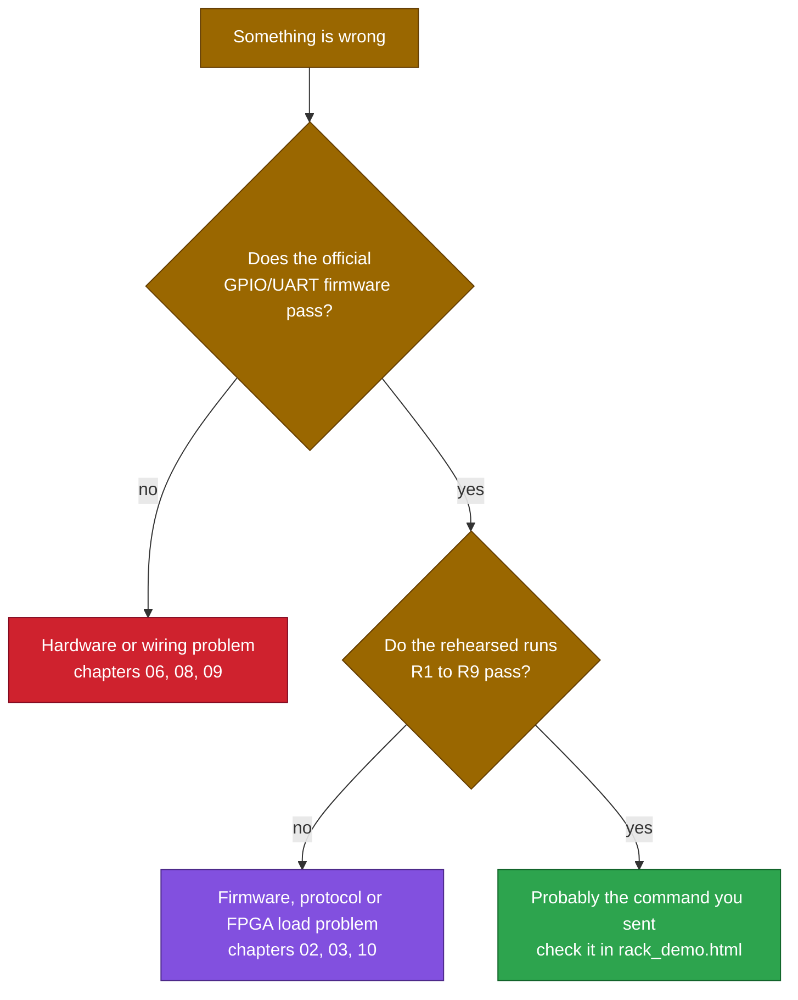

# 13 · Troubleshooting

> [!NOTE]
> **How to use this chapter**
> Find the **symptom**, check the **likely cause**, then look at the signals or files listed. Items come from real pitfalls in this project. Rules are for **v2**.

## First, locate the layer



## On the AWS FPGA

| Symptom | Likely cause | What to do |
|---|---|---|
| `./emu` hangs or prints no `RISC-V started!` | Image not loaded, or not reset | `fpga-describe-local-image -S 0`; reload with `fpga-load-local-image`; run the `axil_rw` reset |
| `describe-fpga-images` shows `pending` | AFI still being generated | Wait until `available` |
| Every reply is wrong after a previous run | State left over from the last run | Reset with `axil_rw` before each run |
| First run fine, later run off by a trip count | Same: the chip remembers trips and energy | Reset between runs; every rehearsed run assumes a fresh chip |
| `[error] ... OUT read error` | Pins differ from the expected `-o` value | Paste the output into `rack_demo.html` to see which step and what the value means |
| `[error] ... UART read error` | Reply byte differs | Same; check the CRC in the `-t4` value first |
| More than 8 reply bytes requested | `./emu` limit | Split the case into two runs |

## Protocol and behaviour

| Symptom | Likely cause | What to check |
|---|---|---|
| Every packet gets `5A` | CRC wrong | CRC over **command and data** only, start `0xFFFF`, low byte first; `-t4 0x{CRC}{DATA}{CMD}` |
| Packet gets `3C` | Invalid value or unknown command | TEMP not 0 or 255; voltage 180 to 254; SET value not 0 or 255; queries need data 0; v1 commands (`0x40`, `0x48`, `0x5A`) no longer exist |
| `SET_WARM` / `SET_HOT` / `SET_CRIT` refused | Would break Warm < Hot < Critical | Change them in an order that keeps the ordering true |
| No reply at all | A packet byte timed out (about 8 s on the FPGA) | Send all four bytes together |
| Thresholds changed but pins did not | Class is only recomputed on the next `TEMP` | Send a new reading |
| Overload alarm turned off by itself | By design: it follows the latest reading | Send a higher current to see it again |
| Power cut on a normal reading | A setting has a 2-bit ECC error (STATUS bit 7) | `COUNTERS` byte 2; rewrite the setting with its `SET_*` command |
| Power cut while still Normal | Thermal runaway: a rise of 2.0 °C or more since the last reading | `TRIP_INFO` cause `02`; raise or turn off the limit with `SET_RISE` |
| Power cut with no message sent | Leak sensor P1 is wet | STATUS bit 4; `TRIP_INFO` cause `04` |
| `TRIP_INFO` byte reads `FF` | That trip-record byte had a 2-bit ECC error | Harmless; it never blocks a reset |

## Why the P0 reset "does nothing" (most common question)

> [!NOTE]
> **Walk through these in order**
> 1. Is the power-off actually latched? (P7 high, STATUS bit 3)
> 2. Is the **latest** temperature below Critical (under 35.0 °C)? Send a fresh `TEMP` first.
> 3. Was the latest reading **not** a runaway? (STATUS bit 5) Send another reading with a smaller rise.
> 4. Is the leak sensor dry? (`-i` bit 1 = 0)
> 5. Is any setting in fault? (STATUS bit 7) Rewrite it.
> 6. Was it a **new** press? Release P0, then press again.

## Hardware and simulation

| Symptom | Likely cause | What to check |
|---|---|---|
| Pins never change | `DATADIR` not set, or direction reversed | Bit = **1 is output** |
| Output pin shows `Z` | Pin still an input | `o_Pins_Oe` for that bit |
| DATAIN does not show what I wrote | By design: DATAIN holds while a pin is an output | Read DATAOUT instead |
| Simulator hangs at the first GPIO or UART read | Peripheral selects built inside an `always` block | Keep decoder selects as continuous `assign` |
| UART echoes the same byte repeatedly | RXDONE not cleared | Write 0 to CONTROL after each receive |
| Nothing transmitted | TRANSMIT never set | A TXDATA write alone does nothing |
| Replies garbled | Baud divisor wrong | 217 at 25 MHz; 271 at 31.25 MHz |
| Assembler rejects `crcb` | Macro missing | Keep the `.insn` macro at the top of the source |
| Edited the exported top-level Verilog, change vanished | It is regenerated on export | Edit the module or the firmware instead |
| `rack_demo.html` says "NOT pre-verified" | Seed above 1,000, or the model block was edited | Use seeds 1 to 1,000; do not edit the model |

## Reading a testbench failure

```text
[FAIL] t=<time> <what>: got 0x.., expected 0x..
```

`t=` is the simulation time; `what` names the check; pin values are hex of P7..P0 (`A0` = fans at maximum + power-off). `-r4` shows the first reply byte as the **least significant**.

## Waveform signals worth looking at

| Signal | Why |
|---|---|
| `o_PC` | Where the CPU is in the program |
| `o_State` | 0 FETCH, 1 DECODE, 2 EXECUTE, 3 WRITEBACK |
| `rx_i`, `tx_o` | The serial lines |
| `pins_io_0..7` | The GPIO pins |

> [!TIP]
> **Stuck PC**
> If the PC loops in a small range, the firmware is waiting: for RXDONE, TXDONE, or a timeout.

Next: [14 Project journey](14-project-journey.md)
