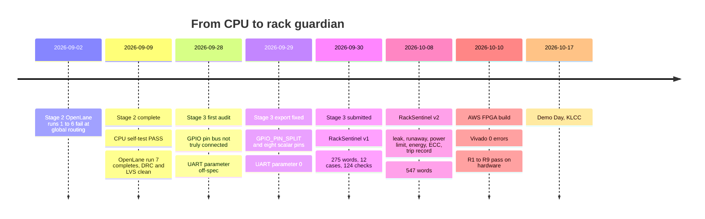

# 14 · Project journey: Stage 2 to Stage 4

> [!NOTE]
> **After this chapter you will know**
> How the project evolved from a bare CPU to a protected rack controller on an FPGA, what changed between RackSentinel **v1** (Stage 3) and **v2** (Stage 4), how the team's feature list maps onto v2, the real bugs we fixed along the way, and the v1 rules for reference.

## Timeline

## Stage 2: the CPU

Six bring-up stages on the ChipInventor canvas, from a fetch loop to the organisers' full firmware self-test, then the OpenLane physical-design flow. Two lessons carried forward: **test after every addition**, and **the bug is often in the wiring, not the block**. The full story is in [05](05-the-cpu.md).

## Stage 3: the SoC and RackSentinel v1

Stage 3 added GPIO, UART, the pin splitter and a larger address decoder, proved them with the organisers' test firmware, then swapped the ROM for RackSentinel v1.

### Two real integration bugs

> [!WARNING]
> **GPIO pins looked connected but were not**
> The first export had one 8-bit pin bus at the top level, but the GPIO pad block's `pins_io` port was left unconnected, so no pin could really be driven or read. Fix: the **GPIO_PIN_SPLIT** block and eight scalar Inout Pins.

> [!WARNING]
> **UART parameter not at the spec value**
> The organisers' rule is that **only** `CONTROL.TRANSMIT` starts a send. The first export had `TX_ON_TXDATA_WRITE = 1` (also send on a TXDATA write). Fix: set it to `0`. The firmware always sets TRANSMIT, so the functional impact was low, but the spec value matters.

### How the Stage 3 application settled

| | First draft | Teammate version | **Submitted v1** |
|---|---|---|---|
| Application | Power and energy features, 488 words | Simpler "DC teammate app" | **RackSentinel**: temperature + current + latched EPO, 275 words |
| EPO | Cleared by safe readings | Latching idea introduced | **Latched; cleared only by a new P0 press under safe conditions** |
| Tests | None runnable | 13 cases | **12 cases, 124 checks**, mutation, CRC, traceability |

## Stage 4: from v1 to v2

### What changed

| Area | v1 (Stage 3) | v2 (Stage 4) |
|---|---|---|
| **Runs on** | Simulation and the ChipInventor simulator | **AWS FPGA**, Vivado 2024.1, 31.25 MHz core |
| **Packet** | 6-byte SAMPLE `[5A][V][I][T][CRC]` plus 4-byte commands | **All packets 4 bytes**; separate `TEMP` and `CURRENT` |
| **Temperature classes** | Normal < 27.0, Warm 27.0 to 32.0, Critical **> 32.0** °C | Normal, Warm ≥ 27.0, Hot ≥ 32.0, Critical **≥ 35.0** °C (ASHRAE) |
| **On a threshold** | 32.0 °C exactly is Warm | A reading on a threshold takes the higher class |
| **P5** | Maximum fan on Critical | Maximum fan on **Hot or Critical** |
| **P6** | Current warning (≥ 25.6 A) | **Power overload** (V × I ≥ limit), non-latching |
| **P1** | Unused | **Water-leak sensor** |
| **EPO causes** | Critical temperature, current > 32.0 A | Critical, **thermal runaway**, **leak**, **config fault** |
| **Current trips the EPO?** | Yes | **No**; overload raises P6 only |
| **Reset allowed when** | Temperature Normal and current below warning | **Below Critical**, no runaway, leak dry, no setting in fault |
| **Voltage** | Measured, validated, never used | A **setting**, used in P = V × I |
| **Settings** | Warm, Critical (two-step via `STAGE_HIGH`), current warning, current trip | Warm, Hot, Critical, runaway limit, voltage, power limit; one command each |
| **Memory protection** | None | **SECDED ECC** on 9 words |
| **Queries** | STATUS, COUNTERS (CRC rejects) | STATUS, COUNTERS (3 counters), **ENERGY**, **TRIP_INFO** |
| **Firmware** | 275 instructions | **547 instructions** |
| **Verification** | 12 cases, 124 checks; mutation 4/4 | 524 checks; mutation 23/23; **9/9 on the FPGA** |

> [!CAUTION]
> **Command `0x46` changed meaning**
> In v1, `0x46` was `SET_WARN_CURRENT`; in v2 it is `SET_POWER_LIMIT`. `0x40`, `0x48` and the `0x5A` SAMPLE frame are gone and reply `3C`. Anything built for v1 sends the wrong commands to the v2 chip. (The digital twin was updated to v2 on 2026-10-13.)

### What stayed the same

- The SoC hardware: RVBL-2 core, GPIO, UART at 115,200 baud, address map, eight scalar pins, `TX_ON_TXDATA_WRITE = 0`.
- CRC-16-CCITT with `crcb`; replies `A5` / `5A` / `3C`.
- The latched power-off with an edge-detected P0 reset.
- The P4 to P7 layout and the `-d 0xF0` direction mask.

### The team's feature list, mapped to v2

| Team meeting item | v2 implementation |
|---|---|
| Inputs: temperature, current, water leak | `TEMP`, `CURRENT`, pin P1 |
| Adjustable: Warm / Hot / Critical | `SET_WARM`, `SET_HOT`, `SET_CRIT` (27.0 / 32.0 / 35.0 °C) |
| Adjustable: difference between first and second temperature | `SET_RISE`, the runaway limit (2.0 °C) |
| Adjustable: voltage | `SET_VOLTAGE` (230 V) |
| Adjustable: power limit | `SET_POWER_LIMIT` (5.9 kW) |
| New: ECC | SECDED on settings and trip record; `FLIP_TEST` self-test |
| New: power limit | P6 overload alarm |
| New: counter | `COUNTERS` (CRC rejects, ECC corrected, uncorrectable) + trips in `STATUS` |
| New: status | `STATUS` |
| New: trip info | `TRIP_INFO` |

Beyond the list: **energy metering** (`ENERGY`) and **thermal runaway** as a trip cause.

### Design decisions to be ready to defend

> [!NOTE]
> **Suggested answers**
> The specification states these rules but not the reasons. The answers below are suggested reasoning.

> [!NOTE]
> **Why does high current no longer cut the power?**
> Current now feeds a power calculation and an overload alarm meant for load shedding. Cutting power on a short overload would take down every server in the rack. The power-off is kept for threats to the hardware and the building: critical heat, cooling failure, water and untrustworthy settings. Upstream breakers still handle short circuits.

> [!NOTE]
> **Why can the operator reset while the rack is Warm or Hot?**
> The power-off trips on Critical, not Warm or Hot. Once below Critical with the cause gone, the fans (P4/P5) are still running and protecting the rack. Requiring Normal could keep a rack off for a long time in a warm hall.

> [!NOTE]
> **Why is voltage a setting instead of a measurement?**
> A data-centre feed voltage is close to constant. A setting keeps every packet at 4 bytes and lets the site choose 230 V or 240 V. A measured voltage is a natural next step.

## v1 rules, for reference

> [!NOTE]
> **Archive**
> These are the rules of the Stage 3 submission. They are **not** what the FPGA runs. Full detail: `stage3_soc/submission/README_RackSentinel_FINAL.md` and `TESTCASES_FINAL_C01-C12.md`.

**SAMPLE frame (6 bytes):** `0x5A`, voltage (1 V), current (0.2 A), temperature (0.5 °C), CRC low, CRC high. On the emulator: `-t4 0x{T}{I}{V}5A -t2 0x{CRC}`.

| v1 command | Hex | Purpose |
|---|---|---|
| `STAGE_HIGH` | `0x40` | Stage the high byte of a 16-bit threshold |
| `SET_WARM` / `SET_CRIT` | `0x41` / `0x43` | Temperature thresholds in 0.1 °C (with the staged byte) |
| `SET_WARN_CURRENT` / `SET_TRIP_CURRENT` | `0x46` / `0x48` | Current levels, raw |
| `STATUS` | `0x50` | Flags, temperature, current, trips |
| `COUNTERS` | `0x52` | CRC rejects + 3 zero bytes |
| `SAMPLE` | `0x5A` | Telemetry |

| v1 rule | Value |
|---|---|
| Warm | 27.0 °C and above (P4) |
| Critical | **above** 32.0 °C (P5 + EPO) |
| Current warning | 25.6 A and above (P6) |
| Current trip | **above** 32.0 A (P6 + EPO) |
| Reset | New P0 press, temperature Normal, current below warning |
| Temperature maths | `5 × raw` with `mul`, compared in 0.1 °C |

Next: [15 Limitations and next steps](15-limitations-and-next-steps.md)
