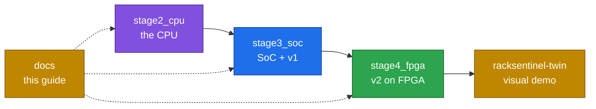

# 17 · File map

> [!NOTE]
> **After this chapter you will know**
> Where everything lives in the project folder, what each important file is for, and which files are safe to edit.

## The project folder

```text
ChipInventor_RISC-V/
├── README.md                 start here: project overview and folder guide
├── docs/                     this guide (open the folder as an Obsidian vault, or read on any Markdown viewer)
├── stage2_cpu/               Stage 2: the RVBL-2 processor
│   ├── design/               ChipInventor export: rtl/, hdl.v, config.json, logs
│   ├── docs/                 original Stage 2 engineering notes
│   └── openlane/             OpenLane run 7 (slimmed): config, reports, final GDS and netlist
├── stage3_soc/               Stage 3: the SoC and RackSentinel v1
│   ├── submission/           the submitted package, unchanged (own git history)
│   ├── report/               the Stage 3 LaTeX report, its PDF and evidence reruns
│   ├── platform_screenshots/ ChipInventor canvas and result screenshots
│   ├── organiser_reference/  organiser repository (emulator source emu.c, builder, test firmware)
│   └── Stage3_Submission_Guide.pdf
├── stage4_fpga/              Stage 4: RackSentinel v2 on the AWS FPGA
│   ├── riscv.sv, top.sv      the two files built on AWS
│   ├── SPEC.md               v2 specification
│   ├── rack_demo.html        offline demo page
│   ├── evidence/             Vivado log, AFI status, R1 to R9 screenshots
│   └── organiser/            AWS guide and pre-departure briefing
└── racksentinel-twin/        digital twin (Next.js, v2 rules) with /features and /data-flow pages
```



## Stage 4: `stage4_fpga/`

| File | What it is | Safe to hand-edit? |
|---|---|---|
| `riscv.sv` | Whole SoC + v2 ROM + AWS wrappers, generated by `CoreX/aws/gen_riscv.py` | **No**: regenerate |
| `top.sv` | Organisers' AWS top level, used unchanged | **No** |
| `SPEC.md` | v2 specification | Keep in sync with the firmware |
| `rack_demo.html` | Offline demo page: firmware model, R1 to R9, 1,000 pre-verified seeds, FPGA compare box | Only outside the `rack-model` script block; editing the model breaks the verification stamp |
| `README_CoreX.md` | the team's file guide for the CoreX repository (lists files that are not in this folder) | Yes |
| `evidence/` | `synthesis_log_2026-10-10.txt`, `afi_available.png`, `load_and_reset.png`, `fpga_emu_R1.png` to `R9.png` | **No**: evidence |
| `organiser/` | `Stage4_AWS_Guide.pdf`, `Stage4_PreDeparture_Briefing.pdf` | No |

## Stage 3: `stage3_soc/submission/`

| File | What it is | Safe to hand-edit? |
|---|---|---|
| `rtl/hdl/hdl_application.v` | SoC + v1 ROM, exported by ChipInventor | **No**: regenerated on export |
| `rtl/hdl/hdl_official_test.v` | Same SoC + organiser test ROM | **No** |
| `rtl/modules/*.v` | The 15 custom blocks | Yes, then re-export and rerun the tests |
| `rtl/imem/IMEM_Data_Center.v`, `IMEM_TESTFW.v` | v1 ROM (275 words), organiser ROM (21 words) | Only by regenerating |
| `firmware/firmware_application/main.s` | v1 firmware source | Yes |
| `testbench/` | Official test (20 checks), C01 to C12 (124 checks) | Carefully |
| `emulator/`, `extra_verification/` | `./emu` replay, mutation, CRC scripts | Rarely |
| `RVBL-Firmware-Builder/` | Organiser builder (Makefile, linker script, `bin2rom.py` unmodified) | **No** |
| `README_RackSentinel_FINAL.md`, `TESTCASES_FINAL_C01-C12.md` | Submission documents | No: record of what was submitted |

> [!NOTE]
> **The submission is a record**
> `stage3_soc/submission/` is kept exactly as submitted, with its own git history. Its internal duplicates (for example `README.md` and `README_RackSentinel_FINAL.md`, and the builder's `build/` outputs) are part of that record.

Other Stage 3 folders:

| Folder | Contents |
|---|---|
| `report/` | `main.tex`, `sections/`, `figures/` (with sources in `figures/src/`), `build.sh`, the PDF, and `sim/` with the reruns behind the report's figures |
| `platform_screenshots/` | Canvas screenshots and `New_Screenshots/Result_Screenshots.pdf` (platform logs per case) |
| `organiser_reference/` | `RVBL-Emulator/src/emu.c` (the organisers' emulator source), `RVBL-GPIO-UART-Test-Firmware/`, and a builder copy whose `src/main.s` and `build/` hold a teammate's firmware, not the organisers' original |

## Stage 2: `stage2_cpu/`

| Path | Contents |
|---|---|
| `design/rtl/` | The 13 CPU modules and `top.v` (with mock memories, as used for OpenLane) |
| `design/hdl.v` | Flattened export, identical to `rtl/top.v` |
| `design/config.json` | The OpenLane configuration used |
| `design/logs/` | Synthesis log of the successful run |
| `docs/` | Original Stage 2 notes: architecture, wiring, bring-up stages and bugs, platform notes, a long beginner explanation, `visual-guide.html` |
| `openlane/builds/…/` | `config.tcl`, `reports/` (metrics, DRC, LVS, antenna, timing summaries), `results/final/` (GDS, gate-level netlist, DEF, LEF, LIB, SDC), logs |

> [!NOTE]
> **OpenLane was slimmed**
> The original run was 2 GB. The temporary files, intermediate per-stage results, multi-megabyte timing path dumps and regenerable parasitics (SPEF, SDF, MAG, SPICE) were removed; everything needed to show the result is kept (about 83 MB).

## Where the truth lives

When files disagree, trust them in this order:

1. **Firmware and module RTL**: `stage4_fpga/riscv.sv` for v2; `main.s` and `rtl/modules/` for v1.
2. **The specification**: `stage4_fpga/SPEC.md`.
3. **Evidence**: logs and screenshots.
4. **Descriptions**: READMEs, the report, this guide.

## Keeping this guide current

> [!WARNING]
> **When something changes**
> If the firmware, a threshold, a command or a test changes, re-check [01](01-racksentinel.md), [02](02-rules-and-protocol.md), [03](03-fpga-and-demo.md), [10](10-firmware.md), [11](11-verification.md).

Back to the [index](README.md).
