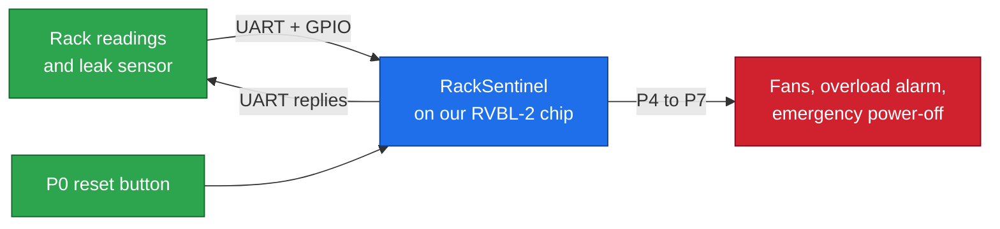

# RackSentinel on RVBL-2: the guide

> [!NOTE]
> **What this guide is**
> A complete, plain-language guide to the project by **Equipe 31 / Team CoreX** for ChampionCHIP eXperience Malaysia 2026: our own RISC-V processor (Stage 2), the chip built around it (Stage 3), and **RackSentinel v2** running on the **AWS FPGA** (Stage 4). It assumes you know nothing about chips, CPUs or Verilog.
> Current as of **2026-10-13**. Everything describes **v2** (the firmware on the FPGA) unless it says otherwise.

> [!TIP]
> **The one-minute version**
> We designed a small RISC-V processor, gave it pins and a serial port, and programmed it to guard a server rack. **RackSentinel** reads temperature, current and a water-leak sensor, checks every message for corruption, runs the fans, raises an overload alarm, and **cuts the power** when the rack is in danger. The power stays off until a human resets it and every danger is gone. Its safety settings use **error-correcting memory**. It runs on a real FPGA in the AWS cloud: nine of nine test runs passed on the hardware.

## Reading paths

| You are... | Read | Time |
|---|---|---|
| New to everything | [00](00-start-here.md), then Part 1, then Part 2 in order | 2 to 3 hours |
| In a hurry | [00](00-start-here.md), [01](01-racksentinel.md), [03](03-fpga-and-demo.md) | 30 min |
| Sending commands to the chip | [02](02-rules-and-protocol.md) | 20 min |
| Rerunning results | [12](12-build-and-reproduce.md) | 20 min |
| Something broke | [13](13-troubleshooting.md) | 10 min |
| Hunting for a word | [Glossary](GLOSSARY.md) | any |

## Chapters

| # | Chapter | In one sentence |
|---|---|---|
| 00 | [Start here](00-start-here.md) | **Read first.** The story from Stage 2 to 4, one analogy, five rules of thumb |
| | **Part 1 · RackSentinel** | |
| 01 | [RackSentinel](01-racksentinel.md) | The problem, Ali's day, the six protection features, why the power-off is latched |
| 02 | [Rules and protocol](02-rules-and-protocol.md) | Packets, commands, flags, ECC, power and energy, decoded examples |
| 03 | [FPGA deployment and demo](03-fpga-and-demo.md) | The AWS build, the evidence, runs R1 to R9, the demo page |
| | **Part 2 · The chip** | |
| 04 | [Digital basics](04-digital-basics.md) | Bits, clocks, registers, memory, pins, serial: the minimum vocabulary |
| 05 | [The CPU (Stage 2)](05-the-cpu.md) | RVBL-2, its 44 instructions, how we built it, the OpenLane result |
| 06 | [SoC and memory map](06-soc-and-memory-map.md) | All the blocks, who talks to whom, and the address of everything |
| 07 | [Module reference](07-module-reference.md) | Every Verilog block, what it does, and why it exists |
| 08 | [GPIO](08-gpio.md) | The eight pins that let the chip touch the real world |
| 09 | [UART](09-uart.md) | The serial link: how bytes travel in and out |
| | **Part 3 · Firmware and proof** | |
| 10 | [Firmware](10-firmware.md) | The v2 program: main loop, ECC routines, the trip, the outputs |
| 11 | [Verification](11-verification.md) | How every stage was proved, up to nine runs on real hardware |
| 12 | [Build and reproduce](12-build-and-reproduce.md) | Commands to rerun the results and to build for the FPGA |
| 13 | [Troubleshooting](13-troubleshooting.md) | Symptom, cause, fix |
| | **Part 4 · Context** | |
| 14 | [Project journey](14-project-journey.md) | Stage 2 to 4, v1 versus v2, the bugs we fixed, the v1 rules |
| 15 | [Limitations and next steps](15-limitations-and-next-steps.md) | What we do not claim, open items, realistic next steps |
| 17 | [File map](17-file-map.md) | Where everything lives and what is safe to edit |
| - | [Glossary](GLOSSARY.md) | Every term, explained once |

## Colour guide used in these notes

> [!NOTE]
> **Blue note**
> Extra explanation.

> [!TIP]
> **Green tip**
> A shortcut or a good habit.

> [!NOTE]
> **Purple example**
> A worked example with real numbers.

> [!WARNING]
> **Orange warning**
> Something that commonly goes wrong.

> [!CAUTION]
> **Red danger**
> Something that can silently give wrong results.

> [!TIP]
> **Green success**
> A verified result.

---
Start reading: [00 Start here](00-start-here.md)
