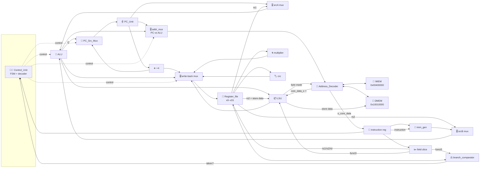
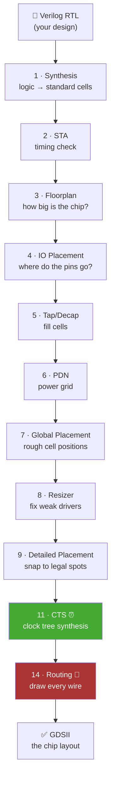

# 🧠 The Whole Project, Explained From Zero

> **Who this is for:** you, pretending you've never seen this project before.
> **What it covers:** what you built, what every part does, why every wire goes where it goes,
> what the squiggly waveform pictures actually prove, and what "OpenLane" is doing at the end.
> **Rule I'm following:** every technical thing gets an everyday analogy first, then the real thing.

**Companion:** there is an interactive visual guide (block diagrams, animated datapath, annotated
waveforms) — link at the very bottom of this file.

---

> ## ⚠️ Read this before the analogies
>
> This walkthrough was written against an earlier version of the design, in which each small
> function sat in its own block on the canvas. The **exported design**
> (`design-2026.09.08/`) groups them differently. The *ideas* below are all still correct —
> a splitter still splits, a format chart still picks the immediate format — but several of
> them are no longer separate blocks you can point at.
>
> | The analogy calls it | Where it actually lives now |
> |---|---|
> | `ir_splitter` (the highlighter) | inside **`Datapath_Mux`** — plain bit-slices of the instruction register |
> | `Imm_Sel_Decoder` (the format chart) | **gone.** `IMM_GENERATOR` reads the opcode itself and has no select input |
> | `PC_Register`, `PC_Plus4_Adder`, `PC_Src_Mux` | inside **`PC_Unit`** |
> | `IR_Register`, `WB_Mux`, `alu_srca_mux`, `alu_srcb_mux`, `addr_mux` | inside **`Datapath_Mux`** |
> | `inverterC` (the reset translator) | **gone.** Reset is active-high everywhere |
> | `imm_gen` / `multiplier` / `crc` / `ALU` | `IMM_GENERATOR` / `MULT_Unit` / `CRC16_Unit` / `alu` |
>
> Two more corrections worth carrying with you: the LSU also **aligns the address** (it sits
> between the datapath and the Address Decoder, not off to the side), and there is only **one
> IMEM**, holding the real firmware — no mock version exists in the export.
>
> For the current structure with nothing simplified, read
> [ARCHITECTURE.md](ARCHITECTURE.md) and [WIRING.md](WIRING.md).

---

## 📖 Table of Contents

| # | Section | What you'll get |
|---|---------|-----------------|
| 0 | [The 60-second version](#0-the-60-second-version) | The whole project in one paragraph |
| 1 | [The Kitchen](#1-the-kitchen--the-master-analogy) | The one analogy everything else hangs off |
| 2 | [What a CPU actually is](#2-what-a-cpu-actually-is) | Why any of this exists |
| 3 | [An instruction is 32 bits of meaning](#3-an-instruction-is-32-bits-of-meaning) | How to read machine code |
| 4 | [The heartbeat: clock, reset, 4 beats](#4-the-heartbeat-clock-reset-and-the-4-beat-rhythm) | The FSM that drives everything |
| 5 | [The map of the world](#5-the-map-of-the-world-memory) | Memory map + address decoding |
| 6 | [Meet every block](#6-meet-every-block) | All ~20 blocks, one at a time |
| 7 | [Why the wiring is like that](#7-why-the-wiring-is-like-that) | Every wire group, justified |
| 8 | [Follow 7 instructions through the machine](#8-follow-7-instructions-through-the-machine) | Beat-by-beat traces |
| 9 | [How to read the waveforms](#9-how-to-read-the-waveforms) | Your actual screenshots, decoded |
| 10 | [The bugs and what they taught](#10-the-bugs-and-what-they-taught) | Especially THE big one |
| 11 | [From circuit to silicon: OpenLane](#11-from-circuit-to-silicon-openlane) | The last mile |
| 12 | [Glossary](#12-glossary) | Look-up table |
| 13 | [One-page cheat sheet](#13-one-page-cheat-sheet) | Print this |

---

## 0. The 60-second version

You and 4 teammates each built one part of a **computer processor**. Not a program that
*simulates* a processor — the actual digital circuit, described in a hardware language (Verilog),
drawn as blocks-and-wires on a cloud tool called **ChipInventor**.

Your job (Member 5) was **not** to build a part. It was to be the person who:

1. **Wires all five people's parts together** into one machine that actually runs,
2. **Proves it works** by running an official test program on it and watching the electrical
   signals in a waveform viewer,
3. **Converts the working circuit into an actual chip layout** — a file a factory could use to
   print silicon — using a tool called **OpenLane**.

The processor understands the **RISC-V** instruction set — specifically `RV32I` (the 32-bit
integer basics), plus `Zmmul` (multiply), plus `Xicrc` (a custom checksum instruction your team
added). It's a **multicycle** design: every instruction takes exactly **4 clock ticks**.

**Status:** all three steps are done and verified — the official firmware runs and reports PASS,
and (as of the 9 Sep 2026 run) OpenLane completed the full flow to a clean, DRC/LVS-passing
GDSII. What's left is packaging: report writeup and the video.

---

## 1. The Kitchen — the master analogy

Every single block in your design maps onto one role in a **one-chef sandwich kitchen**.
Memorise this table and the rest of the document explains itself.

| Kitchen thing | The real block | What it does |
|---|---|---|
| 📕 **The recipe book** bolted to the wall | **IMEM** (instruction memory) | Holds the program. Read-only. Has an **appendix of reference numbers** in the back. |
| ☝️ **Your finger** on the current recipe line | **PC_Unit** (Program Counter) | Remembers *which line* of the program we're on. |
| ➕ **Sliding your finger down one line** | **PC_Plus4_Adder** | Every instruction is 4 bytes, so "next line" = address + 4. |
| 🔀 **Deciding: next line, or jump to another page?** | **PC_Src_Mux** | Normal flow vs. branch/jump. |
| 📝 **The sticky note** where you copy the current line | **instruction register** (inside `Datapath_Mux`) | Your finger will move on; you need the line written down to keep working on it. |
| ✂️ **Highlighting parts of the sentence** | **field slicing** (inside `Datapath_Mux`) | Pulls out "which verb", "which bowl A", "which bowl B", "which output plate". |
| 👨‍💼 **The manager** who reads the order and shouts commands | **Control_Unit** | The brain. Decodes the instruction and tells every other block what to do this tick. |
| 🥣 **32 labelled prep bowls** on the counter | **Register_file** | The CPU's 32 ultra-fast scratch variables (`x0`–`x31`). `x0` is a bowl with a hole in it — always empty, always zero. |
| 🔪 **The chopping / mixing station** | **ALU** | Add, subtract, AND, OR, XOR, shift, compare. The general-purpose worker. |
| 🌀 **The heavy-duty blender** (specialist) | **multiplier** | Only does multiplication. Too expensive to build into the chopping station. |
| 🏷️ **The label / checksum stamper** (specialist) | **crc** | Computes a CRC checksum. Your team's custom extension. |
| 🔢 **The number written into the recipe itself** | **imm_gen** | "add **10**" — the 10 lives inside the instruction, and this block digs it out. |
| 📋 **The "what kind of number is this?" chart** | **`IMM_GENERATOR`** | Reads the opcode itself and picks one of 5 immediate formats. |
| ⚖️ **The taster who answers yes / no** | **branch_comparator** | "Is bowl A equal to bowl B?" → decides if a branch is taken. |
| 📦 **The packer / unpacker** at the fridge door | **LSU** (Load-Store Unit) | Knows how to store a whole box, half a box, or a single item — and how to unwrap one on the way back. |
| 🧭 **The receptionist / mail sorter** | **Address_Decoder** | "Is this request for the recipe book, or for the fridge?" Routes it and brings the answer back. |
| 🧊 **The walk-in fridge** | **DMEM** (data memory) | 8 KB of read/write storage. Slower than the bowls. |
| 🎚️ **Rotary selector switches** | the 4 **muxes** | "Which of these pipes do I open right now?" |
| 🥁 **The metronome** | `clk_i` (clock) | Everything moves on the beat. Nothing commits between beats. |
| 🔔 **The start-of-shift bell** | `rst_i` (reset, **active-high**) | Clears everything to a known starting state. |

Two more, because they matter:

- 🍱 **A "dish"** = one instruction.
- 🎵 **Four beats per dish** = the 4-state cycle FETCH → DECODE → EXECUTE → WRITEBACK.

---

## 2. What a CPU actually is

A CPU is a machine that repeats one boring loop forever:

> **Look up the next instruction → figure out what it means → do it → save the answer → repeat.**

That's it. Every computer you've ever used is doing that, billions of times a second.

Two things make it *feel* like magic:

1. **It's fast.** Yours runs at 100 MHz in simulation (10 ns per tick) → ~25 million instructions/sec.
2. **Instructions can change which instruction comes next** (branches and jumps). That single
   ability turns a flat list of steps into loops, decisions and functions — i.e. software.

### Why "multicycle"?

There are three classic ways to build the loop:

| Style | Kitchen version | Cost | Speed |
|---|---|---|---|
| **Single-cycle** | Do the whole dish in one giant beat | Duplicate hardware everywhere; the beat must be slow enough for the *worst* dish | 1 instr/cycle but a **slow** cycle |
| **Multicycle** ← **you built this** | Break every dish into 4 short beats, reuse the same tools each beat | Cheap, small chip | 4 **fast** cycles per instruction |
| **Pipelined** | 4 chefs, each doing one beat, 4 dishes in flight at once | Complex (hazards, forwarding, stalls) | ~1 instr/cycle at a fast clock |

**Multicycle is the right choice for a student ASIC project**: small area, no hazard logic, easy to
debug, and the waveforms are readable by a human. The price is 4× the cycles.

The big structural win of multicycle: **you only need ONE memory address port**, because fetching
an instruction (beat 1) and reading/writing data (beat 3) happen on *different beats*. That's
exactly what your `addr_mux` is for. A single-cycle design would have needed two separate memory
ports wired in parallel.

---

## 3. An instruction is 32 bits of meaning

Every RISC-V instruction is exactly **32 bits = 4 bytes**. That's why the PC goes up by 4.

Think of those 32 bits as a **sentence with fixed word positions**:

**R-Type Instruction Format:**
| Bits [31:25] | Bits [24:20] | Bits [19:15] | Bits [14:12] | Bits [11:7] | Bits [6:0] |
|:---:|:---:|:---:|:---:|:---:|:---:|
| `funct7` | `rs2` | `rs1` | `funct3` | `rd` | `opcode` |
| "which variant" | bowl B | bowl A | "subtype" | output bowl | "what family" |

- **opcode** (7 bits) — the *family*. Is this maths? A load? A branch? A jump?
- **rd** (5 bits) — **destination** bowl number (0–31). Where the answer goes.
- **funct3** (3 bits) — the *sub-type*. Within "branch", which comparison? Within "load", what size?
- **rs1**, **rs2** (5 bits each) — **source** bowl numbers. The two inputs.
- **funct7** (7 bits) — the *variant*. How `ADD` and `SUB` are told apart — and how your team hid
  `MUL` (`funct7 = 0000001`) and `CRC` (`funct7 = 1000000`) inside the ordinary maths family.

Not every instruction needs all those fields, so RISC-V defines **5 layouts**. The unused space gets
reused to hold a number baked into the instruction (an **immediate**):

| Format | Used by | What replaces what |
|---|---|---|
| **R** | `add`, `sub`, `mul`, `crcb` … | Two register inputs, no immediate |
| **I** | `addi`, `lw`, `jalr` | `rs2` + `funct7` become a 12-bit signed number |
| **S** | `sw`, `sh`, `sb` | `rd` is stolen and glued to `funct7` to form the offset |
| **B** | `beq`, `bne`, `blt` … | Like S, but bits are shuffled so the offset is always even |
| **U** | `lui`, `auipc` | The top 20 bits **are** the number |
| **J** | `jal` | A big 20-bit shuffled jump offset |

**This is exactly why `IMM_GENERATOR` exists.** The immediate lives in a different
place, with a different scramble, for each format. `IMM_GENERATOR` looks at the opcode and says
"this is an S-type" (code `001`); `imm_gen` then unscrambles the bits accordingly and
**sign-extends** them to a full 32 bits.

> 🧒 **ELI5:** every recipe line has the same number of characters, but depending on the verb, the
> "amount" is written in a different spot — and sometimes with the digits out of order.
> The opcode is the chart that says *which spot*; `IMM_GENERATOR` is the person who reads it in
> the right order.

**Decoding `0x00A00293` (`addi x5, x0, 10`):**
| Immediate `imm[11:0]` | Source 1 `rs1` | Function `funct3` | Destination `rd` | Opcode |
|:---:|:---:|:---:|:---:|:---:|
| `0000 0000 1010` | `0 0000` | `000` | `00101` | `0010011` |
| `0x00A` (10) | `0` (x0) | `ADD` | `5` (x5) | `OP-IMM` |

→ **`addi x5, x0, 10`** → "bowl 5 = bowl 0 (which is always zero) + 10" → **x5 = 10**. ✔

And that is *exactly* the value you see pop out on `wb_o` in the waveform.

---

## 4. The heartbeat: clock, reset, and the 4-beat rhythm

### The clock

`clk_i` is a square wave. In your testbench: `always #5 clk_i = ~clk_i;` → flips every 5 ns →
**10 ns period = 100 MHz**.

> 🧒 **ELI5:** the metronome. Every storage block in the kitchen is only allowed to *commit* a
> change on the **downbeat** (the rising edge, 0→1). Between beats, signals wobble while
> electricity settles — and that wobble is meaningless. This is why your notes say *"falling-edge
> flicker on `rd_data_i` is harmless."* **Only the value present at the rising edge gets stored.**

### The reset

`rst_i` is **active-HIGH**: `1` = "reset now", `0` = "run normally".

Your testbench holds it at 1 for the first 12 ns, then drops it to 0. During reset:

- `PC_Unit` loads **`0x00400000`** — the address the firmware starts at.
- The instruction register inside `Datapath_Mux` loads **`0x00000013`** — a NOP ("do nothing"), so the CPU can't act on garbage.
- `Register_File` clears x1–x31 (x0 is structurally zero and never written).

> ⚠️ **Everyone agrees on the polarity.** All four sequential blocks — `Control_Unit`,
> `PC_Unit`, `Register_File` and `Datapath_Mux` — take the same active-high `rst_i` straight from
> the top-level port. There is **no inverter and no active-low `rst_n_i`** anywhere in the design.
>
> 🧒 One person shouts "stop" and everybody stops. No translator needed.

### The 4 beats (the FSM)

An **FSM** (Finite State Machine) is just "a thing that remembers which step it's on". Yours has
4 steps, and `state_o` broadcasts the current one as a 2-bit number.


| Beat | State | Kitchen | What the hardware does | Control pulse |
|---|---|---|---|---|
| 1 | **FETCH** (0) | Point at the recipe line, copy it to the sticky note | `addr_src=0` → PC goes to memory; IMEM returns the instruction; it's latched into IR | `ir_write` = 1 |
| 2 | **DECODE** (1) | Manager reads the note; grab the ingredient bowls | Register file reads `rs1`/`rs2` (**instantly**, no clock needed); `imm_gen` unscrambles the constant | *(none — pure logic)* |
| 3 | **EXECUTE** (2) | Do the actual work | ALU computes result / address / branch target. Multiplier & CRC compute in parallel. Memory access happens here for LW/SW | `mem_oe` / `mem_we` |
| 4 | **WRITEBACK** (3) | Put the answer in the output bowl; move your finger | the write-back mux picks the right answer source → written into `rd`. PC advances | `rd_we` = 1, `pc_write` = 1 |

**This is the single most important thing to understand about the design.** Everything else is
"which wires are open during which beat".

> 🧒 **ELI5:** it's a 4/4 drum beat. *Look-it-up → understand-it → do-it → write-it-down.*
> Then again. Forever. In the waveform you literally see `state_o` counting `0,1,2,3,0,1,2,3…`
> and `pc_o` changing exactly **once per group of four**.

**Why DECODE looks like it does nothing:** it genuinely issues no control pulse. The register file
has **asynchronous reads** (the moment a bowl number appears on the wire, the contents appear on
the output), and `imm_gen` is pure combinational logic. DECODE exists to give those signals a full
clock period to settle before EXECUTE consumes them. It's the "let the dust settle" beat.

---

## 5. The map of the world (memory)

The CPU sees one flat 4-billion-address space, but only two regions are actually wired up:

| Region | Base address | Size | Kind | Kitchen |
|---|---|---|---|---|
| **IMEM** | `0x00400000` | 4 MB | **ROM** — read-only | 📕 The recipe book (plus its reference appendix) |
| **DMEM** | `0x10010000` | 8 KB | **SRAM** — read/write | 🧊 The walk-in fridge |

### How the Address_Decoder decides

It masks the address and compares:

```
IMEM if (address & 0xFFC00000) == 0x00400000     ← top 10 bits match
DMEM if (address & 0xFFFFE000) == 0x10010000     ← top 19 bits match
```

> 🧒 **ELI5:** a postcode sorter. It doesn't read the whole address — it just looks at the first
> few digits. "Starts with 004…? → recipe book. Starts with 1001…? → fridge."

It also **aligns** the address by clearing the bottom 2 bits (rounding down to the nearest multiple
of 4), because memory is organised in 4-byte words. And crucially, it is a **two-way street**:

- **Outbound:** it routes the enable signals (`oe`=read, `we`=write, `bw`=byte-mask) to whichever
  memory the address belongs to. Note it **never** sends `we`/`bw` to IMEM — you can't write to a ROM.
- **Inbound:** it merges both memories' read data into **one** wire, `core_data_o`, and hands that
  back to the core.

**That single merged wire `core_data_o` is the star of this whole project.** It's the reason the
critical bug fix works (see §10), and it's the reason the CPU can load constants that live in the
instruction ROM.

### 📕 Wait — data in the *instruction* memory?

Yes, and this trips everyone up. Look at the firmware layout:

**Firmware Memory Map:**
| Address Range | Contents | Purpose |
|---|---|---|
| `0x00400000` – `0x004003F4` | 259 instructions | The program code |
| `0x004003F8` – `0x00400408` | `0x12345678`, `0x90ABCDEF`, `0x11111111`... | Data constants living inside IMEM |

The firmware does `lw x6, 0(x5)` where `x5 = 0x4003F8` — a **load from IMEM**. That is completely
normal (it's how compilers store constants), but it means **the load path must be able to read
IMEM, not just DMEM.** Remember that sentence; it's the whole of §10.

---

## 6. Meet every block

Ordered roughly by the path a signal takes through the machine.

### 6.1 PC_Unit — ☝️ your finger

```verilog
always @(posedge i_Clk)                        // inside PC_Unit
    if (i_Rst)            r_PC <= 32'h0040_0000;   // firmware start, active-HIGH reset
    else if (i_PC_Write)  r_PC <= r_Next_PC;
```

A 32-bit box that remembers one number: the address of the instruction being worked on.

- On reset → `0x00400000`.
- Otherwise it **only changes when `pc_write` is 1** — which the Control Unit pulses in WRITEBACK.
  That's why the PC steps once per 4 clocks and not once per clock.

> 🧒 Your finger stays on line 47 for all four beats of that dish, then moves.

### 6.2 PC_Plus4_Adder — ➕ next line

One line of logic: `pc_plus4_o = pc_i + 4`. No clock, no state. It's a piece of wire with an adder
in it — the answer is *always* present, instantly.

It feeds **two** places, which is a nice example of a signal doing double duty:
1. → `PC_Src_Mux` (the "just go to the next line" option),
2. → the write-back mux (the **return address** for `jal`/`jalr` — "remember where to come back to").

### 6.3 PC_Src_Mux — 🔀 which line next?

A 3-way selector driven by `Control_Unit.pc_src_o`:

| sel | Source | When |
|---|---|---|
| `0` | `PC + 4` | Normal flow, and branches **not** taken |
| `1` | ALU result | Branch **taken**, or `JAL` |
| `2` | ALU result with **bit 0 forced to 0** | `JALR` |

> 🧒 Why does JALR clear bit 0? Because `jalr` computes its target by adding a register to an
> offset, and that can land on an odd byte. Instructions must sit on even addresses, so the spec
> says "chop off the odd bit". It's the machine refusing to point your finger between two lines.

### 6.4 The instruction register (in Datapath_Mux) — 📝 the sticky note

Identical structure to the PC, but it latches the *instruction* and only when `ir_write` = 1
(pulsed in FETCH). Resets to NOP `0x00000013`.

**Why does this need to exist at all?** Because the address bus gets reused. During EXECUTE the
`addr_mux` swings over to the ALU result so a load/store can happen — at which point IMEM is no
longer showing you your instruction. If you hadn't copied it, you'd lose it mid-dish.

> 🧒 You copy the recipe line onto a sticky note **because you're about to use that same hand to
> point at the fridge.**

### 6.5 Field slicing (in Datapath_Mux) — ✂️ the highlighter

Pure wire-renaming:

```verilog
assign rs1_addr_o = ir_i[19:15];
assign rs2_addr_o = ir_i[24:20];
assign rd_addr_o  = ir_i[11:7];
assign opcode_o   = ir_i[6:0];
assign funct3_o   = ir_i[14:12];
```

**Why is this a separate block?** Purely a **platform limitation**: ChipInventor's canvas can't
tap individual bits out of a 32-bit wire. On a normal text-Verilog project you'd just write
`ir[19:15]` inline. Here you need a physical block that does it. It costs zero gates — the
synthesiser turns it into nothing but wires.

### 6.6 Control_Unit — 👨‍💼 the manager

The most complex block, and the only one that both *remembers* (the FSM state) and *commands*.

**Inputs:** the current instruction, `branch_taken_i` from the comparator, clock, reset.
**Outputs:** 14 control signals that steer everything else.

| Output | Width | Meaning |
|---|---|---|
| `state_o` | 2 | Current FSM beat (debug/observability) |
| `ir_write_o` | 1 | "Latch the instruction now" (FETCH) |
| `pc_write_o` | 1 | "Advance the PC now" (WRITEBACK) |
| `pc_src_o` | 2 | Which next-PC to use |
| `alu_op_o` | 4 | Which operation the ALU performs |
| `alu_src_a_o` | 1 | ALU input A: `0`=rs1, `1`=PC |
| `alu_src_b_o` | 1 | ALU input B: `0`=rs2, `1`=immediate |
| `mul_op_o` | 4 | Which multiply variant |
| `crc_op_o` | 4 | Which CRC width |
| `wb_sel_o` | 3 | Which result gets written back |
| `rd_we_o` | 1 | "Write the register now" |
| `mem_we_o` | 1 | Memory write enable |
| `mem_oe_o` | 1 | Memory read (output) enable |
| `addr_src_o` | 1 | Address bus: `0`=PC (fetch), `1`=ALU (data) |

**ALU op codes** (`alu_op_o`):

| Val | Op | Val | Op |
|---|---|---|---|
| 0 | PASS_B (`Q = B`, used by `LUI`) | 6 | SLL (shift left) |
| 1 | ADD | 7 | SRL (shift right logical) |
| 2 | SUB | 8 | SRA (shift right arithmetic) |
| 3 | AND | 9 | SLT (set-less-than, signed) |
| 4 | OR | A | SLTU (unsigned) |
| 5 | XOR | | |

**How it spots MUL and CRC:** both hide inside opcode `0110011` (normal register maths). The
Control Unit disambiguates on `funct7`:

```
funct7 = 0000000 → ordinary ADD / AND / OR / …
funct7 = 0100000 → SUB / SRA
funct7 = 0000001 → MUL family      → wb_sel = 2
funct7 = 1000000 → CRC family      → wb_sel = 3
```

*(This exact detail caused your Stage-5 bug — see §10.)*

### 6.7 Register_file — 🥣 the 32 bowls

32 registers × 32 bits. **Asynchronous read, synchronous write:**

- Put `rs1_addr_i` = 5 on the wire → `rs1_data_o` shows x5's contents *immediately*, no clock.
  (Two independent read ports, so it can serve both operands at once.)
- Writing needs `reg_we_i` = 1 at a **rising clock edge**.
- `x0` is hardwired to zero and write-protected. Writes to it are silently dropped.

> 🧒 **Why is x0 always zero?** It's a free constant. "Set bowl 5 to 10" is really "bowl 5 = bowl 0
> + 10". "Copy bowl 3 to bowl 9" is "bowl 9 = bowl 3 + bowl 0". One dead bowl buys you a dozen
> instructions you'd otherwise need dedicated hardware for.

**Instance name `blk2832_43`** is just ChipInventor's auto-generated ID for this block on your
canvas — the reason your testbench path is `testbench.dut.blk2832_43.registers[4]`.

### 6.8 IMM_GENERATOR — 🔢 the constant extractor

Works as a pair:

```
opcode ─┐  (decoded inside IMM_GENERATOR — there is no separate select signal)
                                              ├→ [imm_gen] → 32-bit sign-extended constant
full 32-bit instruction ──────────────────────┘
```

| `imm_sel` | Format | Opcodes |
|---|---|---|
| `000` | I | `OP_IMM`, `LOAD`, `JALR` |
| `001` | S | `STORE` |
| `010` | B | `BRANCH` |
| `011` | U | `LUI`, `AUIPC` |
| `100` | J | `JAL` |

Note `imm_gen` takes the **whole 32-bit instruction**, not the split fields — because the immediate
bits are scattered across the word in ways the splitter doesn't extract.

**Sign extension** matters: a 12-bit `-1` is `0xFFF`. Widened naively to 32 bits it becomes
`0x00000FFF` = 4095. Sign-extension copies the top bit outward to give `0xFFFFFFFF` = −1. This is
how `addi x4, x0, -1` (the FAIL path of your firmware) produces `0xFFFFFFFF`.

### 6.9 The three input muxes — 🎚️ the selector switches

A **mux** (multiplexer) is a switch: several inputs, one select line, one output. In hardware it's
a handful of gates.

| Mux | in0 | in1 | Driven by | Purpose |
|---|---|---|---|---|
| `alu_srca_mux` | `rs1_data` | `PC` | `alu_src_a_o` | PC goes in when computing branch/JAL targets and AUIPC |
| `alu_srcb_mux` | `rs2_data` | `immediate` | `alu_src_b_o` | Immediate goes in for `addi`, `lw`/`sw` offsets, branches |
| `addr_mux` | `PC` | `ALU.Q` | `addr_src_o` | **Fetch vs. data access** — the key multicycle trick |

> 🧒 `addr_mux` is the reason one memory port serves the whole CPU. During beat 1 the switch points
> at your finger (fetch the recipe). During beat 3 it points at the ALU (go to the fridge shelf the
> recipe named). Same door, different times.

### 6.10 ALU — 🔪 the chopping station

Two 32-bit inputs `A` and `B`, a 4-bit `alu_sel`, one 32-bit output `Q`. Purely combinational —
change the inputs, `Q` changes immediately.

It is doing **five different jobs** depending on the instruction, which is worth spelling out
because it explains why `ALU.Q` fans out to four places:

| Instruction type | What the ALU computes | Where Q goes |
|---|---|---|
| `add`, `addi`, `and`, `slt`… | The actual arithmetic result | → write-back mux → register |
| `lw`, `sw` | `rs1 + offset` = the **memory address** | → `addr_mux`, → `LSU` |
| `beq`, `bne`… | `PC + branch_offset` = the **target address** | → `PC_Src_Mux` |
| `jal`, `jalr` | `PC + offset` / `rs1 + offset` = the **jump target** | → `PC_Src_Mux` |
| `lui` | `PASS_B` — just passes the immediate through | → write-back mux |

> 🧒 The chopping station is also the calculator you use to work out *which fridge shelf* and
> *which page to flip to*. It's the only general-purpose maths in the building, so everyone borrows it.

### 6.11 branch_comparator — ⚖️ the taster

Takes both register values and `funct3`, outputs a single bit: `branch_taken_o`.

| funct3 | Instruction | Test |
|---|---|---|
| `000` | BEQ | rs1 == rs2 |
| `001` | BNE | rs1 != rs2 |
| `100` | BLT | rs1 < rs2 (signed) |
| `101` | BGE | rs1 >= rs2 (signed) |
| `110` | BLTU | rs1 < rs2 (unsigned) |
| `111` | BGEU | rs1 >= rs2 (unsigned) |

**Why a separate block instead of using the ALU?** Because during a branch the ALU is busy computing
the *target address* (`PC + offset`). It can't also do the comparison. So the comparison gets its
own tiny dedicated unit running in parallel. Its answer goes to the Control Unit, which decides
whether `pc_src_o` should be 0 or 1.

> 🧒 The chef works out *which page to flip to* while the taster simultaneously answers *should we
> flip at all?* Two questions, two people, one beat.

### 6.12 multiplier — 🌀 the blender

`a_i`, `b_i`, `op_i` → `result_o`.

| op | Instruction | Result |
|---|---|---|
| 0 | MUL | low 32 bits of signed × signed |
| 1 | MULH | **high** 32 bits, signed × signed |
| 2 | MULHSU | high 32 bits, signed × unsigned |
| 3 | MULHU | high 32 bits, unsigned × unsigned |

> 🧒 32 bits × 32 bits = 64 bits of answer, but a bowl only holds 32. So RISC-V gives you two
> instructions: `MUL` fetches the bottom half, `MULH` fetches the top half. Usually you only need
> the bottom half.

**It runs on every single instruction** — its inputs are permanently wired to `rs1_data`/`rs2_data`,
so it's always computing *something*. That's fine and normal: its output is simply ignored unless
`wb_sel_o` = 2. Combinational blocks are free to speculate; nothing they do has a side effect.

### 6.13 crc — 🏷️ the stamper

Your team's custom `Xicrc` extension. Same shape as the multiplier: `a_i`, `b_i`, `op_i` → `result_o`.

| op | Instruction | Width |
|---|---|---|
| 0 | CRCB | 8-bit input |
| 1 | CRCH | 16-bit input |
| 2 | CRCW | 32-bit input |

Uses the CRC-16-CCITT polynomial `0x1021`, seeded from `b_i[15:0]`, and returns `{16'h0, crc16}`.

> 🧒 **What's a CRC?** A fingerprint for data. Run a message through it and you get a short number.
> If even one bit of the message changes, the number changes completely. Every time you download a
> file, send a network packet, or read a disk sector, something is computing a CRC to check nothing
> got corrupted. Your team made it a **single CPU instruction** instead of a ~20-instruction
> software loop — that's what a "custom extension" means, and it's the whole point of open ISAs
> like RISC-V.

### 6.14 LSU — 📦 the packer / unpacker

The trickiest block to read, for two reasons.

**Reason 1: it does non-obvious work.** Memory is organised in 4-byte words, but instructions can
ask for a single byte or a half-word at any offset. The LSU handles that repositioning:

- **Storing** a byte to address `…03`? The byte must be shifted into the top 8 bits of the word, and
  the byte-write mask must be `1000` so the other 3 bytes are left alone.
- **Loading** a byte from `…03`? The top 8 bits must be shifted down and then **sign-extended**
  (`lb`) or **zero-extended** (`lbu`).

| `op_size` (funct3) | Instruction | Behaviour |
|---|---|---|
| `000` | `sb` / `lb` | 1 byte, sign-extended on load |
| `001` | `sh` / `lh` | 2 bytes, sign-extended on load |
| `010` | `sw` / `lw` | full 4-byte word |
| `100` | `lbu` | 1 byte, zero-extended |
| `101` | `lhu` | 2 bytes, zero-extended |

> 🧒 The fridge only accepts whole boxes of 4. If you want to store one egg, the packer has to pull
> out the box, put the egg in the right slot, and put the box back — while telling the fridge
> "only slot 3 changed, don't touch the rest". That "only slot 3" note is the **byte-write mask**
> (`byte_write_i`). In your Stage-4 waveform you can see it as `f` = `1111` = "all four slots" —
> because that test stored a whole word.

**Reason 2: ⚠️ the pin names lie.** The LSU's ports are named from **the core's point of view**,
not the LSU's. So a pin ending in `_o` can be an *input*:

| Pin | Actual direction | Meaning |
|---|---|---|
| `core_data_o` | **INPUT** | Store data coming *from* the core (rs2) |
| `core_address_o` | **INPUT** | Address computed by the ALU |
| `op_size_o` | **INPUT** | funct3 |
| `we_i`, `oe_i` | **INPUT** | Enables from the Control Unit |
| `core_data_i` | **OUTPUT** | Formatted load data going *back to* the core |
| `mem_data_i` | **INPUT** | Raw word read from memory |
| `mem_data_o` | **OUTPUT** | Formatted store data going to DMEM |
| `byte_write_i` | **OUTPUT** | The byte-enable mask |
| `mem_address_i` | **OUTPUT** | 4-byte-aligned address → `Address_Decoder.i_core_address` |

**Rule: trust the `input`/`output` keyword in the Verilog, never the suffix.** This is the #1
source of "port expects 32 bits, got 1" errors on this project.

`mem_address_i` **is connected**, and that matters more than it looks: it means the LSU sits
*inside* the address path rather than off to one side. Every access — instruction fetch included —
goes `Datapath_Mux.o_Address` → `LSU.core_address_o` → `LSU.mem_address_i` →
`Address_Decoder.i_core_address`, so the LSU is the block that clears the bottom two address bits.

> 🧒 The LSU isn't a side room off the corridor. It *is* a stretch of the corridor, and
> everything walking to memory passes through it.

### 6.15 Address_Decoder — 🧭 the receptionist

Covered in §5. One thing to underline: it is the **only** block that talks to both memories, and
`core_data_o` is the **only** path data takes to get back into the CPU. Both the instruction stream
(→ IR) and load data (→ LSU) come through that one wire.

### 6.16 DMEM — 🧊 the fridge

8 KB = 2048 words × 32 bits. Word index = `dmem_address_i[12:2]` (i.e. drop the bottom 2 bits and
take 11 bits — 2¹¹ = 2048 ✔).

**Its read is REGISTERED**, meaning data appears **one clock after** you ask for it, unlike IMEM
which is combinational and answers instantly. That's why the Control Unit holds `mem_oe_o` high
through *both* EXECUTE and WRITEBACK for a load — the request goes out in beat 3, the answer comes
back in beat 4, just in time to be written to a register.

> 🧒 Looking something up in the book on the wall is instant. Walking to the fridge takes a beat.

### 6.17 The write-back mux (in Datapath_Mux) — 🎚️ the final selector

Five inputs, one output → the register file's write port. Driven by `wb_sel_o`:

| sel | Source | Used by |
|---|---|---|
| 0 | ALU result | all arithmetic/logic |
| 1 | LSU load data | `lw`, `lb`, `lh`, … |
| 2 | multiplier result | `mul`, `mulh`, … |
| 3 | CRC result | `crcb`, `crch`, `crcw` |
| 4 | PC + 4 | `jal`, `jalr` (return address) |

> 🧒 Four workers all finish their tasks at once and hold up their results. The manager points at
> exactly one and says "that one goes in the bowl". The others are ignored — no harm done.

---

## 7. Why the wiring is like that

Here's the whole datapath. Read it in the order the arrows flow.



Now the justification for each group.

### 7.1 The fetch loop — why it's a *loop*

```
PC → addr_mux → Address_Decoder → IMEM → back through decoder → IR
PC → +4 → PC_Src_Mux → back into PC
```

The PC feeds the memory *and* feeds its own update path. It's a circle, and it's the circle that
makes the CPU move forward. Break any wire in it and the machine either freezes on one instruction
or runs off into garbage.

**Stage 1 proved exactly this circle works**, and it's where you found the missing `ir_write` wire.

### 7.2 Why `PC` also goes to the ALU (`alu_srca_mux.in1_i`)

Three instructions need to do maths *on the program counter itself*:

- `beq` etc. → target = `PC + branch_offset`
- `jal` → target = `PC + jump_offset`
- `auipc` → result = `PC + (immediate << 12)`

So the ALU's A input needs a switch: normally `rs1`, but sometimes `PC`.

### 7.3 Why `ALU.Q` fans out to **four** destinations

Because the ALU result means different things for different instructions (see §6.10). All four
destinations are always connected and always receiving it; only the one whose select signal points
at it actually *uses* it.

> 🧒 A speaker on a wall broadcasts to the whole building. Four rooms can hear it. Only the room
> that's been told "listen now" acts on it. **In hardware, fan-out is free** — one output can drive
> many inputs. What costs you is *choosing*, which is what muxes are for.

### 7.4 Why `addr_mux` exists (the multicycle payoff)

The CPU has exactly **one** path to memory. In FETCH it must carry the PC. In EXECUTE (for a load
or store) it must carry the ALU-computed data address. `addr_src_o` flips it.

This is *the* reason multicycle is cheaper than single-cycle. A single-cycle CPU needs two memory
ports because both accesses happen in the same instant.

### 7.5 Why `Control_Unit.mem_oe_o` and `mem_we_o` each go to **two** places

They go to the `Address_Decoder` **and** to the `LSU`.

- The Decoder needs them to know whether to route a read or a write to memory.
- The LSU needs them to know whether to build a store word + byte mask (`we`) or to format an
  incoming load (`oe`).

Same command, two listeners with different jobs.

### 7.6 Why `funct3` goes to **two** places

`Datapath_Mux.o_Funct3` → `BRANCH_COMPARATOR.i_Branch_Sel` **and** → `LSU.op_size_o`.

RISC-V deliberately reuses the funct3 field: for a branch it means "which comparison", for a
load/store it means "what size". Since only one of those instruction types is active at a time,
both blocks can share the wire. The idle one just computes nonsense that nobody selects.

### 7.7 Why `rs2_data` goes to **five** places

`alu_srcb_mux` (arithmetic), `branch_comparator` (compare), `multiplier`, `crc`, and
`LSU.core_data_o` (store data). Again: broadcast to everyone, select one.

### 7.8 ⭐ The critical wire: `Address_Decoder.core_data_o → LSU.mem_data_i`

**This is the single most important connection in the design**, and it was wrong the first time.

The obvious wiring is `DMEM.dmem_rdata_o → LSU.mem_data_i` — "loads read from data memory,
obviously". It's wrong, because the firmware loads constants that live in **IMEM** (§5).

Correct wiring: the LSU takes its raw data from the **decoder's merged output**, which is IMEM's
data or DMEM's data depending on the address. `DMEM.dmem_rdata_o` then goes to **exactly one
place** — into the decoder.

```
      IMEM ──┐
             ├──► Address_Decoder.o_core_data ──┬──► Datapath_Mux.i_Instruction_In
      DMEM ──┘                                  └──► LSU.mem_data_i  (load data) ⭐
```

> 🧒 The runner was told "when the recipe says look something up, go to the fridge." But some
> lookups point to the **appendix at the back of the recipe book**. He'd go to the fridge, find
> nothing, and come back holding the *page number* instead of the value. The fix: don't send him to
> the fridge — send him to the **receptionist**, who knows whether a given reference lives in the
> book or the fridge, and fetches it from the right place.

Full detail of how you found this: §10.

### 7.9 The reset inverter

Already covered in §4 — polarity mismatch between the Control Unit and everything else.

### 7.10 What is deliberately **not** connected

| Pin | Why |
|---|---|
| *(none on the LSU)* | Every LSU pin is wired, including `mem_address_i`, which carries the aligned address to the Address_Decoder. |
| `IMEM` write/byte-mask | It's a ROM. There is nothing to connect. |

---

## 8. Follow 7 instructions through the machine

Each table is one instruction, beat by beat. `—` means "that block is idle or its output is ignored".

### 8.1 `addi x5, x0, 10` — add a constant

| Beat | What happens |
|---|---|
| **FETCH** | `addr_src=0` → PC `0x00400000` → decoder → IMEM → `0x00A00293` → latched into IR |
| **DECODE** | `Datapath_Mux` slices rs1=0, rd=5; opcode=OP_IMM. `IMM_GENERATOR` takes its I-type path → `10`. RegFile reads x0 → `0` |
| **EXECUTE** | `alu_src_a=0` (rs1=0), `alu_src_b=1` (imm=10), `alu_op=ADD` → **Q = 10** |
| **WRITEBACK** | `wb_sel=0` (ALU) → `wb_o = 10`, `rd_we=1`, `rd_addr=5` → **x5 = 10**. `pc_src=0`, `pc_write=1` → PC = `0x00400004` |

### 8.2 `add x7, x5, x6` — register + register

| Beat | What happens |
|---|---|
| **FETCH** | PC → IMEM → `0x006283B3` → IR |
| **DECODE** | rs1=5, rs2=6, rd=7. RegFile reads → `10` and `5` |
| **EXECUTE** | `alu_src_a=0`, `alu_src_b=0`, `alu_op=ADD` → **Q = 15 (0xF)** |
| **WRITEBACK** | `wb_sel=0` → **x7 = 0xF**; PC += 4 |

*(This is exactly Stage 2's test — and `0xF` on `wb_o` was the evidence.)*

### 8.3 `lui x6, 0x10010` — load upper immediate

| Beat | What happens |
|---|---|
| **DECODE** | opcode is LUI, so `IMM_GENERATOR` takes its U-type path → `0x10010000` (immediate shifted left 12) |
| **EXECUTE** | `alu_op = PASS_B` → **Q = 0x10010000** (the ALU just forwards B) |
| **WRITEBACK** | **x6 = 0x10010000** — the base address of DMEM |

> 🧒 A 32-bit address doesn't fit in a 12-bit immediate. `lui` plants the **top 20 bits**, then an
> `addi` (or the load's own offset) fills in the bottom 12. Two instructions to build one big number.

### 8.4 `sw x5, 0(x6)` — store word 🧊

| Beat | What happens |
|---|---|
| **FETCH** | `0x00532023` → IR |
| **DECODE** | rs1=6 (base), rs2=5 (data), funct3=`010` (word). `imm_sel=001` (S-type) → imm = 0 |
| **EXECUTE** | ALU: `A=x6=0x10010000`, `B=imm=0`, ADD → **Q = 0x10010000**. `addr_src=1` → that address goes to the decoder. `mem_we=1`. LSU sees `we=1`, size=word → emits `mem_data_o = 0x64` and `byte_write_i = 1111`. Decoder sees a DMEM address → routes `we`, `bw`, address to DMEM. **DMEM writes on the clock edge.** |
| **WRITEBACK** | `rd_we = 0` — **stores write no register**. PC += 4 |

**Waveform evidence:** `byte_write_i = f` and `mem_data_o = 64` (§9.3). And `rd_addr_i` sits at 0
through this instruction, which is the visible "gap" in that signal.

### 8.5 `lw x7, 0(x6)` — load word 🧊

| Beat | What happens |
|---|---|
| **DECODE** | rs1=6, rd=7, funct3=`010`. imm = 0 |
| **EXECUTE** | ALU → address `0x10010000`. `addr_src=1`, `mem_oe=1`. Decoder routes the read to DMEM. **DMEM's read is registered → data appears on the NEXT edge.** |
| **WRITEBACK** | `dmem_rdata_o = 0x64` arrives → decoder → `core_data_o` → **LSU.mem_data_i** ⭐ → LSU formats it (word = pass through) → `core_data_i = 0x64` → `wb_sel=1` → **x7 = 0x64 = 100** ✔ |

*Note the Control Unit holds `mem_oe_o` high across both beats to give DMEM its extra cycle.*

### 8.6 `beq x5, x6, +8` — branch if equal

| Beat | What happens |
|---|---|
| **DECODE** | rs1=5, rs2=6 → both read. funct3=`000` → BEQ. `imm_sel=010` (B-type) → imm = 8. **`branch_comparator` immediately outputs `branch_taken = 1`** (both are 10) |
| **EXECUTE** | `alu_src_a=1` (**PC**), `alu_src_b=1` (imm), ADD → **Q = PC + 8** = the branch target |
| **WRITEBACK** | Control Unit sees `branch_taken=1` → `pc_src=1` → PC = ALU result. `rd_we=0`. **The next instruction is skipped.** |

**Waveform evidence (Stage 3):** `pc_o` jumps `0x…08 → 0x…10`, skipping `0x…0C`; `pc_src_o` pulses to 1.

### 8.7 `mul x7, x5, x6` and `crcb x8, x6, x5`

| Beat | `mul` | `crcb` |
|---|---|---|
| **DECODE** | opcode `0110011`, **funct7 = `0000001`** → Control Unit routes to multiplier | opcode `0110011`, **funct7 = `1000000`** → routes to CRC |
| **EXECUTE** | multiplier already has rs1/rs2 on its inputs; `mul_op = 0` → `result_o = 42 (0x2A)` | `crc_op = 0` (CRCB) → `result_o = 0x67C6` |
| **WRITEBACK** | `wb_sel = 2` → **x7 = 0x2A** | `wb_sel = 3` → **x8 = 0x67C6** |

> 🧒 The blender and the stamper were running the whole time, on every instruction. The manager
> just never pointed at them before. `wb_sel` is the pointing.

---

## 9. How to read the waveforms

### 9.1 What a waveform even is

A **waveform viewer** shows the value of every wire in your circuit, over time. It's an
oscilloscope for a simulated chip.

- **Time flows left → right.** The scale is nanoseconds.
- **1-bit signals** (like `clk_i`) are drawn as a line that's high or low.
- **Multi-bit signals** (like `pc_o`) are drawn as a **stretched hexagon** with the value written
  inside. The pinch-points where the hexagon narrows are the moments the value **changes**.
- A **red `x`** means *unknown* — the wire isn't being driven by anything. At time 0 everything is
  `x` until reset takes hold. If an `x` persists, you have a **missing wire** — and the trick is to
  trace upstream to the *first* signal that goes `x`. That's your culprit.
- `blk36xx_xx` names in the signal list are ChipInventor's auto-generated block instance IDs; the
  readable signal names are nested underneath them.

> 🧒 It's a chart recorder. Each row is one wire; the squiggle is what that wire was doing at each
> moment. Debugging hardware is 90% reading this picture.

### 9.2 Stage 1 — the fetch loop 🔎


Read the rows top to bottom:

| Row | What you're seeing | What it proves |
|---|---|---|
| `clk_i` | A steady square wave from 0 ns onwards, one full cycle every **10 ns** | The metronome is running |
| `rst_i` | High, then steps **down** at **12 ns** and stays low | Reset released — the CPU starts here |
| `pc_o` | `x` → `400000` → `400004` → `400008` → `40000c` → `400010` → … each box ≈ **40 ns wide** | ☝️ **The PC advances by 4, once every 4 clocks.** This is the multicycle FSM made visible. |
| `ir_o` | `13` → `a00293` → `500313` → `6283b3` → `32283` → then `13` forever | 📝 The instruction register is capturing each fetched instruction, one per PC step |
| `state_o` | `1 2 3` boxes repeating, with a gap between groups | 🥁 The FSM cycling `0→1→2→3`. *(State 0 has no box because a 0 is drawn as a flat low line — the "gap" **is** FETCH.)* |

**Decode the `ir_o` values yourself:**

| Hex | Instruction |
|---|---|
| `0x00000013` | `nop` (the reset value, and IMEM's default) |
| `0x00A00293` | `addi x5, x0, 10` |
| `0x00500313` | `addi x6, x0, 5` |
| `0x006283B3` | `add x7, x5, x6` |
| `0x00032283` | `lw x5, 0(x6)` |

Past the end of a short test program the ROM returns its default NOP `13` — which is
why `ir_o` flatlines at `13` while `pc_o` keeps marching. **That's correct behaviour, not a bug.**

**Why this screenshot matters:** it's the proof that the PC → IMEM → IR → PC+4 circle closes.
It's also where you found that `ir_write` was never wired — the symptom was `ir_o` **stuck at `13`
forever** while `pc_o` advanced normally. The finger moved; the sticky note never got written.

### 9.3 Stage 4 — the memory round-trip 🔎

%20and%20LW%20reads%20it%20back%20into%20x7,%20confirming%20the%20loadstore%20round-trip..png)

The test program is 4 instructions, and you can read all four straight off `ir_o`:

| Time | `ir_o` | Instruction | Meaning |
|---|---|---|---|
| ~0–40 ns | `6400293` | `addi x5, x0, 100` | put 100 (`0x64`) in x5 |
| ~40–80 ns | `10010337` | `lui x6, 0x10010` | put the DMEM base address in x6 |
| ~80–120 ns | `532023` | `sw x5, 0(x6)` | 🧊 store x5 into the fridge |
| ~120–160 ns | `32383` | `lw x7, 0(x6)` | 🧊 read it straight back into x7 |

Now the two rows that prove it worked:

**`wb_o`** (what's about to be written into a register):
- `64` during instruction 1 → that's 100 going into x5 ✔
- `10010000` during instruction 2 → the base address going into x6 ✔
- then a flurry of `10010000` / `x064` / `64` / `000` during instructions 3–4

> ⚠️ **That flurry is not a bug.** `wb_o` is the output of a combinational mux whose select line
> and inputs are both changing as the FSM walks through its beats. It wobbles. **Only the value at
> the rising clock edge when `rd_we` is high actually gets stored.** Your docs call this
> "falling-edge flicker is harmless" — this is what they mean.

**`rd_addr_i`** (which register is being written):
- `5` → `6` → **a gap** → `7`
- The gap is the `sw` instruction. Stores don't write a register, so `rd_addr_i` is 0 — drawn as a
  flat line. **That gap is itself evidence the store behaved correctly.**

### 9.4 Stage 4, zoomed to the memory signals 🔎

%20and%20LW%20reads%20it%20back%20into%20x7,%20confirming%20the%20loadstore%20round-trip.%20(2).png)

This is the money shot. Four rows tell the entire load/store story:

| Signal | Value | When | What it means |
|---|---|---|---|
| `byte_write_i` | **`f`** = `1111` | ~100 ns (the `sw`) | 📦 "Write **all four** bytes of this word." A `sb` would show `1`,`2`,`4` or `8`; an `sh` would show `3` or `c`. |
| `mem_data_o` | **`64`** | ~100 ns | The data the LSU is handing to DMEM to write. `0x64` = 100 ✔ |
| `dmem_rdata_o` | **`64`** | ~150 ns | 🧊 DMEM's read output. **Note it appears ~50 ns later** — one instruction later, and one clock after the request, because DMEM's read is *registered*. |
| `core_data_i` | **`64`** | ~150 ns | The LSU's formatted output heading for the write-back mux → x7 |

**The round-trip is proven in one picture:** `0x64` went in through `mem_data_o`, came back out
through `dmem_rdata_o`, got formatted into `core_data_i`, and landed in x7. Write and read agree.

Notice the **ordering** too: `mem_data_o` (write, ~100 ns) strictly precedes `dmem_rdata_o`
(read, ~150 ns). If you ever saw the read value appear *before* the write, you'd know your
enables were mis-timed.

### 9.5 Reading the full firmware result — the fast way

The firmware is 259 instructions and takes ~10.4 µs. You don't read all of it. You look at **one
signal**: where `pc_o` finally stops moving.

| `pc_o` settles at | Verdict | What the firmware did |
|---|---|---|
| **`0x004003EC`** | ✅ **PASS** | `addi x4, x0, 0` then `jal x0, 0` (infinite self-loop) |
| **`0x004003F4`** | ❌ **FAIL** | `addi x4, x0, -1` then `jal x0, 0` |

> 🧒 The test program's last act is to walk into one of two rooms and lock the door behind it.
> You don't need to watch the exam — you just check which room it's standing in.

A `jal x0, 0` is "jump to *here*, and throw away the return address" — a deliberate infinite loop.
On the waveform it looks like `pc_o` freezing on one value forever, with `state_o` still ticking
0,1,2,3 underneath. **The CPU hasn't crashed; it's finished.**

**Your last confirmed result: `pc_o = 0x004003EC`, x4 = `0x00000000` → PASS.** ✅

### 9.6 How to read a register's value without exposing the array

Sometimes the waveform tool won't let you see inside `registers[0:31]`. The workaround your docs
describe is genuinely clever, and worth understanding:

Watch three signals together — `rd_addr_i`, `rd_data_i`, `reg_we_i`. Then:

> Find the **last** moment where `rd_addr_i == N` **and** `reg_we_i == 1` at a **rising** clock
> edge. The value on `rd_data_i` at that instant is the current contents of register N.

> 🧒 You can't open the cupboard, but you can stand next to it and write down every delivery.
> The last thing delivered to bowl 4 is what's in bowl 4.

Register numbers appear in **hex**: x4 = `4`, x6 = `6`, x7 = `7`, x10 = `a`, x17 = `11`.

---

## 10. The bugs and what they taught

### 🐞 Bug 1 (Stage 1) — the missing `ir_write` wire

**Symptom:** `pc_o` advanced perfectly, but `ir_o` was stuck at `0x13` (NOP) forever.

**Cause:** `Control_Unit.o_IR_Write` → `Datapath_Mux.i_IR_Write` was never drawn on the canvas.
With `ir_write` never asserted, the IR kept its reset value.

**Lesson:** a *control* wire missing is much sneakier than a *data* wire missing. A missing data
wire gives you red `x`s that scream at you. A missing control wire gives you a perfectly valid but
**frozen** value. Whenever something is "suspiciously constant", check its enable.

### 🐞 Bug 2 (Stage 2) — `X` propagation

**Symptom:** ALU `Q` and register reads showed `X`.

**Cause:** incomplete wiring while the stage was still half-built.

**Lesson:** the debugging technique matters more than the bug. **Trace `X` upstream to the first
signal that goes `X`** — everything downstream is just contamination. That first `X` is your
missing wire.

### 🐞 Bug 3 (Stage 5) — the wrong CRC encoding (a bug in the *test*, not the design)

**Symptom:** `wb_sel_o` never reached 3, so the CRC result never got written back.

**Cause:** you hand-encoded `crcb` as `0x40530433` — `funct7 = 0100000`. But that pattern is
already spoken for: it's how RISC-V marks **SUB / SRA**. The Control Unit correctly saw a SUB.
The right encoding is `funct7 = 1000000` → `0x80530433`.

**Lesson:** two lessons, actually. (1) Custom extensions have to pick an *unused* encoding, and
`0100000` is not unused. (2) **This bug was good news** — it proved the Control Unit correctly
*rejects* malformed CRC encodings rather than blindly matching. A test failing for the right reason
is a passing test for the decoder.

### ⭐🐞 Bug 4 (Stage 6) — THE BIG ONE: loads couldn't read IMEM

This is the bug worth telling in an interview. Here's the full detective story.

**Symptom:** the firmware ran all 259 instructions and settled at `0x004003F4` — the **FAIL** address.

**Step 1 — find where it goes wrong.** You traced back from the FAIL to the *first* failing check:
a `bne x10, x17` at address `0x400374`. That instruction says "if these two differ, branch to the
fail path". x17 held the expected value `0x1E82`. x10 held something else.

**Step 2 — where did x10 come from?** A chain of `crcw` instructions, ending at `0x400364`
(`crcw x10, x6, x10`). So the CRC was producing a wrong answer.

**Step 3 — is the CRC broken?** Look at what's *feeding* it. Its inputs x6 and x7 came from two
loads:

```asm
lw x6, 0(x5)      # x5 = 0x004003F8
lw x7, 4(x5)
```

**Step 4 — the smoking gun.** x6 contained **`0x004003F8`** — which is *the address itself*, not
the data at that address. It should have been `0x12345678`.

**Step 5 — root cause.** `LSU.mem_data_i` was wired to `DMEM.dmem_rdata_o`. The address
`0x004003F8` is in **IMEM**, not DMEM. So:

- The Address_Decoder correctly routed the read to IMEM and correctly produced the data on
  `core_data_o` …
- … but the **LSU wasn't listening to `core_data_o`.** It was staring at DMEM's output, which had
  nothing meaningful for an IMEM address.

**Step 6 — the fix.** Rewire `LSU.mem_data_i` ← `Address_Decoder.core_data_o`. `DMEM.dmem_rdata_o`
now goes to exactly one place: back into the decoder.

**Result:** x6 = `0x12345678`, x7 = `0x90ABCDEF`, the CRC chain produced `0x1E82`, the `bne` was not
taken, and the firmware ran to **`0x004003EC` = PASS**. ✅

> 🧒 **The whole bug in one sentence:** the runner was only ever allowed to go to the fridge, so
> when the recipe said "look up the value in the appendix of the book", he came back holding the
> page number instead of the value.

**Three lessons worth keeping:**

1. **It looked like someone else's bug.** The failing signal was a CRC result. The CRC module was
   flawless — it was computing perfectly correct answers on garbage input. **When a block produces
   a wrong answer, check its inputs before you check its logic.** This is *the* integration
   engineer's core skill.
2. **The "obvious" wiring was the wrong wiring.** "Loads read data memory" is true 95% of the time
   and completely wrong here. The correct mental model is *"loads read whatever the address
   decoder decided the address points at."*
3. **Bisect by data, not by code.** You didn't read 259 instructions. You found the failing branch,
   walked backwards through the data dependencies (`x10 ← crcw ← x6 ← lw`), and found the first
   value that was wrong. Four hops.

---

## 11. From circuit to silicon: OpenLane

### 11.1 What OpenLane actually is

Everything so far has been a **description** of a circuit (Verilog) and a **simulation** of that
description. Neither is a chip. **OpenLane** is the open-source toolchain that turns the description
into an actual physical layout a foundry can manufacture.

> 🧒 So far you've written the *recipe for a building*: "there's a kitchen, a fridge, a counter,
> and the counter connects to the fridge." OpenLane is the architect who turns that into an actual
> **floor plan**: where every wall physically sits, in millimetres, and how every pipe and cable is
> routed through the walls without crossing.

The output is a **GDSII** file — the universal "photographic negative" format that chip fabs use.
It's literally a stack of polygons per layer.

**PDK: Sky130** — SkyWater's open 130 nm process. The "standard cells" (`sky130_fd_sc_hd`) are the
prefabricated Lego bricks: an AND gate, a flip-flop, an inverter, each with a known physical size
and speed. Synthesis' job is to express your Verilog entirely in those bricks.

### 11.2 The flow, step by step



| Step | Kitchen analogy | What it does |
|---|---|---|
| **Synthesis** | Translate "a fridge" into "these exact 47 prefab panels" | Converts your Verilog into a netlist of Sky130 standard cells |
| **STA** | "Can a signal get from A to B before the next beat?" | Static Timing Analysis — checks you'll actually hit your clock speed |
| **Floorplan** | Decide the building's footprint | Sets the die area |
| **IO Placement** | Where the doors go | Positions the external pins (`clk_i`, `rst_i`, `o_PC`, `o_State`, `o_RD_We`) |
| **Tap / Decap** | Structural filler + local water tanks | Well-taps for electrical stability, decoupling caps for power smoothing |
| **PDN** | Run mains power to every room | Power Distribution Network — the metal grid feeding VDD/GND everywhere |
| **Global → Detailed Placement** | Rough-position the furniture, then align it to the floor tiles | Each standard cell gets a legal physical position |
| **Resizer** | Swap a weak motor for a stronger one on long runs | Upsizes drivers / inserts buffers where signals travel too far |
| **⏰ CTS** | Run the metronome's cable to every room so **every room hears the beat at the same instant** | Clock Tree Synthesis — the hardest, most important step |
| **🔌 Routing** | Physically pull every cable through the walls | Draws the actual metal wires on ~5 layers |
| **GDSII** | The finished blueprint you hand the builder | The manufacturable file |

**Why CTS is the scary one:** the clock has to arrive at every flip-flop *simultaneously*. If one
register hears the beat 200 ps late (**clock skew**), it may latch old data. CTS builds a balanced
tree of buffers so every leaf is equidistant from the root.

> 🧒 An orchestra where the back row hears the conductor a half-beat late will fall apart. CTS is
> running the conductor's video feed to every music stand with matched cable lengths.

> **9 Sep 2026 update:** the run described as failing below is history — run #7
> (`RUN_2026.09.09_01.14.39`, against `design-2026.09.09/`) applied a fix and
> **completed the flow: GDSII produced, 0 DRC violations, LVS clean, timing met.** The
> failure story in 11.3 is kept because it's still the best way to understand *why* CTS
> and routing need a clock and a big-enough die; 11.4 onward has been updated to show
> what was actually changed to make it work, which differs in a few places from what was
> guessed here originally. See PLATFORM_NOTES.md for the full metrics.

### 11.3 Why the first six runs failed (and it's a great failure to understand)

The run reached CTS, then died at routing with:

```
Total wirelength: 0
Routed nets: 0
Found 0 clock nets
[ERROR RSZ-0005] Run global_route before estimating parasitics
```

**"Found 0 clock nets" is the whole story.** The config said:

```json
"CLOCK_PORT": null,          ← "this design has no clock"
"CLOCK_TREE_SYNTH": false,   ← "don't build a clock tree"
```

So OpenLane dutifully built a clock tree for zero clocks. Then routing had no timing constraints to
route against, produced zero wires, and the parasitics estimator threw its hands up.

> 🧒 You handed the architect a building plan and ticked the box "this building has no electricity."
> They faithfully installed no wiring, then the electrician showed up and found nothing to connect.

**The second problem** was the floorplan:

```json
"FP_SIZING": "absolute",
"DIE_AREA": "0 0 34.5 57.12"    ← 34.5 µm × 57.12 µm
```

That's about **2000 µm²**. Your CPU contains 8 KB of DMEM (2048 × 32 = **65,536 flip-flops**) plus a
32 × 32 register file (1,024 more) plus a full datapath. A single flip-flop in Sky130 is already
several µm². The requested die is smaller than the design by *orders of magnitude*.

> 🧒 You asked the architect to fit a warehouse onto a parking space.

Plus two junk keys (`TEST_POTENTIALLY_MALICIOUS_VARIABLE`, `TEST_EXTERNAL_GLOB`) that were noise
from a template.

### 11.4 The config that actually fixed it

Run #7 (`RUN_2026.09.09_01.14.39`) used `design-2026.09.09/design/config.json` below —
**not** the config this section originally guessed at. Both fix the same two root causes
(no clock, too-small die), but differently, so the table after it marks where the real
fix diverged:

```json
{
    "DESIGN_NAME": "top",
    "VERILOG_FILES": "dir::src/*.v",
    "CLOCK_PORT": "clk_i",
    "CLOCK_PERIOD": 40.0,
    "PL_RANDOM_GLB_PLACEMENT": 0,
    "PL_TARGET_DENSITY": 0.45,
    "FP_SIZING": "absolute",
    "DIE_AREA": "0 0 650 650",
    "FP_PDN_AUTO_ADJUST": true,
    "RUN_HEURISTIC_DIODE_INSERTION": 1,
    "GRT_REPAIR_ANTENNAS": 1,
    "GRT_ADJUSTMENT": 0.1,
    "ROUTING_OPT_ITERS": 64,
    "DIODE_ON_PORTS": "none"
}
```
*(the two junk `TEST_*` keys are still present in the real file — OpenLane just ignores
unrecognized keys, so they never mattered)*

| Key | Why | vs. the original guess |
|---|---|---|
| `DESIGN_NAME: "top"` | Names the top-level module. | unchanged |
| `CLOCK_PORT: "clk_i"` | **The actual fix.** Tells the tool which pin is the clock. | same idea — this was always the critical line |
| `CLOCK_PERIOD: 40.0` | Target 40 ns = **25 MHz**, even more conservative than the 20 ns guessed here. The actual critical path came in at 11.68 ns, so there's plenty of room to push this faster later if wanted. | guessed 20 ns; shipped 40 ns |
| `FP_SIZING: "absolute"` + `DIE_AREA: "0 0 650 650"` | **Not** auto-sizing — a hand-picked, generously large fixed die (650 × 650 µm = 0.42 mm²). This is what actually solved the "warehouse on a parking space" problem below. | guessed `"relative"` (let OpenLane compute it); shipped a bigger fixed number instead |
| `PL_TARGET_DENSITY: 0.45` | Fill 45% of the area with cells. | guessed 0.55; shipped 0.45 — final utilization landed at 45.44%, right on target |
| `FP_PDN_AUTO_ADJUST: true` | Auto-size the power grid to the die. | unchanged |
| `GRT_REPAIR_ANTENNAS` / `DIODE_ON_PORTS` / `RUN_HEURISTIC_DIODE_INSERTION` | The modern antenna-diode trio (OpenLane's own deprecation warning recommends these over the old key). Result: 3 pin / 3 net antenna violations remained flagged, but didn't block the run. | guessed the older `DIODE_INSERTION_STRATEGY: 3` |

> 🧒 **Density** is furniture-per-floor-space. Cram in 90% furniture and the electrician can't get
> a cable through. 45% leaves plenty of corridor.

### 11.5 The IMEM question — resolved: yes, a mock was used

A 3-instruction mock ROM **was** introduced for this run — `IMEM_MOCK.v`
(`x5=10; x6=5; x7=x5+x6`, default NOP) replacing `IMEM_FIRMWARE.v`, plus `DMEM_MOCK.v`
replacing `DMEM.v`. Same module ports, same wiring — the swap is only in what's *inside*.

This **is disclosed here and in the report** (section 4.8/4.12), exactly as this section
always said it must be if it ever happened: the OpenLane GDSII was built from a
placeholder program, not the 259-word official firmware. The full-firmware functional
result (Stage 6 PASS, `o_PC = 0x004003EC`, x4 = 0) came from a separate simulation run
against the real `IMEM_FIRMWARE.v` — that's the run the firmware-demo video and report
section 6 are about. OpenLane proves the layout is manufacturable; the firmware
simulation proves the CPU is correct. They're two different runs of the same RTL (minus
the memory contents), and both need to be in the report, clearly labeled.

> 🧒 You verified the car by driving the full test track. For the crash test you don't need a full
> tank of fuel — same car, less cargo. Just say so in the report.

One extra wrinkle found in the mock: `DMEM_MOCK.v`'s comment claims "2048 words = 8 kB",
but the array is declared with `DEPTH_W = 4`, i.e. actually 4 words (16 bytes). Harmless
here — the 3-instruction program never issues a load or store — but don't quote "8 kB
DMEM" for this particular build, and it's worth fixing before this mock is reused for
anything that touches memory.

### 11.6 What was collected — the run succeeded

| Deliverable | Where | Status |
|---|---|---|
| **GDSII** | `results/final/gds/top.gds` (48 MB) | ✅ done |
| **Gate-level netlist** | `results/final/verilog/gl/top.v`, `top.nl.v` | ✅ done |
| **config.json** | `design-2026.09.09/design/config.json` (above) | ✅ done |
| **Area + density numbers** | die 0.4225 mm², core 399,720.9 µm², 45.44% utilization (`reports/metrics.csv`) | ✅ done |
| **Layout image** | render of `results/signoff/top.gds` / `top.mag` | ⬜ still needs to be rendered — not auto-generated by the run |

Headline signoff numbers: **0 Magic/KLayout DRC violations, LVS clean (14,367/14,367
nets), 0 setup/hold timing violations** (critical path 11.68 ns vs. a 40 ns clock period).
3 pin / 3 net antenna violations and a max-fanout warning were flagged but didn't fail the
run.

### 11.7 One note on the log path

The logs show `designs/spm/`. That is **ChipInventor's internal staging folder name** — `spm` is
just the name of OpenLane's bundled example design that the platform reuses as a working directory.
`DESIGN_NAME: "top"` is what actually determines what gets built. This is a red herring, not a bug.

---

## 12. Glossary

| Term | Plain English |
|---|---|
| **RTL** | "Register Transfer Level" — describing hardware as *registers* + *the logic between them*. What Verilog does. |
| **Verilog** | The language you describe hardware in. Looks like C; behaves nothing like C — statements happen **in parallel**, not in sequence. |
| **Combinational** | Logic with no memory. Output = f(inputs), instantly. The ALU, muxes, adders, imm_gen. |
| **Sequential / Registered** | Logic with memory. Only updates on a clock edge. PC, IR, register file, DMEM. |
| **Synchronous** | Happens on the clock edge. |
| **Asynchronous** | Happens immediately, independent of the clock (register-file *reads*, and the reset). |
| **Mux** | A switch: N inputs, a select line, 1 output. |
| **Fan-out** | One output driving many inputs. Free in hardware. |
| **Netlist** | The list of every component and every wire. Your `WIRING.md` is a human-readable netlist. |
| **Testbench** | Not part of the chip. A simulation-only wrapper that generates the clock and reset and pokes the design. |
| **VCD** | "Value Change Dump" — the file the simulator writes, containing every signal's history. What the waveform viewer reads. |
| **FSM** | Finite State Machine — logic that remembers which step it's on. |
| **ISA** | Instruction Set Architecture — the contract between hardware and software. RISC-V is one. |
| **Immediate** | A constant baked into the instruction itself. |
| **Sign extension** | Widening a signed number while preserving its sign: 12-bit `0xFFF` (−1) → 32-bit `0xFFFFFFFF` (still −1). |
| **NOP** | "No operation" — `0x00000013`, actually `addi x0, x0, 0`, which does nothing because x0 can't be written. |
| **ROM / SRAM** | Read-only memory / static read-write memory. |
| **Byte-write mask** | Which bytes of a 32-bit word a write should actually change. |
| **ASIC** | Application-Specific Integrated Circuit — a permanent, custom-manufactured chip. (Contrast **FPGA**: a reprogrammable chip. **This project is ASIC.**) |
| **PDK** | Process Design Kit — the foundry's rulebook + cell library. Yours is Sky130 (130 nm). |
| **Standard cell** | A pre-designed logic brick (AND, flip-flop, …) with known size and timing. |
| **GDSII** | The final layout file format sent to the fab. |
| **STA** | Static Timing Analysis — proves signals arrive before the next clock edge, without simulating. |
| **CTS** | Clock Tree Synthesis — distributing the clock so it arrives everywhere simultaneously. |
| **Clock skew** | The arrival-time difference of the clock between two flip-flops. CTS minimises it. |
| **Routing congestion** | Too many wires wanting the same space. The #1 cause of failed physical runs. |
| **Antenna effect** | Static charge accumulating on long metal during manufacture, damaging gates. Fixed with diodes. |
| **`X`** | Unknown value in simulation. Means undriven. Trace upstream. |

---

## 13. One-page cheat sheet

### Architecture Overview
**RV32I + Zmmul + Xicrc · MULTICYCLE · 4 CYCLES/INSTR · Sky130 ASIC**

### The 4 Beats
| State | Name | Action | Control Signals |
|---|---|---|---|
| 0 | **FETCH** | PC → memory → IR | `ir_write = 1` |
| 1 | **DECODE** | read registers, build imm | (no pulse) |
| 2 | **EXECUTE** | ALU works; memory accessed | `mem_oe` / `mem_we` |
| 3 | **WRITEBACK** | result → register; PC += 4 | `rd_we = 1`, `pc_write = 1` |

### Memory Map
| Memory | Address Range | Size | Type | Content | Mask |
|---|---|---|---|---|---|
| **IMEM** | `0x00400000` | 4 MB | ROM | program + constants | `FFC00000` |
| **DMEM** | `0x10010000` | 8 KB | SRAM | read/write | `FFFFE000` |

### Mux Select Cheat
- **`addr_src`**: `0` = PC (fetch), `1` = ALU (data)
- **`alu_src_a`**: `0` = rs1, `1` = PC
- **`alu_src_b`**: `0` = rs2, `1` = immediate
- **`pc_src`**: `0` = PC+4, `1` = ALU, `2` = ALU with bit 0 cleared (JALR)
- **`wb_sel`**: `0` = ALU, `1` = LSU, `2` = MUL, `3` = CRC, `4` = PC+4
- **`imm_sel`**: `0` = I, `1` = S, `2` = B, `3` = U, `4` = J

### Funct7 Disambiguation (all inside opcode `0110011`)
- `0000000` = ADD / AND / OR / ...
- `0100000` = SUB / SRA
- `0000001` = MUL family
- `1000000` = CRC family

### Firmware Verdict
Watch where `pc_o` stops:
- ✅ **PASS**: `0x004003EC` (`x4 = 0x00000000`)
- ❌ **FAIL**: `0x004003F4` (`x4 = 0xFFFFFFFF`)

### The 5 Things That Will Bite You
1. `LSU.mem_data_i` ← `Address_Decoder.o_core_data` (**NEVER** from DMEM)
2. Reset `rst_i` is **ACTIVE-HIGH** everywhere — no inverter, no `rst_n_i`
3. LSU pins are named from the CORE's view → trust `input`/`output`
4. LSU also aligns the ADDRESS: `o_Address` → `LSU` → `Address_Decoder`
5. One IMEM only, holding the real firmware — no mock in the export

---

## Where to go next

| I want to… | Read |
|---|---|
| See the exact port list of every block | [ARCHITECTURE.md](ARCHITECTURE.md) |
| See every wire, pin to pin | [WIRING.md](WIRING.md) |
| See the source of the glue blocks | [VERILOG_MODULES.md](VERILOG_MODULES.md) |
| Reproduce a stage test | [STAGES_AND_BUGS.md](STAGES_AND_BUGS.md) |
| Run the firmware / read PASS-FAIL | [FIRMWARE_AND_SIM.md](FIRMWARE_AND_SIM.md) |
| Fix the OpenLane run | [PLATFORM_NOTES.md](PLATFORM_NOTES.md) |
| Get the project-status summary | [CLAUDE.md](CLAUDE.md) |
