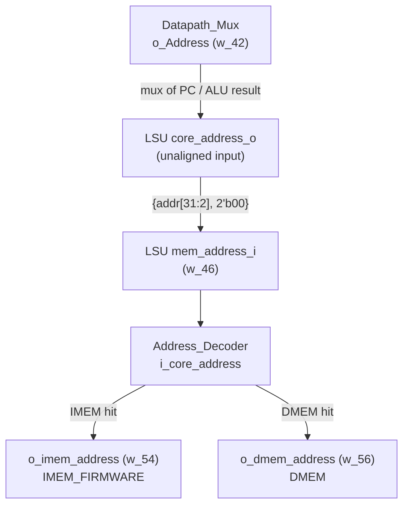
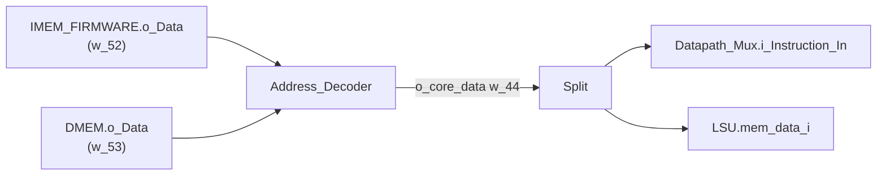

# WIRING.md — Complete CPU Netlist (pin-to-pin)

> **Transcribed from `design-2026.09.09/design/rtl/top.v`** (supersedes
> `design-2026.09.08/`; re-verified identical at these line numbers and net names).
> Wire names below (`w_1`, `w_23`, …) are the generated net names in that file, so you can
> grep for them. This supersedes the earlier hand-written netlist, which described a
> different block decomposition.
>
> The 9 Sep export's memory modules are named `IMEM_MOCK`/`DMEM_MOCK` (mock contents,
> disclosed OpenLane-only substitution — see PLATFORM_NOTES.md); their ports and every
> wire below are otherwise unchanged.

## Top-level ports

```verilog
module top (
    input  wire        clk_i,
    input  wire        rst_i,        // ACTIVE HIGH
    output wire [31:0] o_PC,         // = w_23  (PC_Unit.o_PC)
    output wire [1:0]  o_State,      // driven directly by Control_Unit.o_State
    output wire        o_RD_We       // = w_12  (Control_Unit.o_RD_We)
);
```

## Clock and reset distribution

`clk_i` fans out to the four sequential blocks:
- `clk_i` → `Control_Unit.i_Clk`
- `clk_i` → `PC_Unit.i_Clk`
- `clk_i` → `Register_File.i_clk`
- `clk_i` → `Datapath_Mux.i_Clk`
- `clk_i` → `DMEM.i_Clk`

`rst_i` (**active high, no inverter anywhere**) fans out to:
- `rst_i` → `Control_Unit.i_Rst`
- `rst_i` → `PC_Unit.i_Rst`
- `rst_i` → `Register_File.i_rst`
- `rst_i` → `Datapath_Mux.i_Rst`

`DMEM` and `IMEM_FIRMWARE` take no reset.

---

## Net-by-net map

| Net | Width | Driver | Loads |
|---|---|---|---|
| `w_1` | 32 | `Datapath_Mux.o_IR` | `Control_Unit.i_Instruction`, `IMM_GENERATOR.i_Instruction` |
| `w_2` | 1 | `BRANCH_COMPARATOR.o_Branch_Taken` | `Control_Unit.i_Branch_Taken` |
| `w_3` | 1 | `Control_Unit.o_IR_Write` | `Datapath_Mux.i_IR_Write` |
| `w_4` | 1 | `Control_Unit.o_PC_Write` | `PC_Unit.i_PC_Write` |
| `w_5` | 2 | `Control_Unit.o_PC_Src` | `PC_Unit.i_PC_Src` |
| `w_6` | 4 | `Control_Unit.o_ALU_Op` | `alu.sel_i` |
| `w_7` | 1 | `Control_Unit.o_ALU_SrcA` | `Datapath_Mux.i_ALU_SrcA` |
| `w_8` | 1 | `Control_Unit.o_ALU_SrcB` | `Datapath_Mux.i_ALU_SrcB` |
| `w_9` | 4 | `Control_Unit.o_Mul_Op` | `MULT_Unit.i_Mul_Op` |
| `w_10` | 4 | `Control_Unit.o_CRC_Op` | `CRC16_Unit.i_CRC_Op` |
| `w_11` | 3 | `Control_Unit.o_WB_Sel` | `Datapath_Mux.i_WB_Sel` |
| `w_12` | 1 | `Control_Unit.o_RD_We` | `Register_File.i_we`, **`top.o_RD_We`** |
| `w_14` | 1 | `Control_Unit.o_Mem_We` | `LSU.we_i`, `Address_Decoder.i_core_we` |
| `w_16` | 1 | `Control_Unit.o_Mem_Oe` | `LSU.oe_i`, `Address_Decoder.i_core_oe` |
| `w_18` | 1 | `Control_Unit.o_Addr_Src` | `Datapath_Mux.i_Addr_Src` |
| `w_19` | 32 | `Register_File.o_rs1_data` | `BRANCH_COMPARATOR.i_Reg_A`, `MULT_Unit.i_rs1`, `CRC16_Unit.i_rs1`, `Datapath_Mux.i_RS1` |
| `w_20` | 32 | `Register_File.o_rs2_data` | `BRANCH_COMPARATOR.i_Reg_B`, `MULT_Unit.i_rs2`, `CRC16_Unit.i_rs2`, `LSU.core_data_o`, `Datapath_Mux.i_RS2` |
| `w_21` | 3 | `Datapath_Mux.o_Funct3` | `BRANCH_COMPARATOR.i_Branch_Sel`, `LSU.op_size_o` |
| `w_22` | 32 | `alu.q_o` | `PC_Unit.i_ALU_Result`, `Datapath_Mux.i_ALU_Result` |
| `w_23` | 32 | `PC_Unit.o_PC` | `Datapath_Mux.i_PC`, **`top.o_PC`** |
| `w_25` | 32 | `PC_Unit.o_PC_Plus4` | `Datapath_Mux.i_PC_Plus4` |
| `w_26` | 32 | `Datapath_Mux.o_ALU_A` | `alu.a_i` |
| `w_27` | 32 | `Datapath_Mux.o_ALU_B` | `alu.b_i` |
| `w_31` | 32 | `MULT_Unit.o_Result` | `Datapath_Mux.i_Mul_Result` |
| `w_34` | 32 | `CRC16_Unit.o_Result` | `Datapath_Mux.i_CRC_Result` |
| `w_35` | 5 | `Datapath_Mux.o_RS1_Addr` | `Register_File.i_rs1_addr` |
| `w_36` | 5 | `Datapath_Mux.o_RS2_Addr` | `Register_File.i_rs2_addr` |
| `w_37` | 5 | `Datapath_Mux.o_RD_Addr` | `Register_File.i_rd_addr` |
| `w_38` | 32 | `Datapath_Mux.o_WB_Data` | `Register_File.i_rd_data` |
| `w_42` | 32 | `Datapath_Mux.o_Address` | `LSU.core_address_o` |
| `w_44` | 32 | `Address_Decoder.o_core_data` | **`LSU.mem_data_i`**, **`Datapath_Mux.i_Instruction_In`** |
| `w_45` | 32 | `LSU.core_data_i` | `Datapath_Mux.i_LSU_Data` |
| `w_46` | 32 | `LSU.mem_address_i` | `Address_Decoder.i_core_address` |
| `w_47` | 4 | `LSU.byte_write_i` | `Address_Decoder.i_core_bw` |
| `w_48` | 32 | `LSU.mem_data_o` | `DMEM.i_Data` |
| `w_50` | 32 | `IMM_GENERATOR.o_Immediate` | `Datapath_Mux.i_Immediate` |
| `w_52` | 32 | `IMEM_FIRMWARE.o_Data` | `Address_Decoder.i_imem_data` |
| `w_53` | 32 | `DMEM.o_Data` | `Address_Decoder.i_dmem_data` |
| `w_54` | 32 | `Address_Decoder.o_imem_address` | `IMEM_FIRMWARE.i_Address` |
| `w_55` | 1 | `Address_Decoder.o_imem_oe` | `IMEM_FIRMWARE.i_Oe` |
| `w_56` | 32 | `Address_Decoder.o_dmem_address` | `DMEM.i_Address` |
| `w_57` | 1 | `Address_Decoder.o_dmem_we` | `DMEM.i_We` |
| `w_58` | 1 | `Address_Decoder.o_dmem_oe` | `DMEM.i_Oe` |
| `w_59` | 4 | `Address_Decoder.o_dmem_bw` | `DMEM.i_Bw` |

---

## The address path — read this before touching memory

The address does **not** go straight from the datapath to the decoder. It passes
*through the LSU*, which performs the 4-byte alignment:



This holds for instruction fetch too: during FETCH, `o_Addr_Src = 0`, so the PC is
routed through the LSU's alignment logic and on to the decoder.

## The read path — one net feeds both instruction and load data

`Address_Decoder.o_core_data` (`w_44`) is the single read-data return, and it has
**two** loads:



`DMEM.o_Data` goes **only** to the decoder; it is not wired to the LSU directly.
Because the decoder muxes IMEM and DMEM by address, a load whose target lies in the
IMEM window returns the ROM word — which is what lets the firmware read its constants
at `0x004003F8` onward. Wiring `LSU.mem_data_i` straight to `DMEM.o_Data` would restrict
loads to the DMEM region; the exported design does **not** do that.

## Fan-out summary (single driver → multiple loads)

- `Address_Decoder.o_core_data` (`w_44`) → `Datapath_Mux.i_Instruction_In` **and** `LSU.mem_data_i`
- `Register_File.o_rs1_data` (`w_19`) → branch comparator, multiplier, CRC, `Datapath_Mux.i_RS1`
- `Register_File.o_rs2_data` (`w_20`) → branch comparator, multiplier, CRC, `Datapath_Mux.i_RS2`, `LSU.core_data_o`
- `Datapath_Mux.o_Funct3` (`w_21`) → `BRANCH_COMPARATOR.i_Branch_Sel` **and** `LSU.op_size_o`
- `alu.q_o` (`w_22`) → `PC_Unit.i_ALU_Result` **and** `Datapath_Mux.i_ALU_Result`
- `PC_Unit.o_PC` (`w_23`) → `Datapath_Mux.i_PC` **and** top-level `o_PC`
- `Control_Unit.o_Mem_Oe` (`w_16`) → `LSU.oe_i` **and** `Address_Decoder.i_core_oe`
- `Control_Unit.o_Mem_We` (`w_14`) → `LSU.we_i` **and** `Address_Decoder.i_core_we`
- `Control_Unit.o_RD_We` (`w_12`) → `Register_File.i_we` **and** top-level `o_RD_We`

## Nets that do not exist

`w_13`, `w_15`, `w_17`, `w_24`, `w_28`–`w_30`, `w_32`, `w_33`, `w_39`–`w_41`, `w_43`,
`w_49`, `w_51` are absent from the declaration list — the converter numbers nets from
canvas connection IDs and skips the ones consumed by direct port-to-port links. Their
absence is not a missing connection.
