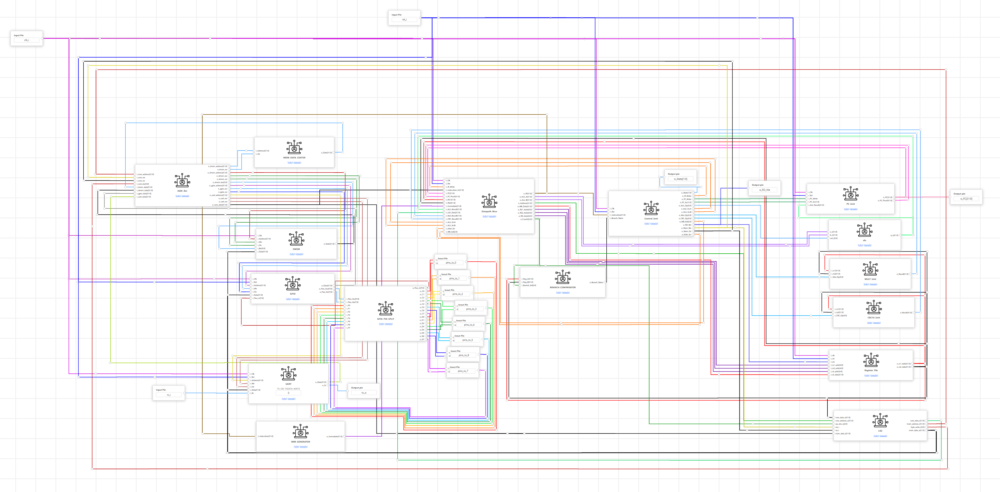
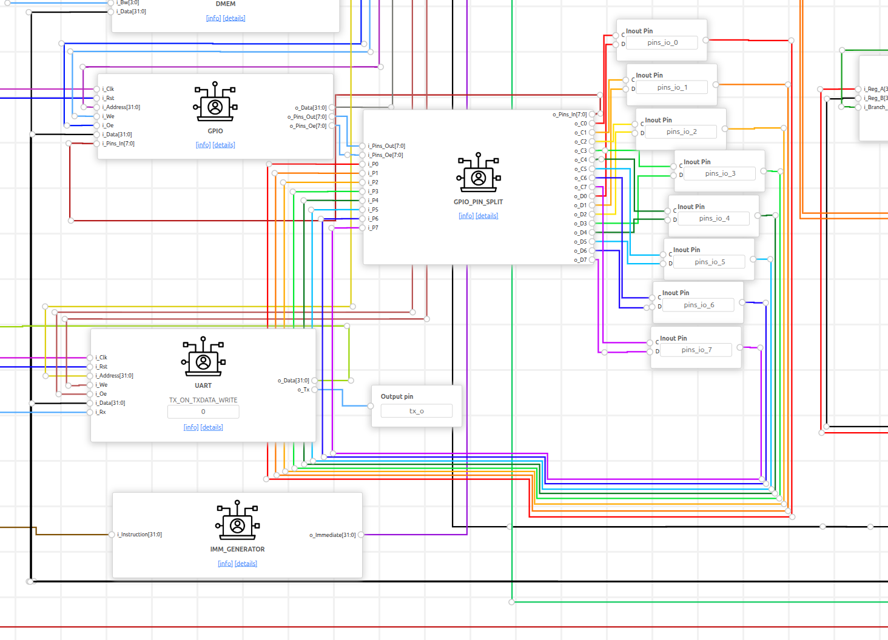
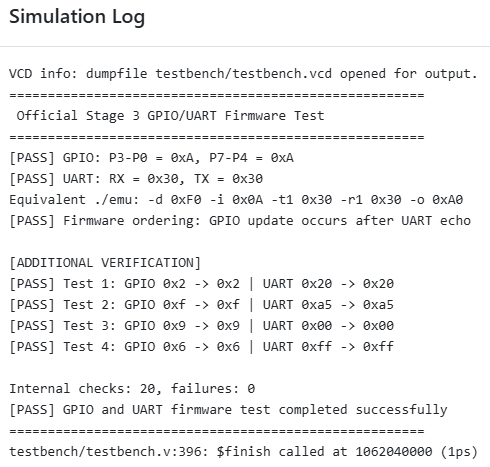
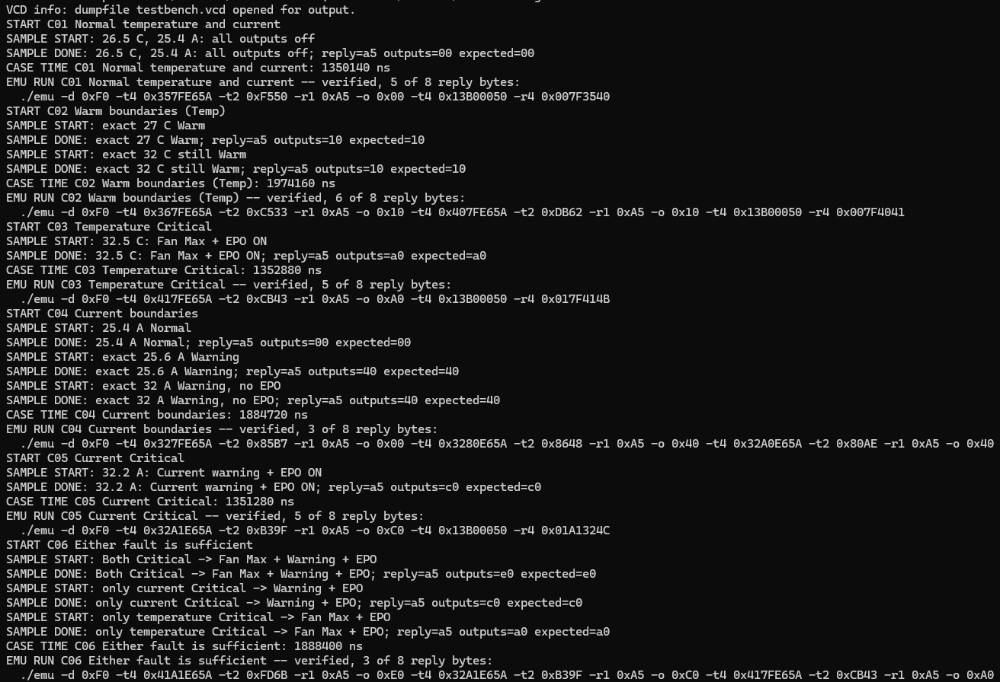
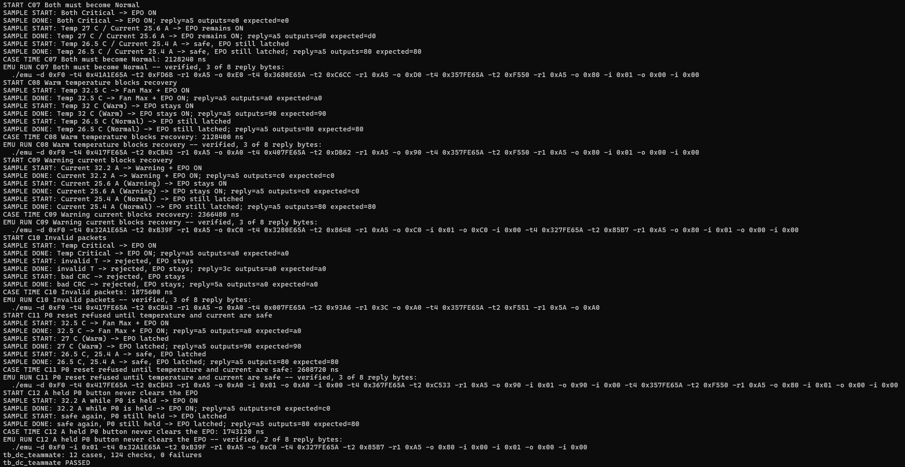
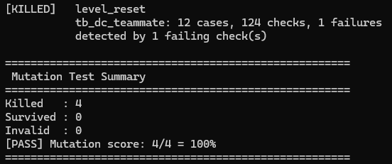
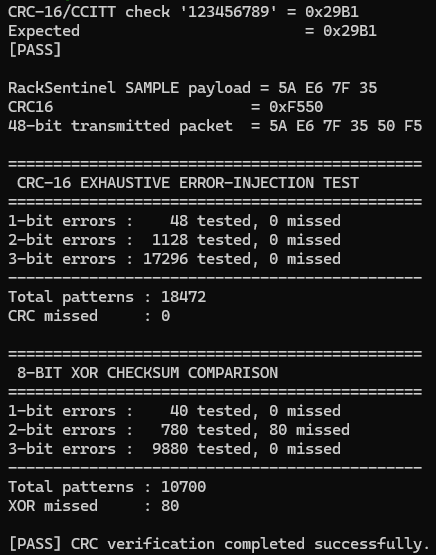

# RackSentinel — Data-Centre Rack Protection on RVBL-2

**Equipe 31 · Team CoreX · ChampionCHIP eXperience Malaysia 2026 · Stage 3**

**RackSentinel** is a firmware-controlled rack-protection controller implemented on our **RVBL-2 RISC-V SoC**. The Stage 2 processor is reused and extended in Stage 3 with memory-mapped **GPIO** and **UART** peripherals. Rack telemetry is received over UART, packet integrity is checked with the custom **Xicrc `crcb`** instruction, temperature is scaled with **Zmmul `mul`**, protection decisions are made locally, and the result is driven to four GPIO outputs.

The application is intentionally fail-safe. A critical temperature or over-current event **latches the EPO**; the EPO does not disappear just because the sensor value later becomes safe. It can be cleared only by a **new P0 operator-reset press**, and only when the temperature is Normal and the current is below the warning threshold. A held or stuck button cannot clear a later trip.

> **Stage 3 principle:** same integrated SoC hardware, different firmware image. The organiser test firmware validates the GPIO/UART platform first; the application firmware (`firmware/firmware_application/main.s`) then turns the same hardware into RackSentinel.

| Evidence | Final verified result |
|---|---|
| **Official GPIO/UART firmware** | **PASS** on the integrated SoC; GPIO direction/copy and UART echo verified |
| **Application firmware** | `main.s` → **1,100 B / 275 machine words** using the organiser RVBL Firmware Builder |
| **Firmware → IMEM traceability** | **275 / 275 words matched · 0 mismatches** |
| **Application regression** | **12 cases · 124 checks · 0 failures** |
| **Mutation testing** | **4 / 4 safety mutations killed · 0 survived · 0 invalid** |
| **CRC exhaustive test** | **18,472** one-, two- and three-bit corruptions tested · **0 missed by CRC-16** |
| **Checksum comparison** | 8-bit XOR checksum missed **80 / 10,700** corresponding corruption patterns |
| **Emulator compatibility** | C01–C12 emit official-format `./emu` sequences; all stay within the **8-byte reply limit** |

---

## Contents

- [1. What RackSentinel does](#1-what-racksentinel-does)
- [2. Final Stage 3 architecture](#2-final-stage-3-architecture)
- [3. GPIO and UART integration](#3-gpio-and-uart-integration)
- [4. Application protocol](#4-application-protocol)
- [5. Firmware processing](#5-firmware-processing)
- [6. Official firmware validation](#6-official-firmware-validation)
- [7. Custom firmware validation](#7-custom-firmware-validation)
- [8. Firmware-to-IMEM traceability](#8-firmware-to-imem-traceability)
- [9. Emulator-compatible execution](#9-emulator-compatible-execution)
- [10. Stage 3 guide coverage](#10-stage-3-guide-coverage)
- [11. Reproduce the results](#11-reproduce-the-results)
- [12. Package layout](#12-package-layout)
- [13. Organiser material used](#13-organiser-material-used)
- [14. Honest limitations](#14-honest-limitations)
- [15. Stage 2 foundation](#15-stage-2-foundation)
- [16. Attribution](#16-attribution)

---

## 1. What RackSentinel does

RackSentinel models the protection controller of one data-centre rack. A supervisory/DCIM side provides telemetry through UART; the controller makes the protection decision on-chip and exposes the actions through GPIO.

### Inputs

**UART SAMPLE telemetry**

```text
[0x5A] [Voltage] [Current] [Temperature] [CRC_LO] [CRC_HI]
```

- Voltage: 1 V/LSB, accepted range `180…254 V`.
- Current: `0.2 A/LSB`.
- Temperature: `0.5 °C/LSB`.
- CRC: CRC-16, polynomial `0x1021`, initial value `0xFFFF`.

**GPIO input**

- **P0** — operator EPO reset.
- P1–P3 — unused by the final application.

Voltage is a validated telemetry field and is stored by the firmware, but the final protection actions are decided from **temperature, current, and the latched-EPO/reset state**.

### Processing

The firmware:

1. receives a complete UART packet;
2. recomputes and verifies CRC-16 with `crcb`;
3. rejects invalid ranges/commands;
4. converts raw temperature to 0.1 °C units using `mul`;
5. classifies the thermal state;
6. evaluates current warning/trip thresholds;
7. latches EPO on a critical condition;
8. accepts reset only on a new P0 press under safe conditions;
9. updates GPIO outputs and sends a UART reply.

### Outputs

| Pin | Function |
|---|---|
| **P4** | Fan Boost |
| **P5** | Maximum Fan |
| **P6** | Current Warning |
| **P7** | Emergency Power-Off request |

### Default protection rules

| Condition | Interpretation | Output behaviour |
|---|---|---|
| `T < 27.0 °C` and `I < 25.6 A` | Normal | P4–P6 off; P7 remains high only if EPO is already latched |
| `27.0 °C ≤ T ≤ 32.0 °C` | Warm | P4 asserted |
| `T > 32.0 °C` | Critical | P5 + latched P7 EPO |
| `I ≥ 25.6 A` | Current warning | P6 asserted |
| `I > 32.0 A` | Current trip | P6 + latched P7 EPO |
| New P0 press while fully safe | Operator-confirmed recovery | Latched P7 is cleared |
| P0 held/stuck | No new rising edge | Cannot clear a future EPO trip |

The default thresholds can be changed by validated firmware commands while preserving the required ordering between warning and trip levels.

---

## 2. Final Stage 3 architecture

The final design keeps the RVBL-2 processor from Stage 2 and adds GPIO and UART as memory-mapped bus slaves. The address decoder routes normal `lw`/`sw` transactions to IMEM, DMEM, GPIO or UART.



*Figure 1. Final ChipInventor Stage 3 canvas. This is the final full-system diagram used for RackSentinel.*



*Figure 2. Final peripheral-side view. GPIO is connected through the pin-side integration to eight scalar Inout Pin blocks; UART is connected to `rx_i` and `tx_o`.*

### Memory map

| Block | Base address | Interface |
|---|---:|---|
| IMEM | `0x0040_0000` | Application ROM (`IMEM_Data_Center`) or organiser test ROM |
| DMEM | `0x1001_0000` | Application state |
| GPIO | `0xF000_0000` | `DATAOUT +0x0`, `DATAIN +0x4`, `DATADIR +0x8` |
| UART | `0xF100_0000` | `TXDATA +0x0`, `RXDATA +0x4`, `CONTROL +0x8` |

For GPIO, the Stage 3 Block Guide convention is used:

```text
DATADIR[x] = 0  -> input
DATADIR[x] = 1  -> output
```

RackSentinel sets `P7:P4` as outputs and keeps `P3:P0` as inputs.

---

## 3. GPIO and UART integration

### 3.1 GPIO

At boot the firmware performs a read-modify-write on `DATADIR`, ORs in `0xF0`, then clears `DATAOUT`. This means no application output is asserted before state initialization is complete.

```asm
lw   t0, GPIO_DATADIR(s0)
ori  t0, t0, 0xF0
sw   t0, GPIO_DATADIR(s0)
sw   zero, GPIO_DATAOUT(s0)
```

`update_outputs` constructs one output byte from the current state and commits it with one write to `GPIO_DATAOUT`:

```text
bit 4 -> Fan Boost
bit 5 -> Maximum Fan
bit 6 -> Current Warning
bit 7 -> EPO
```

### 3.2 UART

The UART operates at **115,200 baud** with the Stage 3 register interface. Firmware follows the required software handshake:

**Receive**

1. poll `CONTROL.RXDONE`;
2. clear RXDONE by writing `0` to `CONTROL`;
3. read the byte from `RXDATA`.

**Transmit**

1. wait for `CONTROL.TXDONE`;
2. write the reply byte to `TXDATA`;
3. read-modify-write `CONTROL.TRANSMIT` to start transmission.

While waiting for the first byte of the next packet, the firmware also polls P0 so that an operator reset can be processed even when UART traffic is idle.

---

## 4. Application protocol

### 4.1 SAMPLE frame

A rack observation is a six-byte frame:

```text
Byte 0     Byte 1     Byte 2     Byte 3       Byte 4      Byte 5
0x5A       Voltage    Current    Temperature  CRC_LO      CRC_HI
```

CRC-16 protects the first four bytes. A bad CRC returns `0x5A`, increments the CRC-reject counter and executes no application action.

### 4.2 Control/status frame

All non-SAMPLE commands use:

```text
[CMD] [DATA] [CRC_LO] [CRC_HI]
```

| Command | Hex | Purpose |
|---|---:|---|
| `STAGE_HIGH` | `0x40` | Stage the high byte used for a temperature-threshold update |
| `SET_WARM` | `0x41` | Set Warm threshold after validation |
| `SET_CRIT` | `0x43` | Set Critical threshold after validation |
| `SET_WARN_CURRENT` | `0x46` | Set current-warning threshold |
| `SET_TRIP_CURRENT` | `0x48` | Set current-trip threshold |
| `STATUS` | `0x50` | Return status/latest readings/EPO-trip information |
| `COUNTERS` | `0x52` | Return CRC-reject count plus reserved counter bytes |
| `SAMPLE` | `0x5A` | Submit rack telemetry |

### 4.3 Reply codes

| Reply | Meaning |
|---:|---|
| `0xA5` | Accepted / completed successfully |
| `0x3C` | Invalid command or invalid data |
| `0x5A` | CRC mismatch; packet rejected |

### 4.4 Why the EPO is latched

If the EPO automatically disappeared when a reading returned to Normal, the P0 reset button would serve no safety purpose. RackSentinel therefore retains the trip state until an operator deliberately acknowledges recovery.

A reset is accepted only when:

```text
new P0 press
AND EPO is currently latched
AND temperature class = Normal
AND current < warning threshold
```

The firmware stores the previous P0 level. A continuously held button therefore produces no new `0 -> 1` transition and cannot clear an EPO that trips later.

---

## 5. Firmware processing

The final application source is **`firmware/firmware_application/main.s`** (the file name the organiser Firmware Builder expects).

```text
BOOT
  |
  +-- configure GPIO direction
  +-- clear output/state
  +-- load default thresholds
  |
WAIT FOR CMD  <-----------------------------------------------+
  |                                                           |
  +-- poll P0 reset                                           |
  |                                                           |
  +-- receive packet                                          |
        |                                                     |
        +-- SAMPLE: V, I, T, CRC_LO, CRC_HI                  |
        +-- other:  DATA, CRC_LO, CRC_HI                     |
        |                                                     |
        +-- CRC-16 using Xicrc crcb                           |
              |                                               |
              +-- bad -> 0x5A, count reject -----------------+
              |
              +-- good -> validate command/data
                              |
                              +-- invalid -> 0x3C ------------+
                              |
                              +-- process
                                   |
                                   +-- temperature x5 using mul
                                   +-- classify temperature
                                   +-- evaluate current
                                   +-- set/retain EPO latch
                                   +-- write GPIO DATAOUT
                                   +-- send reply/status ------+
```

### 5.1 Xicrc: CRC-16 in hardware

For a SAMPLE frame the firmware starts from `0xFFFF` and applies one `crcb` to each protected byte:

```asm
li   t0, 0xFFFF
crcb t0, s2, t0      # 0x5A
crcb t0, s3, t0      # voltage
crcb t0, s4, t0      # current
crcb t0, s5, t0      # temperature
bne  t0, t5, cmd_badcrc
```

### 5.2 Zmmul: temperature scaling without division

The temperature byte is encoded in 0.5 °C steps. One multiply converts it to 0.1 °C units:

```text
T_0.1°C = 5 × raw_T
```

This allows integer comparisons against the default thresholds `270` (27.0 °C) and `320` (32.0 °C).

### 5.3 Fail-safe EPO state

A SAMPLE trips EPO when either:

```text
temperature > 32.0 °C
OR
current > 32.0 A
```

Once asserted, EPO remains asserted through later safe readings. Only `check_reset` may clear it, and only under the safe-reset conditions described above.

---

## 6. Official firmware validation

Before application testing, the integrated GPIO/UART hardware is validated with the organiser-provided **RVBL-GPIO-UART-Test-Firmware**. This separates peripheral-integration correctness from application-firmware correctness.

The organiser firmware configures `P7:P4` as outputs, copies `P3:P0` to the upper nibble, waits for a UART byte and echoes it. The final end-to-end test exercises GPIO direction, GPIO copy, UART receive/transmit and ordering on the integrated design.



*Figure 3. Final official-firmware test log. The integrated design completes the GPIO/UART validation with PASS results.*

The application project uses the same SoC architecture; only the instruction-memory image is changed to the RackSentinel firmware.

---

## 7. Custom firmware validation

### 7.1 Complete C01–C12 regression

The final self-checking application testbench, **`testbench/tb_data_center_application.v`**, was executed with **Icarus Verilog 12.0** against the final integrated HDL, `rtl/hdl/hdl_application.v`. Its summary lines are printed under the name `tb_dc_teammate`.

Final result:

```text
tb_dc_teammate: 12 cases, 124 checks, 0 failures
tb_dc_teammate PASSED
```





*Figure 4. Complete application regression. C01–C12 finish with 124 checks and zero failures. Each case was also run on its own on the ChipInventor platform: `simulation_log/log_tb_dc_teammate_application/log_case1.png` … `log_case12.png`.*

### 7.2 Validation matrix

| Case | Scenario | What is proved |
|---|---|---|
| **C01** | Normal temperature and current | No protection outputs; valid status path |
| **C02** | Temperature boundaries | 27.0 °C and 32.0 °C classify as Warm |
| **C03** | Temperature Critical | 32.5 °C asserts Maximum Fan + EPO |
| **C04** | Current boundaries | 25.4 A Normal; 25.6 A Warning; 32.0 A Warning without trip |
| **C05** | Current Critical | 32.2 A asserts Current Warning + EPO |
| **C06** | Independent faults | temperature-only, current-only and combined critical events |
| **C07** | Both conditions must recover | safe readings alone do not clear a latched EPO; deliberate reset is required |
| **C08** | Warm blocks reset | P0 cannot reset while temperature remains Warm |
| **C09** | Warning current blocks reset | P0 cannot reset while current remains at/above warning |
| **C10** | Invalid packet / bad CRC | `0x3C` and `0x5A` rejection paths preserve the protection state |
| **C11** | Safe-reset interlock | reset attempts are refused until both conditions are safe |
| **C12** | Held/stuck P0 | held button cannot clear a future EPO; release + new press is required |

### 7.3 Mutation testing — proving the testbench can fail

A testbench that only passes good firmware is not enough. `mutate_final.sh` deliberately injects four realistic faults into the safety logic and reruns the same C01–C12 regression.

| Mutation | Deliberate fault | Result |
|---|---|---|
| **M1** | Restore automatic EPO clearing | **KILLED** |
| **M2** | Allow reset while temperature is Warm | **KILLED** |
| **M3** | Allow reset at current-warning threshold | **KILLED** |
| **M4** | Remove edge detection; make reset level-triggered | **KILLED** |

```text
Killed   : 4
Survived : 0
Invalid  : 0
[PASS] Mutation score: 4/4 = 100%
```



*Figure 5. All four planted safety faults are detected. No mutation survives and none is invalid.*

### 7.4 Independent CRC error-injection test

`crc_verify.py` independently implements the same CRC-16 configuration and first checks the standard string `"123456789"`, which produces `0x29B1`.

For the 48-bit transmitted SAMPLE frame (`4 protected bytes + 16-bit CRC`), every possible 1-, 2- and 3-bit corruption is injected:

| Error weight | Patterns | CRC-16 misses |
|---:|---:|---:|
| 1 bit | 48 | 0 |
| 2 bits | 1,128 | 0 |
| 3 bits | 17,296 | 0 |
| **Total** | **18,472** | **0** |

For comparison, an 8-bit XOR checksum misses **80 of 10,700** corresponding corruption patterns.



*Figure 6. Independent exhaustive CRC verification: 18,472 tested 1/2/3-bit corruptions, zero undetected by CRC-16.*

Two different layers are therefore covered:

- **C10 SoC simulation:** proves the actual firmware returns `0x5A` for a bad CRC and preserves protection state.
- **`crc_verify.py`:** independently measures the detection strength of the CRC algorithm over the final SAMPLE frame.

---

## 8. Firmware-to-IMEM traceability

The final `main.s` was rebuilt with the organiser-provided **RVBL Firmware Builder** (included unmodified in `RVBL-Firmware-Builder/`).

```text
Application source          firmware/firmware_application/main.s
Program size                1,100 bytes
Machine-code words          275
Final IMEM words compared   275
Matched                     275 / 275
Mismatches                  0
First instruction address   0x00400000
Last instruction address    0x00400448
```

A word-for-word comparison between the builder-generated `firmware.txt` and the final `IMEM_Data_Center` contents gave **zero mismatches**. This links the submitted assembly source to the exact program executed by the RackSentinel design.

No separate screenshot is required for this claim; the build artifacts (`firmware.bin`, `firmware.txt`, `firmware.dmp`, `firmware.elf`) are included in `firmware/firmware_application/`, and rebuilding `main.s` with the organiser Makefile reproduces `firmware.bin` byte for byte.

---

## 9. Emulator-compatible execution

The organiser's `RVBL-Emulator` is intended for the AWS FPGA environment. Stage 3 therefore does **not** claim that C01–C12 were executed on AWS. Instead, the final testbench emits an equivalent `./emu` command sequence for every scenario and verifies the corresponding UART and GPIO behaviour on the SoC simulation.

### Official option semantics used

| Option | RackSentinel usage |
|---|---|
| `-d 0xF0` | P3:P0 driven toward processor; P7:P4 observed as outputs |
| `-i 0x01` | P0 pressed |
| `-i 0x00` | P0 released |
| `-t1/-t2/-t4` | Send 1/2/4 UART bytes to processor RX |
| `-r1/-r2/-r4` | Compare 1/2/4 bytes returned by processor TX |
| `-o` | Compare GPIO output value |

Multi-byte `-t` values are sent **least-significant byte first**. For example:

```sh
-t4 0x357FE65A
```

is transmitted as:

```text
0x5A  0xE6  0x7F  0x35
 CMD     V     I     T
```

### Example — C01 Normal condition

```sh
./emu -d 0xF0 \
  -t4 0x357FE65A -t2 0xF550 -r1 0xA5 -o 0x00 \
  -t4 0x13B00050 -r4 0x007F3540
```

Every scenario is started from reset by the testbench. Across C01–C12, the generated sequences stay within the emulator's **maximum eight returned bytes per execution**; the longest simulated case is approximately **2.61 ms**.

The twelve generated command lines are in `emulator/emu_runs.txt` and can be used directly as the application protocol reference for the later FPGA stage. `emulator/emu.sh --all` replays every line on the simulated SoC with `emulator/emu_sim.py`, which applies the option semantics of the organiser's `emu.c`; the replay outputs are in `emulator/emu_replay_screenshots/`.

---

## 10. Stage 3 guide coverage

This README follows the organiser's Stage 3 Topics 1–6 so that each required item can be found quickly.

| Guide topic | Where it is answered | Main evidence |
|---|---|---|
| **1. Project Overview** | §1 | context, inputs, local processing, P4–P7 actions |
| **2. GPIO & UART Integration** | §2–§3 | final ChipInventor full diagram + peripheral close-up + memory map |
| **3. Official Firmware Testbench** | §6 | organiser GPIO/UART firmware PASS log |
| **4. Application Definition** | §1 + §4 + §9 | system context, input, processing, output and emulator values |
| **5. Firmware Development & Processing** | §5 + §8 | `crcb`, `mul`, latch/reset logic, official Builder, 275/275 traceability |
| **6. Custom Firmware Validation** | §7 | C01–C12 = 124/0, mutation 4/4, CRC 18,472/0 |

The current competition correction replaces the public-GitHub requirement: the source package is shared through the team's Google Drive folder, <https://drive.google.com/drive/folders/1gjHcHdo499uA5_Xjsm2XVFN7f1pyN7J5?usp=drive_link>, and the report and video link are submitted on the ChampionCHIP platform. This README is the navigation and reproducibility entry point for the source package.

---

## 11. Reproduce the results

### 11.1 Dependencies

Ubuntu / WSL:

```sh
sudo apt update
sudo apt install -y make python3 iverilog gcc-riscv64-unknown-elf
```

Verified development environment used during final checks:

```text
GNU Make            4.4.1
Icarus Verilog      12.0
RISC-V GCC          14.2.0
Python              3.14.4
```

### 11.2 Run the testbenches

All commands are run from the root of this package.

**Official GPIO/UART firmware test** (organiser ROM `IMEM_TESTFW`):

```sh
iverilog -g2012 -o official.out testbench/tb_official_test.v rtl/hdl/hdl_official_test.v
vvp -n official.out
```

Expected final lines:

```text
Internal checks: 20, failures: 0
[PASS] GPIO and UART firmware test completed successfully
```

**Complete C01–C12 application regression** (application ROM `IMEM_Data_Center`):

```sh
iverilog -g2012 -o application.out testbench/tb_data_center_application.v rtl/hdl/hdl_application.v
vvp -n application.out
```

Expected final lines:

```text
tb_dc_teammate: 12 cases, 124 checks, 0 failures
tb_dc_teammate PASSED
```

To run a single case, as on the ChipInventor platform, set `FIRST_RUN = LAST_RUN = k` at the top of the testbench.

### 11.3 Run mutation testing

```sh
bash extra_verification/mutation_test/mutate_final.sh
```

The script assembles each mutant of `firmware/firmware_application/main.s` with the GNU RISC-V toolchain and the organiser linker script `RVBL-Firmware-Builder/bsp/custom.ld`, swaps it into `rtl/hdl/hdl_application.v` and reruns the C01–C12 testbench. Its working files go to `extra_verification/mutation_test/build/`. Expected summary:

```text
Killed   : 4
Survived : 0
Invalid  : 0
[PASS] Mutation score: 4/4 = 100%
```

### 11.4 Run exhaustive CRC verification

```sh
python3 extra_verification/crc_verify/crc_verify.py
```

Expected key result:

```text
CRC-16/CCITT check '123456789' = 0x29B1
Total patterns : 18472
CRC missed     : 0
[PASS] CRC verification completed successfully.
```

### 11.5 Replay the `./emu` runs on the simulated SoC

```sh
bash emulator/emu.sh --all
```

Expected final line:

```text
emu_sim: 12 of 12 ./emu runs passed
```

### 11.6 Rebuild the application with the organiser Firmware Builder

`RVBL-Firmware-Builder/` is the organiser's builder (its `Makefile`, `bsp/custom.ld` and `scripts/bin2rom.py` are unmodified) with the application source placed in `src/main.s`, where the Makefile expects it.

```sh
make -C RVBL-Firmware-Builder clean
make -C RVBL-Firmware-Builder
cmp RVBL-Firmware-Builder/build/firmware.bin firmware/firmware_application/firmware.bin && echo IDENTICAL
```

Expected application size:

```text
1,100 bytes
275 machine-code words
```

The resulting `firmware.txt` matches the final application IMEM (`rtl/imem/IMEM_Data_Center.v`) word for word.

---

## 12. Package layout

```text
.
├── README_RackSentinel_FINAL.md           # this file
├── TESTCASES_FINAL_C01-C12.md             # C01–C12 test plan, expected replies and ./emu lines
├── Full_Block_Diagram.png                 # mandatory ChipInventor block diagram (full canvas)
├── Peripheral_Block_Diagram.png           # close-up: GPIO, GPIO_PIN_SPLIT, 8 Inout Pins, UART
├── rtl/
│   ├── hdl/
│   │   ├── hdl_application.v              # exported SoC with the application ROM (IMEM_Data_Center)
│   │   └── hdl_official_test.v            # same SoC with the organiser test ROM (IMEM_TESTFW)
│   ├── modules/                           # the 15 custom blocks: core, decoder, GPIO, GPIO_PIN_SPLIT, UART, ...
│   └── imem/
│       ├── IMEM_Data_Center.v             # application ROM, 275 words
│       └── IMEM_TESTFW.v                  # organiser test ROM, 21 words
├── firmware/
│   ├── firmware_application/              # main.s (assembly) + firmware.bin (binary), .txt, .dmp, .elf, main.o
│   └── firmware_official_test_reference/  # organiser main.s + firmware.txt, unmodified
├── RVBL-Firmware-Builder/                 # organiser builder with src/main.s and its build/ output
├── testbench/
│   ├── tb_official_test.v                 # official GPIO/UART test, 20 checks
│   └── tb_data_center_application.v       # C01–C12 application testbench, 124 checks
├── simulation_log/                        # ChipInventor platform logs: official test, C01–C12 per case, full regression
├── waveform/
│   └── waveform_tb_official_test.png      # official-test waveform on the platform
├── emulator/
│   ├── emu_runs.txt                       # the 12 verified ./emu command lines
│   ├── emu.sh, emu_sim.py                 # replay ./emu lines on the simulated SoC
│   └── emu_replay_screenshots/            # replay output for C01–C12
└── extra_verification/
    ├── baseline.log                       # text log of the full C01–C12 regression
    ├── mutation_test/                     # mutate_final.sh + result screenshot
    └── crc_verify/                        # crc_verify.py + result screenshot
```

Running the scripts above creates `build/` folders and `.out`/`.vcd` files; these are generated outputs and are not part of the package.

---

## 13. Organiser material used

The design uses the organiser's Stage 3 interface definitions rather than inventing a separate peripheral convention.

| Organiser resource | Use in RackSentinel |
|---|---|
| [`RVBL-GPIO-UART-Test-Firmware`](https://github.com/championchip-experience-community/CCX_Malaysia_Edition_Stage_3/tree/main/RVBL-GPIO-UART-Test-Firmware) | Independent baseline validation of the integrated GPIO/UART hardware |
| [`RVBL-Firmware-Builder`](https://github.com/championchip-experience-community/CCX_Malaysia_Edition_Stage_3/tree/main/RVBL-Firmware-Builder) | Builds `main.s` into the final binary / `firmware.txt`; final program = 275 words |
| [`RVBL-Emulator`](https://github.com/championchip-experience-community/CCX_Malaysia_Edition_Stage_3/tree/main/RVBL-Emulator) | Defines the `-d`, `-i`, `-o`, `-t1/2/4`, `-r1/2/4` semantics used by the application scenarios |
| Stage 3 Block Guide | GPIO/UART memory maps, register behaviour and pin direction semantics |

---

## 14. Honest limitations

- **No AWS FPGA execution is claimed for Stage 3.** The `./emu` sequences are verified in simulation using the official documented option semantics; actual AWS execution belongs to the later FPGA stage.
- **The combined C01–C12 regression is run locally with Icarus Verilog.** ChipInventor's simulation window can be shorter than the complete suite, so platform runs may be performed in smaller case batches without changing the DUT or firmware.
- **Voltage is not the final protection trigger.** It is validated and stored as part of the SAMPLE telemetry frame; temperature, current and the EPO/reset state determine P4–P7.
- RackSentinel is the **digital control layer**. Real sensors, fan drivers, contactors, galvanic isolation and power-switching hardware are outside the Stage 3 SoC scope.

---

## 15. Stage 2 foundation

RackSentinel is not a new CPU built for Stage 3. It is an application on the RVBL-2 processor developed and validated in Stage 2.

| Stage 2 block/capability | Stage 3 use |
|---|---|
| RV32I processor | executes all RackSentinel firmware |
| Zmmul | `mul` performs temperature scaling |
| Xicrc | `crcb` performs packet CRC-16 processing |
| LSU / memory bus | accesses GPIO/UART through MMIO |
| Address decoder | extended to select Stage 3 peripherals |

The Stage 2 assessed ISA consists of **37 RV32I instructions + 4 Zmmul + 3 Xicrc = 44 instructions**. Stage 3 focuses on peripheral integration, application firmware and end-to-end system validation.

---

## 16. Attribution

RackSentinel was developed for **ChampionCHIP eXperience Malaysia 2026, Stage 3** by **Equipe 31 / Team CoreX**.

Organiser-provided GPIO/UART specifications, test firmware, Firmware Builder and emulator interface originate from:

<https://github.com/championchip-experience-community/CCX_Malaysia_Edition_Stage_3>

The **RackSentinel application protocol, application firmware (`main.s`), application testbench, latching/safe-reset behaviour, mutation campaign, CRC comparison and application-specific emulator-compatible scenarios** are the team's Stage 3 work.
